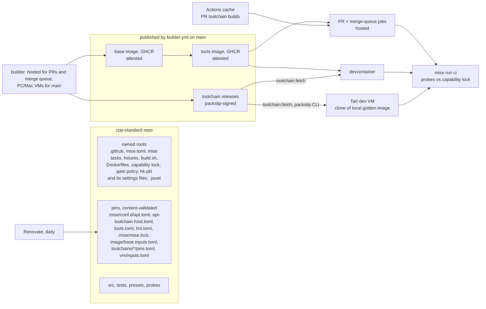
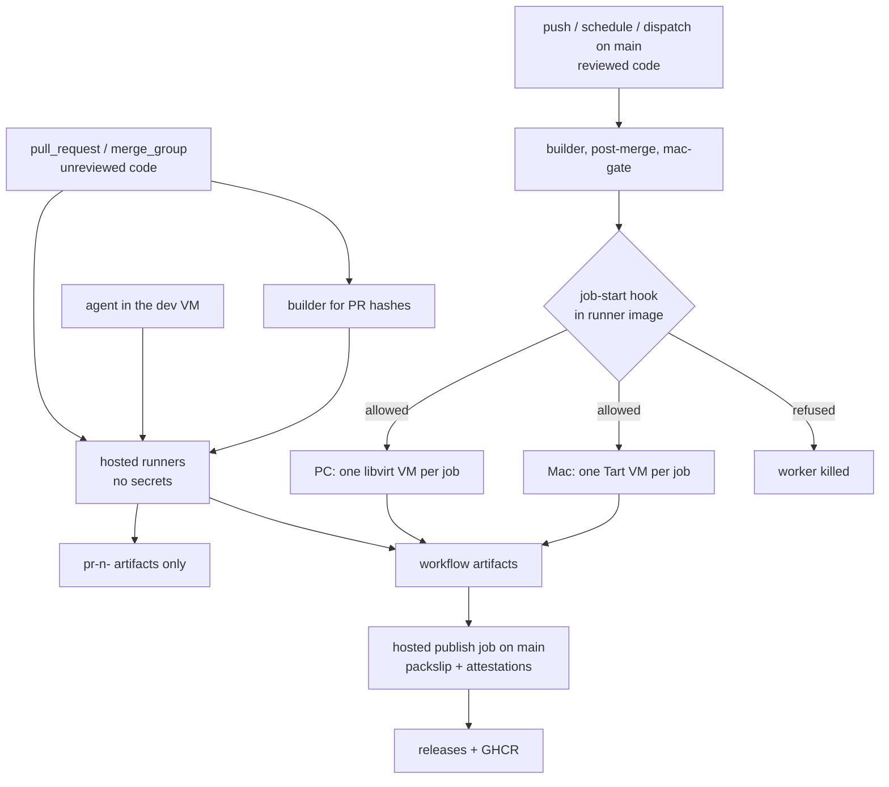

# cpp-standard: the C++ environment and project standard (Level 1)

- **Author:** ray-manaloto
- **Status:** EGM review complete through D98. D99-D107 and the text
  they changed await their Goldfish review: D101 (glossary, §1, §6, §7,
  §10 critical path, Alternatives Considered, risks, setup, M1a, file
  plan), D107 (the fence wording, §3's Linux-run line, the Action SHA
  line, §7's after-merge look and base switch, the §9 digest list, the
  risk rows) and D103-D105 (§3, M0 pass lines, hash inputs, owned roots,
  file plan).
- **Date:** 2026-11-13

--------------------------------------------------------------------------------

## Overview

`ray-manaloto/cpp-standard` is a public repository in the free `ray-manaloto`
GitHub organization. It holds:

1. **A written standard** for setting up a C++ project: compilers and their
   roles, standard libraries, build presets, dependencies, tests, coverage,
   sanitizers and analysis tools.
2. **A reference project.** It uses C++20 named modules and `import std`. It
   contains one small module written by the owner: an encoder for FIX-style
   tagged fields, generated with C++26 static reflection.
3. **A reflection canary.** It builds and tests pinned versions of upstream
   projects that use C++26 reflection. It starts with glaze, and adds
   reflect-cpp, simdjson and rosetta once glaze is green (D47).
4. **One mise bootstrap project** that builds the whole environment from one
   configuration: a Tart macOS VM, plus Ubuntu 26.10 arm64 and amd64 container
   images.
5. **One gate.** `mise run ci` gives the same result locally and in GitHub
   Actions.

Level 1 ends on 2026-11-27 (D21). The glaze FIX Orchestra project then starts
on top of this standard, in its own repository. Level 2, a separate
brainstorm, decides what glaze FIX implements. The critical path to that date
is Linux-first (D44, D53, §10).

**Inputs:**

- [concepts_brief.md](level-1/concepts_brief.md);
- [decisions-log.md](level-1/decisions-log.md), D1 to D102. "Dnn" in this
  document means row Dnn of that log;
- the reports in [level-1/research/](level-1/research/), and
  [goldfish_brainstorm_report.md](level-1/goldfish_brainstorm_report.md);
- the review reports:
  [zoom_out_report.md](level-1/zoom_out_report.md),
  [zoom_out_reaudit_report.md](level-1/zoom_out_reaudit_report.md),
  [comprehension_report.md](level-1/comprehension_report.md),
  [critic_report.md](level-1/critic_report.md),
  [goldfish_review_report.md](level-1/goldfish_review_report.md) and
  [intermediate_zoom_out_report.md](level-1/intermediate_zoom_out_report.md).

Research follows the owner's playbook: primary docs first; then GitHub
issues, PRs and discussions; then example projects; then relevant repositories
cloned offline and mapped in code. Each claim cites its source.

Where this design differs from `concepts_brief.md`, this design wins. The
owner confirmed three such differences:

- the reference project includes the owner's reflection module (D22);
- updates are daily, with p2996 automated (D31, D32, D34);
- the implementing agent does the work, and asks the owner only for steps
  that need a person (D57).

### Glossary

#### Process terms

| Term | Meaning |
|---|---|
| **EGM** | The Elephant-Goldfish Model, the design process used here. One drafting agent (the "Elephant") writes the design. Fresh-context reviewers (the "Goldfish") review it in stages. `/egm-drift-report` later compares a design with the code and lists where they differ. |
| **Milestones** | **M0**: the spike, throwaway pass/fail experiments (a)-(j), split into M0-Linux, which blocks M1a and ends 2026-11-16, and M0-Mac, which runs in parallel and feeds M3 (§10, D84). The runner tests are not in M0; they form the M2 entry gate (D77). **M1a**: the critical path. **M1b**: work around it that can be cut. **M2**: amd64 and the PC runner. **M3**: the Mac VM, runner and toolchains. **M4**: the canary. **M5**: tier-2 tools and the perf task (the digest moved to M1b, D84). |
| **Level 1 / Level 2** | Level 1 is this environment standard, ending 2026-11-27. Level 2 is the glaze FIX project built on it. |
| **The gate** | `mise run ci` and nothing else (§5). The macOS run after merge is called "the post-merge macOS run". |
| **Agent session** | One live Claude or Codex session working in this repository. The cap on them is in `review/cap.toml` and starts at 3 (§9). |
| **the setup agent** | The owner's agent session that manages the dotfiles repository. It is the only session that installs or changes software and credentials on the owner's machines (Mac, PC), so every install step in this plan goes through it. |
| **Abbreviations** | **CUJ**: critical user journey. **CLT**: Apple's Command Line Tools. **SOH**: the FIX field separator, byte `0x01`. **GHCR**: GitHub Container Registry. **P2996** / **P3394**: the C++ proposals for static reflection and for annotations. |
| **Two-VM rule** | Apple's licence lets a Mac run at most two macOS VMs at once. The dev VM and one runner or golden-build VM share that limit (D68). |

#### Code, paths and pins

| Term | Meaning |
|---|---|
| **First-party code** | Everything under `src/` written for this repository. This is the code the 100% coverage rule measures. It does not include fixtures or third-party code. |
| **Owned roots** | The paths CODEOWNERS assigns to the owner (§6, D51, D76), for example workflows, every mise task except a named list, the build scripts and the gate policy. Since D101 this is documentation, not a merge gate: code-owner review is off, no PR needs a GitHub approval, and the required checks are the gate. |
| **Pins** | Files that hold only versions, URLs, hashes or sizes. Renovate and agents may change them, and `pins:validate` checks their content (§3). |
| **Capability lock** | `cmake/capabilities.lock.json`: what each compiler can do in each environment (D42). Never called just "the lock". `.mise/mise.lock` is always named in full. |
| **Inputs hash** | The 16-hex value computed from an artifact's input files and `.mise/mise.lock` slices (§2). |
| **Artifact tag** | The name built from the inputs hash, such as `tools-arm64-<hash>` or `p2996-linux-arm64-<hash>`. Written as `<tag>` in task arguments and paths (§2). |
| **Release tag** | The git tag of a toolchain release, `<project>-v<version>`. The release's title is its artifact tag (D89). |
| **Image tag** | The GHCR tag of an image: `<arch>-<hash>` on `main`, `pr-<n>-<arch>-<hash>` or `pr-<n>-mq-<arch>-<hash>` for PRs and merge groups (§2). |
| **packslip project** | One signed release line per `<toolchain>-<os>-<arch>`, such as `github.com/ray-manaloto/cpp-standard/p2996-linux-arm64` (D89). |
| **Toolchain pins** | `toolchains/<name>/pins.toml`, one file per toolchain shared by every OS: version or commit, source URL and sha256, `salt` and `host_tools`. Each OS adds its own host inputs to the hash (D85). |
| **Fetch rule** | How `toolchain:fetch` gets a toolchain in any job: `main`'s signed release for the hash, else the PR run's artifact (merge groups) or cache (PRs), else a rebuild (D83). |
| **Leaf bump** | An update to an input that only the tools image or a single tool depends on, such as a new cmake. It is the opposite of a compiler or base-image change. |
| **The fence** | Self-hosted runners run only `main` code; since D101 "reviewed" means the agent commit review plus the required checks for agent code, and the required checks alone for Renovate code, not a human review (D107, proposed). Agent code runs only in the dev VM and on hosted runners (§6, D48, D58, D70). |
| **ut** | Boost.ext ut (`bext-ut`), the header-only C++ unit-test framework. |
| **Prior repositories** | a private prototype ("the prototype"), glaze-build-setup, cpp-core and the cpp-utilities catalogue each had their own build-preset setup. symphony-cpp built hash-tagged toolchains. dotfiles is the owner's current machine setup; dotfiles-legacy is its older version. cpp-core is a separate project, developed by agents on low-cost models. |

#### Machines and images

| Term | Meaning |
|---|---|
| **Golden image** | A local Tart VM named by its inputs hash. The Mac golden image is the base for both the Mac runner VMs and the dev VM (§3). The PC's runner VM image is its libvirt counterpart. |
| **Dev VM** | A clone of the Mac golden image where the owner and agents work. |
| **Runner VM** | A one-job clone of a golden image, made and deleted by gha-outrunner (D65). |

#### Tools

| Term | Meaning |
|---|---|
| **mise** | jdx's tool and task manager. It installs pinned tools, runs tasks, and bootstraps machines (`mise bootstrap`). |
| **hk** | jdx's git-hook and check runner. |
| **fnox** | jdx's secret manager. It reads secrets from Doppler and passes them to commands without printing them. |
| **packslip** | jdx's signed release manifest and its CLI. A release job signs a list of its files' digests with its workflow identity; `packslip install` checks the signer and digests before extracting. Here the standalone CLI installs the toolchains (`toolchain:fetch`) and mise itself in the base image (D59, D72, D73). |
| **jouet** | A command-line toolkit for coding agents, with test, commit and search commands, and rules that its hooks apply to agent tool calls (D64). |
| **gha-outrunner** | A small controller on GitHub's `actions/scaleset` client that runs each job in a fresh libvirt or Tart VM (D65). |
| **Context7, codebase-memory** | Two MCP servers available to agents. Context7 serves current library documentation. codebase-memory indexes this repository's code as a searchable graph. |

#### Identities

| Term | Meaning |
|---|---|
| **Owner's personal account** | The owner's personal GitHub account. |
| **Agent App** | A new GitHub App, `cpp-standard-agents`, that agents push, open PRs and dispatch workflows as. Its private key stays on the Mac host; agents get one-hour tokens from the `agent:token` broker (D71). |
| **Runner PAT** | A fine-grained token for cpp-standard only, used by gha-outrunner to register runners (D65). It is dropped if the runners accept the App below (D82). |
| **PC runner App** | An existing GitHub App in the org. Its only permission is registering self-hosted runners. M2 checks whether gha-outrunner accepts it, which would replace the runner PAT (D82). |
| **Org-admin App** | An existing GitHub App with wide org-admin rights. It is not used here. |
| **Commit review** | Each commit is reviewed by a separate agent session, and is made only with that session's approval. |

## The Problem

The owner wants to grow as a low-level C++ developer, focused on C++26 static
reflection for performance work. Over the past weeks, most of the time went to
side issues instead.

- **Setups were rebuilt over and over.** There were four separate
  implementations of build presets (the private prototype, glaze-build-setup, cpp-core and the
  cpp-utilities catalogue).
- **The compiler source kept changing.** The compiler ruling flip-flopped
  between Homebrew, conda and apt.
- **Agent sessions collided.** Several agent sessions edited the same
  repositories and the shared dotfiles at once.
- **dotfiles grew too large.** It is now about 66,000 lines (counted with
  `tokei` on 2026-11-12, in [the brief](level-1/concepts_brief.md)), and only
  about a quarter of that is environment bootstrap.
- **Rules were never enforced.** Rulings such as "one lane at a time" were
  overtaken within days, because nothing enforced them.

The work stopped at the step that turns the FIX Orchestra XML into C++
structs for a C++26 glaze FIX serializer. It can't restart until the
environment underneath it stops moving.

The proposed fix is one place that defines and proves the environment, built
from one pinned configuration and isolated from the owner's other projects
and host setup. It must be checked by one command, finished by a fixed date,
and then used, not grown.

## Goals

- **G1. One pinned environment from one configuration, at the newest
  versions.** A single mise bootstrap project builds a Tart macOS VM and
  Ubuntu 26.10 arm64 and amd64 images (D13, D25, D45).
  - Every input is pinned by version, hash or digest. Every tool is kept
    at its newest release by daily Renovate; Action SHAs are batched weekly.
  - Images and toolchains are tagged by a hash of their inputs (D49).
  - Measure: the tags computed from a commit's inputs always resolve to the
    same toolchain versions. An old commit is reproduced by pulling them,
    not by rebuilding.
  - Accepted limit: the Mac golden image is local only, and depends on the
    cirruslabs vanilla image staying available by digest.
- **G2. Three compilers, each with a written role** (D1, D3, D6, D25). §1
  has the table.
  - **LLVM/clang 23 with libc++** is the daily compiler and runs the
    tier-1 sanitizer checks.
  - **GCC 16.2 with libstdc++** is the second compiler that must pass the
    gate. It runs Valgrind and also compiles reflection code.
  - **clang-p2996 with its own libc++** is the reflection reference
    compiler.
  - Measure: the §1 table holds for every environment, as recorded in the
    capability lock.
- **G3. One gate, `mise run ci`, identical locally and in CI** (§5, D19,
  D37, D42).
  - Measure: the same commit gives the same tier-1 result in the
    devcontainer, the dev VM and Actions, and every applicable must-fail
    fixture fails.
- **G4. Reflection learning on real code.**
  - **The owner's module (D22):** a FIX-shaped encoder of about 100 lines.
    Tag numbers come from P3394 annotations. It builds on GCC 16 and
    clang-p2996, with 100% coverage, and seeds glaze FIX.
  - **The reflection canary (D20, D47)** shows the compilers and libraries
    cope with real reflection code.
  - Measure: the encoder is green in the gate on both reflection compilers;
    the canary's glaze row is green or allow-listed.
- **G5. Isolation from everything else** (D4, D17, D18).
  - The C++ work and its agents run in the Tart VM and the images.
  - The host's global agent setup, dotfiles and the parked C++ projects are
    not dependencies of the build. The host keeps only credentials: the
    agent App key behind the `agent:token` broker, the runner PAT, and the
    PC SSH access (D65, D70, D71).
  - D17 is provisional until M0 (a) reports. If agents can't work inside
    the VM, they stay on the host, and only builds and tests run in the VM
    and containers.
  - Measure: CUJ 1 changes no file outside the VM.
- **G6. No collisions between agents** (D23). One worktree and branch per
  agent, and a GitHub merge queue into `main` (§9).
  - Measure: the digest shows the agent count under the cap, and no merge
    bypasses the queue.
- **G7. Visible progress, finished on a date** (D14, D21, D44).
  - Level 1 is a checklist of gate items. An item is ticked only by a green
    `mise run ci` on `main`. macOS items are ticked by the post-merge
    macOS run (D46).
  - A daily digest with no model calls shows the checklist and anything
    off-track (§9).
  - On 2026-11-27, whatever tier-1 items are green form the standard.
    Unfinished items become dated tickets, in the cut order (D53).
  - Measure: the checklist on 2026-11-27.
- **G8. Enough CI capacity at no cost, without exposing the owner's
  hardware** (D16, D48). The repository is public. §6 holds the fence.
  - Measure: the negative test at the M2 entry gate (D58, D77) shows no
    non-`main` job starts on the PC or Mac.

## Non-Goals

- **glaze FIX itself.** This covers the Orchestra XML-to-C++ generator and
  the serializer. Level 2 designs them. Level 1 only provides the owner's
  small encoder module as a seed.
- **cpp-core.** It stays a separate project, developed by agents on
  low-cost models, and gets its own brainstorm later.
- **The parked projects** (D4): the private prototype, cpp-utilities,
  cmake_template, modern_cpp_project_template, cpp-playground and
  hftuniversity. Pieces of them are copied in only when needed, with a link
  to the source.
- **The glaze worktrees and spikes.** They move into the glaze FIX repo in
  Level 2.
- **Cleaning up the host's agent setup, the owner's existing
  rulings, and the rest of dotfiles** (D18). dotfiles' C++ parts
  retire, and nothing else changes in Level 1.
- **A project-template generator** (the mise "cookiecutter"). It is a
  separate later project.
- **Windows.**
- **Performance results used as claims, and the tooling for them** (D46).
  Level 1 has the metrics standard (§8) and one unprivileged task,
  `perf:instructions`. Hardware counters, the privileged perf container and
  macOS profilers move to Level 2.
- **A vcpkg binary cache** (D52). The only dependency, ut, is header-only.
- **Upstream changes to mise or Renovate.** The three drafted posts stay
  unposted until the owner decides. Level 1 works around the gaps.

## Open Questions

- **Q1. Before going public.**
  - Scrub local paths, session ids, internal account names and internal
    tool names from all of `docs/designs/`.
  - rosetta lists no license, so it is built for testing and not
    redistributed.
  - Check the FIX Orchestra license before glaze FIX goes public.
- **Q2. The mise and Renovate upstream posts.** The three drafts are ready
  and verified on 26.10. When, if at all, to post them is the owner's call.
- **Q3. License.** cpp-standard needs a `LICENSE` before it goes public.
  The choice is the owner's.
- **Q4. When the post-merge macOS run becomes a required check** (D46).
  The owner decides by hand, or later automates it with a rule such as "N
  consecutive green daily runs". Until then, a red post-merge macOS run is
  fixed or reverted by the owner; there are no Mac-only pins (D85).

The settled questions are listed at the end of the Technical Plan.

## Critical User Journeys (CUJs)

### CUJ 1: Fresh Mac to a green gate

- **Given**: An Apple Silicon Mac with only Tart and git installed, and
  the cpp-standard repository URL.
- **When**: The owner clones the pinned Tart macOS image and runs the
  pinned mise installer and `mise bootstrap --from <repo>?ref=<sha>` inside
  the VM. They then run `mise run ci`.
- **Then**:
  - The VM gets the mise tools, including the LLVM release tarball, from
    `.mise/mise.lock`. `mise run toolchain:fetch` installs GCC 16.2 and
    clang-p2996 with the packslip CLI, which checks they were signed by
    `main`'s builder (D72). If Mac GCC was cut, reflection is gated on
    p2996 only.
  - Every tier-1 check runs for the macOS compiler set and passes, and the
    probes match the capability lock.
  - No file outside the VM changes.

### CUJ 2: The Linux image, locally and in CI

- **Given**: A commit on any branch of cpp-standard.
- **When**: `mise run artifact:tag` computes the base and tools tags from the
  commit's image inputs (§2). If either tag is missing, the builder builds
  it on hosted runners for arm64 (and amd64 from M2).
- **Then**:
  - The same tools tag is the devcontainer image and the CI job
    `container:`. Outside PR jobs, the pull is checked against `main`'s
    attestation (D59).
  - A non-root user can run every tool. Toolchains are installed by
    `toolchain:fetch` when the job starts, by the one fetch rule in §2:
    `main`'s signed release for the hash, else the PR's artifact or cache,
    else a rebuild (D72, D83).
  - `mise run ci` gives the same result in the devcontainer and in GitHub
    Actions.

### CUJ 3: The owner writes reflection code

- **Given**: The devcontainer, or the dev VM, and the reference project.
- **When**: The owner edits the reflection encoder module and runs `mise run
  ci`.
- **Then**:
  - The module builds with GCC 16 `-freflection` and with clang-p2996. It
    is not built with plain LLVM.
  - Its ut tests and `static_assert` tests pass.
  - Each compiler's own coverage tool reports 100% under the consteval
    rule in §5.
  - The sanitizers pass.

### CUJ 4: A dependency update arrives

- **Given**: Renovate finds new versions of pinned inputs: mise tools, apt
  packages, GitHub Actions, or a toolchain input such as the p2996 commit.
- **When**: Renovate opens its daily PRs (D31, D61).
- **Then**: the merge rule in §7 decides. Linux artifacts are built on
  hosted runners before merge; Mac toolchains are built after merge (D62).
  A red PR lands in the daily digest and nothing merges.

### CUJ 5: Two agents work at once

- **Given**: Two agents, each on its own branch and worktree.
- **When**: Both finish and ask to merge.
- **Then**: The merge queue tests each one on top of `main` and the other
  agent's change, on hosted runners, building any new input combination
  (D61). Neither merges unless the required Linux checks pass. The daily
  digest flags any agent count over the cap (§9).

### CUJ 6: Daily review

- **Given**: The scheduled digest workflow (daily by default) and the
  `review:cap` report.
- **When**: It runs `mise run review:digest`.
- **Then**: The owner gets the gate checklist and the other items listed in
  §9, all with no model calls. `/egm-drift-report` runs only if code under
  a design doc changed.

--------------------------------------------------------------------------------

## Technical Plan (Architecture)

This section describes how the pieces fit together. Decisions D26 to D82 were
made while drafting and reviewing it. The file-by-file list is in Detailed
Implementation. What is unproven, and the accepted risks, are in
[Risks & Mitigations](#risks--mitigations).

### Architecture at a glance



There is one configuration: `mise.toml` with three conf.d pins fragments
(`apt.toml`, `apt-toolchain-host.toml` and `tools.toml`) and a lock file. It produces three environments. Images and
toolchains are tagged by the hash of their inputs and built once by one
builder. Only `main`'s builder publishes what `main` uses. Unreviewed code runs
only on hosted runners and in the dev VM. All three environments run the same
`mise run ci`, which checks the probes against the committed capability lock.

### 1. Compilers: one table

| | macOS VM (arm64) | Ubuntu 26.10 arm64 | Ubuntu 26.10 amd64 |
|---|---|---|---|
| **LLVM/clang 23 + libc++** | LLVM release tarball via mise `github:` (D38) | apt.llvm.org `resolute-23`, exact pins, in the base image (D27, D45) | same |
| **GCC 16.2.0 + libstdc++** | source build, Homebrew recipe + Darwin patch (D33) | Ubuntu archive `g++-16`, in the base image (D25) | same |
| **clang-p2996 + libc++** | source build (D30) | source build with compiler-rt (D32) | same |

Checks for each compiler and kind of project:

| Check | clang 23 | GCC 16.2 | clang-p2996 |
|---|---|---|---|
| Builds reflection code | no (no P2996 upstream) | yes, `-freflection` | yes, `-freflection-latest` |
| Builds non-reflection code | yes | yes | yes |
| Coverage tool (gcov mode, D88) | `llvm-cov gcov` | `gcov` | `llvm-cov gcov` (after M0 (c), (j)) |
| ASan + UBSan | yes | Linux yes; macOS yes with `detect_leaks=0`, after M0 (e) | after M0 (c) |
| TSan | yes | Linux only | after M0 (c) |
| Valgrind | no | Linux only | no |
| clang-tidy | Linux clang image, non-reflection targets | no | no |

The configure-time probes (D39) fill in the actual values for each
environment. The committed capability lock (D42) is the expected state. A
probe result that differs from the capability lock fails tier 1. A legitimate
change is accepted by regenerating the capability lock in the same PR; the
diff shows the change, and the required checks are the gate (D101). A
Renovate PR that changes the capability lock still waits for the owner,
because Renovate does not merge it (D56).

**macOS entries (D78).** The agent runs `caps:update` for macOS in the dev
VM, which is macOS on the same Mac, and adds the macOS entries to the same
PR as the Linux change. No PR code runs on the
owner's Mac runner. On `main`, a macOS mismatch turns the post-merge macOS
run red and shows in the digest.

### 2. The builder: images and toolchains by inputs hash (D49)

Images and the two toolchains that no package source can pin (GCC on macOS,
clang-p2996 everywhere) use one pattern. It is the inputs-hash pattern from
dotfiles-legacy `p2996_hash.py` and the private prototype's toolchain check; symphony-cpp
published toolchains as `<version>-<arch>-<inputs sha256>` the same way (D68).

1. **Inputs.**

   | Artifact | Hash covers |
   |---|---|
   | base image | `image/base.Dockerfile`, `image/base.inputs.toml` (Ubuntu digest, exact mise version, packslip image digest), `.mise/conf.d/apt.toml`, `.mise/conf.d/apt-toolchain-host.toml` and `.mise/conf.d/apt-sources.toml` (D69, D73, D75, D86, D90) |
   | tools image | the base tag, `image/tools.Dockerfile`, `.mise/conf.d/tools.toml`, the linux-`<arch>` slice of `.mise/mise.lock`, and the `.mise/locks/**` sidecars the slice names (D68, D74, D90) |
   | runner image (PC qcow2) | the tools tag, `runner/pc/**`, `runner/hook/job-started.sh` and the pinned actions/runner version (D90) |
   | Mac golden image | `vm/inputs.toml` (Tart base digest and sizes), `image/base.inputs.toml` (the same mise pin), `.mise/conf.d/tools.toml`, the macos-arm64 slice of `.mise/mise.lock`, `.mise/tasks/vm/golden`, `runner/hook/job-started.sh` and the actions/runner version (D68, D74, D86, D90) |
   | toolchain, Linux | the shared `toolchains/<name>/pins.toml`, `toolchains/<name>/build.sh`, the Linux patches under `toolchains/<name>/linux/` (D105), `.mise/conf.d/apt-toolchain-host.toml`, `.mise/conf.d/apt-sources.toml`, and the slice `.mise/mise.lock#linux-<arch>:<host_tools>` (D75, D85, D90) |
   | toolchain, macOS | the shared `toolchains/<name>/pins.toml`, `toolchains/<name>/build.sh`, the Mac recipe patches under `toolchains/<name>/macos/`, `vm/inputs.toml`, and the slice `.mise/mise.lock#macos-arm64:<host_tools>` (D85) |

   - **One shared pins file per toolchain (D85).** `toolchains/<name>/pins.toml`
     holds only data, used by every OS: the version or commit, the source
     URL and sha256, the configure-flag set name, `salt`, and `host_tools`,
     the exact list of mise tools the build uses (for example
     `host_tools = ["cmake", "ninja"]`). Every flag and argument lives in
     `build.sh`. A bump is one PR.
     - **GCC on macOS** also lists, in the same file under `[macos]`: the
       Darwin patch; gmp, mpfr, mpc, isl, zstd and zlib (URL and sha256); the
       CLT version; the SDK major version.
     - **clang-p2996:** the commit and source URL, shared by Linux and macOS.
     - **`salt`:** bumped only to republish a toolchain whose release was
       deleted (D72).
   - **Host versions come from the pins, not from a generated file (D75).**
     Linux toolchains build inside the current base image. The host packages
     that shape a compiler (`g++-16`, binutils, make and a pinned
     `libc6-dev`) live in their own pins fragment,
     `.mise/conf.d/apt-toolchain-host.toml`, so the toolchain hash follows
     them and nothing else in the base. The build tools come from `.mise/mise.lock`
     and are hashed per platform. `mise bootstrap packages status --missing` runs in the
     built image only to check that it matches the pins; it never writes a
     file. On macOS the toolchain smoke test records the exact Tart digest
     and CLT patch level; the golden image's hash includes the Tart digest.
   - **Not inputs:** python and the rest of the tools image.
2. **Tag.** `mise run artifact:tag <name>` computes the inputs hash: the
   blob id of each listed file at the commit (`git rev-parse <sha>:<path>`,
   so no filters apply), combined as the sha256 of the sorted
   `path\0blob\n` lines, truncated to 16 hex characters. A `.mise/mise.lock`
   slice is one more line: its key is `.mise/mise.lock#<platform>:<tools>` and its
   value is the sha256 of the canonical JSON (sorted keys, no spaces) of the
   lock entries for those tools on that platform (D85). The full tag is the
   name plus the hash: `base-<arch>-<hash>`, `tools-<arch>-<hash>` and
   `<toolchain>-<os>-<arch>-<hash>`. Every consumer computes the tag itself,
   from git; no file records it. The file list for each row is exactly the
   set of files the build reads or its Dockerfile COPYs, plus `schema = 1`
   as the first line, so a change to the hashing rule changes every hash
   (D90). `artifact:tag` has golden-vector tests: fixed file sets with known
   hashes, in `tests/artifact_tag/`.
   - **Toolchain release versions (D89).** packslip refuses two releases
     that differ only in build metadata (`spec.md:1897-1899`) and needs
     semver, so the hash can't be the version. Each `<toolchain>-<os>-<arch>`
     is its own packslip project, released under the tag
     `<project>-v<version>`. The version is the upstream semver plus an
     ordered prerelease part: `<upstream>-r.<builder run number>`, or
     `<upstream>.r.<n>` when `upstream` already has a prerelease part. For
     example `16.2.0-r.812` for `gcc-macos-macos-arm64`, and `21.0.0-p2996.r.815`
     for p2996, whose `upstream` is `21.0.0-p2996` (the fork's LLVM version
     is 21). The release title is the full artifact tag
     (`<toolchain>-<os>-<arch>-<16 hex>`), and the hash is also an
     `inputs-hash.txt` asset. `toolchain:fetch` finds the release whose title
     is the artifact tag with `gh release list --json name,tagName --limit
     1000`, authenticated with `GITHUB_TOKEN` in Actions (the unauthenticated
     limit is 60 requests an hour), then installs that version.
3. **Build.** `builder.yml` runs on a schedule, on `workflow_dispatch`, on
   PRs that change an input, and on `merge_group` (D61). For each missing tag
   it builds where the code is allowed to run (D48):
   - PR and merge-queue builds of Linux images and toolchains run on hosted
     runners (arm64, and amd64 from M2);
   - `main` builds of Linux toolchains run in PC runner VMs (amd64) and on
     hosted arm64 runners;
   - macOS toolchains build only from `main`, in Mac runner VMs, after merge
     (D62, D85). A bump that breaks only on macOS merges; the red post-merge
     macOS build is the backstop.
4. **Publish (D59, D72, D98).** Tasks prepare files; workflow steps call the
   Actions, because a mise task can't. The build job holds no token:
   `mise run artifact:build <tag>` builds and smoke-tests the artifact and
   writes `dist/<tag>/` (for a toolchain, `<tag>.tar.zst` of the install
   tree plus `inputs-hash.txt`; for an image, a Docker build with `--load`
   and `dist/<tag>/image.txt`). A workflow step uploads `dist/<tag>/` as the
   artifact `toolchain-<tag>` or `image-<tag>` (`retention-days: 7`), and in
   PR jobs saves the toolchain to `actions/cache` with key `toolchain-<tag>`.
   A hosted publish job then downloads it, runs `mise run artifact:names
   <tag>` (it writes the project, version, release tag, title and image
   reference to `$GITHUB_OUTPUT`), and publishes with workflow steps:
   - **On `main`:** a toolchain becomes a GitHub Release tagged
     `<project>-v<version>` and titled with its artifact tag (D89). The step
     is `jdx/packslip@<commit sha>` with `project:
     github.com/ray-manaloto/cpp-standard/<project>`, `version: <version>`,
     `tag: <project>-v<version>` and `attest: false`, which signs the bundle
     keyless as `builder.yml` at `refs/heads/main`. The order is fixed,
     because immutable releases lock assets once published: create a draft
     release, upload the archive and the packslip bundle, then publish;
     toolchain trust is the packslip signature, not a GitHub attestation.
     Images are pushed with `docker push` to
     `ghcr.io/ray-manaloto/cpp-standard/<base|tools>:<arch>-<hash>` and
     attested with `actions/attest-build-provenance` (`push-to-registry:
     true`). The publish job is the only job with `contents: write`,
     `packages: write`, `attestations: write` and `id-token: write`.
   - **For PRs and the merge queue:** no toolchain release is published.
     Images go only under `pr-` tags: `:pr-<n>-<arch>-<hash>` for a PR, and
     `:pr-<n>-mq-<arch>-<hash>` for a merge group, where `<n>` is parsed from
     the merge-group ref `gh-readonly-queue/main/pr-<n>-<sha>`. They are
     unattested; `main`, the runners, the dev VM and the devcontainer never
     use them. A PR builder run that builds a toolchain leaves it as the
     workflow artifact and the cache entry above.
   - **One fetch rule for every job (D72, D83, D91).** A mise task can't call
     an Action, so the work is split. In Actions, workflow steps run first:
     in a merge-group job, `actions/download-artifact` (`run-id` of the PR
     builder run found by `gh run list --workflow builder.yml --commit
     <PR head>`, where the PR head is `gh pr view <n> --json headRefOid` and
     `<n>` comes from the merge-group ref; artifact name `toolchain-<tag>`, `github-token` input set,
     `actions: read`); in a PR job, `actions/cache/restore` with key
     `toolchain-<tag>`. Both write into `.cache/toolchains/<tag>/`. Then
     `mise run toolchain:fetch` computes each toolchain's hash and takes the
     first source that has it:
     1. **`main`'s signed release** for that hash, installed with the
        packslip CLI and the `main` identity (below). This is the normal case,
        including every PR that does not change a toolchain's inputs.
     2. **In a merge-group job:** the PR builder run's artifact, staged in
        `.cache/toolchains/<tag>/` by the step above. A cache made on
        `refs/pull/<n>/merge` is not readable from the merge-group ref.
     3. **In a PR job:** the `actions/cache` entry, staged the same way.
     4. **Otherwise:** the job rebuilds it. A miss is slow, never a failure.
     Outside Actions (the dev VM, the devcontainer, a laptop) only sources 1
     and 4 exist. A staged copy (sources 2 and 3) is `<tag>.tar.zst`,
     checked against its `inputs-hash.txt` and extracted into the same
     absolute install directory. It carries no signature, which is allowed
     only because those jobs are PR and merge-group jobs (D54).
     A merge group rebuilds only when two input-changing PRs share it (D61).
     **Sources 2-4 are only for PR and merge-group jobs.** Those jobs run on
     hosted runners and hold no secrets. A job on `main` uses only source 1. The
     `main` builder always builds a toolchain from source and never reads a PR
     artifact or cache. So an agent's PR can upload a poisoned toolchain
     (D54), but the most that toolchain can do is fake a green PR or queue
     result. It can never become `main`'s release. After the merge, the gate on
     `main` runs with the toolchain `main` built itself, which catches a faked
     result (Risks).
     M0 (h) records each toolchain's compressed size against the 10 GB
     `actions/cache` quota, and M0 (i) confirms the cache scoping.
   - **Trust check on use.** For source 1, `toolchain:fetch` uses the
     standalone packslip CLI:

     ```sh
     packslip install github.com/ray-manaloto/cpp-standard/<project> \
       --version <version> \
       --identity https://github.com/ray-manaloto/cpp-standard/.github/workflows/builder.yml@refs/heads/main \
       --issuer https://token.actions.githubusercontent.com \
       --install-dir <dir>
     ```

     A release signed from any other ref is refused. Not mise's
     `packslip:` backend: `mise install --locked` needs a `.mise/mise.lock` entry
     for every exact version (`src/backend/mod.rs:5276-5293`), so a computed
     version would need a post-merge `mise lock` write-back. Every non-PR
     image pull runs `image:verify`, which is `gh attestation verify
     --signer-workflow ray-manaloto/cpp-standard/.github/workflows/builder.yml
     --source-ref refs/heads/main`. A tag existing proves nothing.
   - **Release protections (M1b).** Immutable releases are on, so assets and
     tags can't be replaced. A tag ruleset blocks deleting or moving
     toolchain tags. A deleted release can't be republished under the same
     version, so recovery is a PR that bumps the toolchain's `salt`, which
     changes its hash. The post-merge and daily runs install every toolchain
     `main` computes, so a missing release turns them red.
5. **Status.** The publish job posts a commit status for each tag on the head
   of every PR or merge-group commit that needs it. The required
   `artifact:check` passes when all of a PR's Linux tags exist (D62), and
   times out after 3 hours with a message naming the missing tag and the
   builder run (D61).
6. **Retention (D79, M1b).** A daily job deletes only `pr-<n>-` GHCR images
   and caches after their PR closes; `vm:golden` keeps the newest 2 local Tart
   golden images. Neither ever deletes an image or release that any commit in `main`'s
   history references, so an old commit is still reproduced by pulling (G1,
   D27).

### 3. The bootstrap project, image layers and the three environments

`mise.toml` is the bootstrap project (D13), and the owner owns it. It holds:

- **`[tasks]`:** settings only. Every task is a file under `.mise/tasks/`
  (D93); §6 lists which ones agents may edit;
- **`[settings]`:** a fixed `minimum_release_age` cutoff, so `mise lock`
  gives the same lock whenever it runs (M0 (i)), bumped with the pins, and
  `lockfile = true`; a pins PR that needs a release newer than the cutoff
  also moves the cutoff in this owned file, which D101 allows (the checks,
  not the owner, gate it); M1b's Renovate config does this;
- **`[hooks] postinstall`:** `hk install --mise` outside CI, so the hk git
  hooks (D102) are installed with the pinned tools;
- **`min_version`**, a floor: "the oldest mise release that can use this
  file" (mise `docs/configuration.md:590`). It is not a pin and changes only
  when the config needs a newer feature. The exact mise version lives only in
  `image/base.inputs.toml` (D86).

`mise.toml` and `.mise/mise.lock` never name a toolchain version; `toolchain:fetch`
computes it (D72). All tools are locked in `.mise/mise.lock`, which is committed
with mode 644. Five pins fragments live in `.mise/conf.d/`, which mise loads
(M0 (f) checks that bootstrap and Renovate both read them, D53):

- **`tools.toml`** (D74), `[tools]` only, each at an exact version that
  Renovate bumps to the newest release: cmake, ninja, python, mold, sccache,
  gh, packslip, gcovr, clang-format (through `pipx:`, 23.x), jouet and fnox,
  and LLVM on macOS. Tier-2 tools join in M5. It is a pins file, so the
  daily tools PR merges without the owner (§7).
- **`lint.toml`** (D102), `[tools]` only, at exact versions: hk (the same
  version as the `hk.pkl` package and the global pin) and the tools its
  builtins run (jactionlint, zizmor, pinact, ghalint, shellcheck, shfmt,
  typos, rumdl, tombi, pkl, ryl, jq, editorconfig-checker, betterleaks).
- **`apt-sources.toml`** (D90), `[bootstrap.apt.sources.llvm]` only:
  apt.llvm.org's `llvm-toolchain-resolute-23` suite with its key fingerprint.
  `resolute` is Ubuntu 26.04; the image is 26.10, which apt.llvm.org does not
  publish yet, so this cross-release use is deliberate and M0 (f) checks that
  it installs.
- **`apt-toolchain-host.toml`** (D75), `[bootstrap.packages]` only, all with
  `os = ["linux"]`: the Ubuntu packages that shape a compiler, `g++-16`,
  binutils, make and a pinned `libc6-dev`. The toolchain hash covers this
  file.
- **`apt.toml`**, `[bootstrap.packages]` only, all with `os = ["linux"]`:
  - from apt.llvm.org: `clang-23`, `libc++-23-dev`, `llvm-23` (it ships
    `llvm-cov-23`), `libclang-rt-23-dev` (it ships the profile runtime
    `--coverage` links, D105) and the rest;
  - from the Ubuntu archive: valgrind, bison, flex, m4 and texinfo.

`pins:validate` (D51) is a required hosted check. It makes sure:

- `tools.toml` and `lint.toml` hold only `[tools]`, `apt-sources.toml` only
  `[bootstrap.apt.sources.*]`, and `apt.toml` and `apt-toolchain-host.toml`
  only `[bootstrap.packages]`;
- every name is in `pins-allowlist.toml`;
- every URL in `.mise/mise.lock`, `apt-sources.toml`, `image/base.inputs.toml`,
  `vm/inputs.toml`, `toolchains/*/pins.toml` and `canary/pins.toml` comes from
  an allowlisted host, and the apt key fingerprint is 40 hex characters;
- each `toolchains/*/pins.toml` holds only `upstream`, `source` (URL, sha256,
  commit), `host_tools` (each a name in `tools.toml`) and `salt`, plus the
  `[macos]` table for GCC (D85, D89);
- `image/base.inputs.toml` holds only `ubuntu:26.10@sha256:<64 hex>`, an
  exact mise version (`YYYY.M.P`), a `ps1_` signer key id and
  `ghcr.io/jdx/packslip@sha256:<64 hex>` (D69, D86);
- `vm/inputs.toml` holds only the Tart image name and digest, and CPU,
  memory and disk sizes;
- `canary/pins.toml` holds only repository URLs and commit SHAs.

**Linux images** (D45, D49). Each Dockerfile is a few lines that only call
mise; there is no `mise oci build` (D13).

1. **base:** start from the image and digest in `image/base.inputs.toml`
   (passed as build arguments). Install mise with `packslip install
   github.com/jdx/mise --pin <mise_signer>`, run from a digest-pinned
   `ghcr.io/jdx/packslip` build stage, as in the mise cookbook (D73). Then run
   `mise bootstrap --skip tools --yes` with the three apt fragments, and
   check the result with `mise bootstrap packages status --missing`, which
   must exit 0 (D75).
2. **tools:** `FROM` the base tag, run `mise install --system --locked && mise
   reshim --system`, and add a non-root user.

Toolchains are not baked into images. `mise run toolchain:fetch` installs
them at the start of every job, and when a devcontainer or VM is created,
following the one fetch rule in §2 (D72, D83). The tag comes in as an
argument, so no `.git` directory is needed in a build.

**The macOS VM (D68).**

1. The **golden image**, kept locally as a Tart VM named by its inputs hash,
   is built from `macos-golden-gate-vanilla` by digest. It holds the
   bootstrapped mise tools and the D58 runner hook, and is rebuilt only when
   its hash changes.
2. Runner jobs get a gha-outrunner clone that runs one job and is deleted
   (D65). The dev VM is a longer-lived clone of the same image.
3. A weekly job repeats CUJ 1 from the vanilla image, so the bootstrap path
   stays tested.
4. macOS allows at most two macOS guest VMs per host: one dev, one runner.
   Golden-image builds take the runner slot, one at a time. The disk budget
   is about 150 GB: two golden images plus the dev VM.

**Linux runs from inside the VM** (D48, D71). `mise run linux:run` pushes the
branch, dispatches `ci.yml` for it on hosted runners as the agent App, and
follows the run with `gh run watch`. Code not yet on `main` never reaches the PC this
way. The owner's own interactive Linux work uses the devcontainer on the PC,
opened from the Mac host terminal (D70).

### 4. Build configuration

- **Presets (D8).** The presets are hand-written in layers, one layer each
  for compiler, standard library, configuration and checks.
  - They use preset schema 13 and `${configurePresetName}` binary
    directories.
  - All targets in a build tree share the same flags, because CMake issue
    #28242 (Kitware's GitLab) makes per-target flags break module dependency
    scanning.
  - Agents may edit presets. `gate-policy.toml` (owned) states which flags
    each preset must keep, and the gate checks it (§5, D64).
- **Probes (D39).** `cmake/probes.cmake` starts from cpp-utilities
  `ProfileCheck.cmake`, with a link back to it. It runs at configure time:
  - `CMAKE_CXX_COMPILER_IMPORT_STD` and the modules JSON check whether
    `import std` works.
  - `try_compile` with `SOURCES_TYPE CXX_MODULE` tests named modules.
  - `check_source_compiles` and `check_source_runs` try a P2996 snippet: a
    reflection operator, `members_of`, and a P3394 annotation.
  - `check_compiler_flag` and `check_linker_flag` test each sanitizer,
    coverage and hardening flag.
  - `check_ipo_supported` and `check_pie_supported` check IPO and PIE.

  Each result switches its feature on or off. Reflection targets are built
  only where `CPPSTD_HAS_REFLECTION` is on. All results go to
  `capabilities.json`, and CI compares that file with the capability lock
  (D42).
- **Dependencies (D7, D52).** vcpkg runs in manifest mode with a pinned
  baseline.
  - Triplets are hand-written for the compiler, standard library and
    sanitizer combinations on the critical path (D6). They are copied from
    glaze-build-setup, with a link back.
  - There is no binary cache in Level 1.
- **Cache (D9).** sccache caches clang builds, including module builds. GCC
  module compiles are not cached.

### 5. The gate: `mise run ci`

`mise run ci` runs the same steps everywhere:

1. configure, with the probes, then compare them with the capability lock;
2. check the gate policy (`gate:policy`, D64): every preset keeps the flags
   `gate-policy.toml` requires, and first-party code holds no
   coverage-exclusion marker of any tool (`GCOVR_EXCL`, `LCOV_EXCL`,
   `GCOV_EXCL`) (D88);
3. build;
4. run the ut tests and the `static_assert` tests;
5. run coverage with each compiler's own tool, in gcov mode: GCC builds with
   `--coverage` and reports with `gcov`; clang and p2996 build with
   `--coverage` and report with their own `llvm-cov gcov`: `llvm-cov-23`
   from the apt `llvm-23` package for clang, and the `llvm-cov` shipped in the
   p2996 toolchain archive, whose version matches its `.gcno` files (D88).
   gcovr, pinned in `tools.toml`, runs with `--gcov-executable "<llvm-cov>
   gcov"` and turns both into one report. It must report 100% line
   coverage of first-party code, with no exclusions. Code that runs only at
   compile time (`consteval`, and `constexpr` code used only in constant
   expressions) is not in the binary, so gcov-mode tools never count it; the
   `static_assert` tests are its coverage (D47). clang's source-based mode
   (`-fprofile-instr-generate`) is not used: it marks `constexpr` helpers used
   only at compile time as uncovered, and on p2996 (LLVM 21, without LLVM PR
   #190870) also `static consteval` members;
6. run the sanitizer presets;
7. run Valgrind (Linux GCC only);
8. run clang-format (one pinned version on every OS) and clang-tidy (Linux
   clang image only) (D46);
9. run the hardening check;
10. upload SARIF.

These steps are tier 1, and they fail the build. Tier-2 tools only produce a
report (D19): IWYU, cppcheck, ClangBuildAnalyzer, mrdocs, Doxygen, clang-uml,
fuzzing and benchmarks. llvm-mca, BOLT and perf wait for Level 2 (D46). A
tier-2 tool moves to tier 1 when it reports zero findings on the reference
project and the owner approves.

**Negative controls (D37, D42).** The gate builds `fixtures/must-fail/`
separately. There is one must-fail fixture for each tier-1 check listed above,
and each must fail its own check:

- an uncovered line (once for each coverage tool);
- a coverage-exclusion marker, and a preset missing a required flag;
- an ASan overflow;
- a UBSan signed overflow;
- a TSan race;
- a Valgrind leak;
- a format violation;
- a tidy finding;
- a missing hardening flag.

Which fixtures apply in an environment comes from the capability lock, never
from live probes. If any applicable fixture passes, the gate is red. The
fixtures run daily, on every Renovate PR (D50), and on every PR that changes
an owned root.

**Local hooks and the lint gate (D81, D102).** `hk.pkl` amends the jdx hk
package at the pinned hk version and runs hk builtins: jactionlint
(pedantic, strict exit), pinact, ghalint and zizmor (pedantic; offline in the hook, plus the
online audits in CI through the `online` profile) on workflows;
shfmt and shellcheck on shell and file tasks; ryl (YAML), jq, mise, tombi,
pkl, rumdl, typos and editorconfig-checker on config and docs; betterleaks
for secrets; and the hygiene checks. The tools are pinned in
`.mise/conf.d/lint.toml`. The same steps run on pre-commit, in `mise run
check`, and in the required `lint` job of `ci.yml` (`mise run check
--online`), so CI refuses what a local hook refuses, and also runs the
checks that need the GitHub API. M1a adds `gate:policy` as a further step;
`gate:policy` stays the real build gate.

**Edit-time guard (D64, M1b, cuttable).** jouet's `gate-guard` rules in `.jouet/rules` stop
an agent, before the edit lands, from adding coverage-exclusion markers
(`GCOVR_EXCL`, `LCOV_EXCL`, `GCOV_EXCL` in `src/**`) or removing required
sanitizer flags from `CMakePresets.json` and `cmake/presets/*.json`. This is advisory
only: it blocks before the edit in Claude, Gemini and Copilot, blocks only
shell commands in Codex, does nothing in other harnesses, and does nothing if
jouet is missing. The gate above (`gate:policy`) is what enforces the rule.

**The reflection canary (D20, D47)** is not part of `mise run ci`. It runs as
its own daily report-only workflow on hosted runners. It starts with glaze on
GCC 16 and p2996, and adds reflect-cpp, simdjson and rosetta once glaze is
green. Known upstream failures are kept on the canary allowlist.

### 6. Where code runs, and who can change what (D48, D51, D58, D65)



- **The fence.** Self-hosted runners run only `main` code. Since D101 no
  human reviews it: agent code has passed the agent commit review and the
  required checks, and Renovate code only the required checks (D107,
  proposed). Agent code runs only in the dev VM and on
  hosted runners.
- **Branches and PRs do run before `main`.** Every push runs the full Linux
  gate on hosted runners. Agents run the macOS gate, and `caps:update`, in
  their dev VM. The Mac runner never runs a PR's code; the post-merge macOS
  run is the backstop (D78).
- **Hosted jobs.** Every `pull_request` and `merge_group` job uses
  `persist-credentials: false` and gets no secrets. Its permissions are the
  ones in the job table below: the `ci.yml` checks are read-only except
  `security-events: write`, and the PR publish job may write `pr-` images
  and statuses.
- **Runner-side enforcement (D58).** Workflow files choose their own runner,
  so routing alone is not a fence. Each runner image sets
  `ACTIONS_RUNNER_HOOK_JOB_STARTED` to a read-only, root-owned script. It
  allows a job only if:
  - the repository is `ray-manaloto/cpp-standard`;
  - `GITHUB_EVENT_NAME` is `push`, `schedule` or `workflow_dispatch`;
  - `GITHUB_REF` is `refs/heads/main`;
  - `GITHUB_WORKFLOW_REF` matches
    `ray-manaloto/cpp-standard/.github/workflows/(builder|post-merge|mac-gate).yml@refs/heads/main`.

  Any missing or unknown value refuses the job. On refusal the hook kills
  the parent Runner.Worker and exits non-zero, because steps marked
  `always()` still run after a failed hook (rejifald/faber ADR-0059). The hook runs
  before "Initialize containers" (actions/runner
  `src/Runner.Worker/JobExtension.cs:303-331`), so a refused job starts no
  container. Job `env:` can't change what the hook sees: it gets an empty
  environment plus a fixed GitHub context. The hook has no GITHUB_TOKEN
  (actions/runner#2813), so it checks only these values. The allowlist
  changes only when the runner image is rebuilt from `main`.
- **Runner VMs (D65).** gha-outrunner gives each job a fresh VM: a libvirt
  KVM VM on a qcow2 overlay on the PC, and a Tart clone on the Mac. The VM is
  destroyed after one job. Docker and `container:` jobs run inside the VM;
  the host Docker socket is never exposed. The VMs are egress-only, with no
  tailnet route.
- **Credentials.** `GITHUB_TOKEN` is the only credential in Actions, with one
  exception: the daily settings check reads the ruleset's bypass list, which
  GitHub returns only to a token with Administration write (REST docs;
  community discussion #152059). It uses the owner's existing Doppler PAT,
  stored once as the secret `RULESETS_PAT` in an `audit` environment whose
  deployment branch policy allows only `main`. One job in
  `repo-verify.yml` uses it, on `schedule` and `workflow_dispatch` from
  `main` only (D92). The same PAT serves
  every future C++ project, so a leak exposes them all. Since D101 no human
  review guards `.github/**`; the guards are the required checks, the
  agent rules' reviewer approval on every commit, and the job's
  `main`-only environment. An agent PR that changes `repo-verify.yml`
  merges on those checks, and the agent App can then dispatch it from
  `main` with the PAT; D107 (proposed) records this as an accepted risk.
- **Job permissions (D60, D94).** Every workflow sets `permissions: {}` at
  the top and grants per job:

  | Job | Event | Permissions |
  |---|---|---|
  | `ci.yml` checks | `pull_request`, `merge_group` | `contents: read`, `security-events: write`; merge group adds `actions: read` |
  | `builder.yml` build | all | `contents: read` |
  | `builder.yml` PR publish | `pull_request`, `merge_group` | `contents: read`, `packages: write` (only `pr-<n>-` tags), `statuses: write`. The cache action uses the runner's own token, so no `actions: write`. Accepted risk: an agent PR can push a `pr-` image and post a status on its own commit (D54) |
  | `builder.yml` main publish | `push`, `schedule`, `workflow_dispatch` on `main` | `contents: write`, `packages: write`, `attestations: write`, `id-token: write` |
  | `post-merge.yml`, `mac-gate.yml` | `push`, `schedule` on `main` | `contents: read`, `packages: read` |
  | `retention.yml` | `schedule` | `packages: write`, `actions: write` |
  | `repo-verify.yml` | `schedule`, `workflow_dispatch` on `main` | `contents: read`, plus the `audit` environment |
  | `digest.yml` | `schedule` | `contents: read`, `actions: read`, `issues: write`, `pull-requests: read` |

- **Public repository and self-hosted runners (D95).** GitHub warns against
  self-hosted runners on public repositories, because a fork's PR could run
  on them. Right after the switch to public (GitHub refuses the setting on a
  private repository), fork-PR workflows are set to need approval for every
  outside contributor (`gh api -X PUT
  repos/{repo}/actions/permissions/fork-pr-contributor-approval`, policy
  `all_external_contributors`). No self-hosted runner is registered until
  M2, so there is no window. The D58 job-start hook refuses every non-`main`
  job either way.
- **Credential storage (D65, D70, D71).**
  - The agent App key stays on the Mac host. In M1a agents work on the host,
    and `agent:token` is a git and gh credential helper that mints a
    one-hour App token on demand (D71, D80, D84). In M3, when the dev VM
    exists, a host launchd job runs `agent:token` every 50 minutes and writes
    the token into a read-only Tart shared directory; the same credential
    helper in the VM reads it. The key never enters the VM.
  - The runner PAT stays on the hosts: an encrypted systemd credential on the
    PC, a Keychain item on the Mac. It is set up by the owner's setup agent from Doppler
    (D65).
  - PC SSH and Docker access exist only on the Mac host. The tailnet ACL lets
    only the Mac host's tag reach the PC's SSH (D70).
- **Owned roots (D51, D64, D76)** are the paths CODEOWNERS assigns to the
  owner. Since D101 CODEOWNERS is documentation: code-owner review is off,
  no PR needs a GitHub approval, and the required checks are the gate.
  Renovate PRs with a major compiler bump or a capability lock change
  still wait for the owner, because Renovate does not merge them (D56).
  The list:
  - `.github/**` (including CODEOWNERS);
  - `renovate.json5`;
  - `mise.toml`;
  - `.mise/tasks/**`, except the tasks agents may edit: `linux/run`,
    `doctor`, `perf/*`, `review/cap` and `vcpkg/bootstrap`. CODEOWNERS and the file plan
    use this one list;
  - `fixtures/**`;
  - `cmake/capabilities.lock.json`;
  - `gate-policy.toml`, `hk.pkl` and its settings files (`.editorconfig`,
    `.rumdl.toml`, `.ryl.toml`, `_typos.toml`, D102), and `.jouet/**`;
  - `toolchains/*/build.sh`, the Mac recipe patches `toolchains/*/macos/**`
    and the Linux patches `toolchains/*/linux/**`;
  - `image/*.Dockerfile` and `runner/**`;
  - `pins-allowlist.toml`.

  Every PR, owned root or not, merges once the required checks pass,
  apart from the Renovate PRs above. The
  guards are the capability lock, the gate policy, the fixtures,
  `pins:validate`, and for agent PRs the agent rules' reviewer approval
  on each commit; Renovate PRs pass the checks only.
- **Identities (D40, D52, D71).**
  - Agents push, open PRs and dispatch workflows as the agent App. It has
    contents, pull_requests, workflows and actions write, on cpp-standard
    only.
  - gha-outrunner registers runners with the runner PAT.
  - GITHUB_TOKEN never opens PRs.
- **The repository settings are checked daily (D53, D60, D63, D100, D101).** `mise run
  repo:rulesets --verify` fails if:
  - `main` turns code-owner review back on (D101), stops dismissing stale
    approvals, or starts requiring approval of the most recent reviewable
    push, which would make every PR wait for a second person (D100);
  - the ruleset gains a bypass actor other than the owner;
  - the merge queue is not required;
  - the required checks differ from the `ci.yml` job names listed in the
    M1a file plan (D93);
  - immutable releases or the toolchain tag ruleset are off (from M1b);
  - a required workflow is disabled.
- **Every merge goes through the merge queue (D23).**

### 7. Updates

- **Daily Renovate (D31, D61).**
  - Built-in managers cover mise tools, Docker digests and the vcpkg
    baseline. Tool bumps are grouped into one daily PR (`groupName: tools`).
  - Custom regex managers cover:
    - the `apt.toml` and `apt-toolchain-host.toml` pins (`deb` datasource);
    - `image/base.inputs.toml`: the Ubuntu digest, the exact mise version
      (GitHub releases of jdx/mise) and the `ghcr.io/jdx/packslip` digest
      (D86);
    - in `toolchains/*/pins.toml`: the p2996 commit, the GCC tarball and
      Darwin patch (D85);
    - the canary git refs;
    - the `ubuntu:YY.MM` tag.
  - A change to `apt-toolchain-host.toml` or a toolchain's `pins.toml`
    changes the toolchain hash, so the builder rebuilds the Linux toolchain
    in that PR; nothing is written back (D75, D85). One PR bumps every OS;
    macOS builds after merge.
  - The daily tools PR touches only `tools.toml` and `.mise/mise.lock`, both
    pins (D74).
  - Action SHAs live in `.github/**` and are batched weekly; since D101
    the batch merges on the checks (D107, proposed).
- **Merge rule (D50, D56, D101).** This is the one statement of it.
  - **A Renovate PR merges when** the gate is green in its own image, the
    capability lock is unchanged, and the fixtures pass; no PR needs a
    GitHub approval, since code-owner review is off (D101).
    The owner confirmed this covers LLVM minor bumps, p2996 commits, GCC
    tarball and patch changes, and Ubuntu `g++-16` updates (D56). Compiler
    changes that no probe detects, such as codegen or new diagnostics, are
    guarded only by `-Werror` and the tests.
  - **The owner reviews major compiler bumps and capability lock changes
    (D56):** Renovate does not merge them itself, so they wait for the
    owner to merge them; this is a Renovate rule, not a GitHub review.
  - **The owner looks at owned-root changes after merge (D101; D107, proposed):**
    in the merged PR diffs and git history, and from M1b in
    `review:digest`.
    There are no Mac-only pins (D85): a macOS-only breakage shows as a red
    post-merge macOS build, which the owner fixes or reverts.
- **Base upgrades (D36, D47).** In Level 1 this is a written process only:
  - build a new Ubuntu or Tart base next to the current one;
  - the owner merges the switch PR; Renovate does not merge it (D107,
    proposed);
  - the old base is kept 30 days.

### 8. Performance metrics (D35, D46)

This table is the standard. In Level 1 only the first row has a task:
`perf:instructions`.

| Metric | Where results are valid | Comparable across environments | Level |
|---|---|---|---|
| Instruction counts (Valgrind callgrind and cachegrind) | Linux images | yes, deterministic | 1 |
| llvm-mca reports | anywhere | yes, static | 2 |
| Generated assembly diffs | anywhere | yes, static | 2 |
| perf hardware counters, wall-clock time | PC on bare metal, owner-run, never on a runner | no | 2 |
| xctrace, samply | macOS VM | no, VM only | 2 |

### 9. Agents, collisions and the daily digest

- **Isolation.** Each agent works in its own worktree and branch (D23), and
  the merge queue serializes merges into `main`.
- **Agent sessions and the cap.** An agent session is one live Claude or
  Codex session working in this repository. The cap is set in
  `review/cap.toml` and starts at 3. `mise run review:cap` counts sessions on
  the VM's schedule (or on the host, if M0 (a) rules out agents in the VM),
  and posts the count as the agent App to a pinned `digest` issue.
- **Agent tooling (D41).** Project skills, codebase-memory and Context7, fnox
  placeholders, and jouet's hooks and `gate-guard` rules (D64). Plugins are
  added only with the owner's approval.
- **Daily digest.** `mise run review:digest` runs in Actions and calls no
  model. This is the one list of what it reports:
  - the gate checklist, each item open or closed;
  - merged commits;
  - red runs;
  - Renovate PRs waiting for the owner;
  - merged PRs that touch owned roots (D107, proposed);
  - capability lock changes;
  - the repository settings check;
  - tier-2 reports;
  - the agent count.
- **Drift reports.** `/egm-drift-report` runs only when code under a design
  document changed (D14).

### 10. Order of work, critical path and cuts (D44, D53)

**Critical path to glaze FIX (M1a, must be green by 2026-11-27):**

1. the Linux arm64 base and tools images, through the hosted builder;
2. GCC 16 and clang-p2996 on Linux;
3. the owned encoder module;
4. tier-1 `mise run ci` for those presets, with the capability lock, the gate
   policy and the fixtures;
5. the merge queue, CODEOWNERS (documentation, D101), the repository settings check and
   `pins:validate`;
6. the M1a trust work, and nothing more (D77): `main`-only publishing,
   packslip signing with `toolchain:fetch`, image attestations with
   `image:verify`, the `pr-` namespace and the merge-group artifact download
   (D83), and the host credential-helper `agent:token` (D80, D84).

**M1b** holds the rest of the trust and upkeep work: immutable releases and
the toolchain tag ruleset, retention (D79), the jouet gate-guard (D81),
Renovate polish (Action SHA batching) and the daily digest,
`review:digest`. Until the digest exists, the primary signal for every risk
row is the failed required run itself.

**Cut order.** If time runs short, items are cut in this order, first cut
first, and each becomes a dated ticket (D77, D84). Each item is cut on its
date trigger if it is not green by then:

1. the jouet gate-guard (2026-11-20);
2. Renovate polish (2026-11-20);
3. the daily digest (2026-11-21);
4. retention (2026-11-21);
5. immutable releases and the toolchain tag ruleset (2026-11-22);
6. perf beyond `perf:instructions` (2026-11-22);
7. canary projects beyond glaze (2026-11-23);
8. tier-2 tools (2026-11-23);
9. the PC runner, so amd64 runs only on hosted runners (2026-11-23);
10. Mac GCC (two days after the first M0-Mac (e) attempt, at the latest
    2026-11-24);
11. the Mac runner together with Mac p2996 (fallback: build p2996 by hand in
    the dev VM) (2026-11-25);
12. the Mac dev VM with LLVM, and with it the Tart shared-directory broker
    (2026-11-25);
13. amd64 on hosted runners (2026-11-26).

**M0** (D24, D53) is split in two (D84). Each check is pass or fail.

**M0-Linux** blocks M1a and ends on 2026-11-16: (b), (c), (f), (g), (h), (i)
and (j).

**M0-Mac** runs in parallel, does not block M1a, and feeds M3: (a), (d) and
(e).

- **(a)** *(M0-Mac)* Agents in the Tart VM. This also covers installing Tart
  (by the owner's setup agent) and pulling the base image by digest.
- **(b)** gcov on GCC named modules.
- **(c)** clang-p2996 with compiler-rt (sanitizers and coverage).
- **(d)** *(M0-Mac)* The LLVM release tarball with the VM's SDK.
- **(e)** *(M0-Mac)* A first Mac GCC source build, from the recipe on the M0
  spike branch, and GCC ASan on macOS with `detect_leaks=0`.
- **(f)** Whether mise bootstrap and Renovate read `.mise/conf.d/`.
- **(g)** clang-format on `^^` and `[: :]`.
- **(h)** A cold p2996 build with compiler-rt in the `ubuntu:26.10`
  container (the base image's Ubuntu) on the `ubuntu-26.04-arm` runner, the
  newest arm64 runner GitHub offers, recording peak disk and wall time (D67).
  Fallbacks, in order: build under `/mnt` after freeing preinstalled toolsets
  (a container job cannot free the host's toolsets, so it only moves to
  `/mnt`); build only the needed runtimes; build arm64 p2996 from `main` on a
  larger hosted runner. It is on the critical path.
- **(i)** The packslip and cache leg (D72, D75, D83):
  - it runs after setup steps 3-6, so a minimal `builder.yml` on `main` can
    sign, and a test PR can go through the merge queue;
  - it publishes a test release `<project>-v<version>` titled with its hash
    (D89), in the order draft, upload, publish;
  - `packslip install` with the exact `--identity` for `builder.yml` at
    `refs/heads/main` installs it;
  - a release signed from a branch is refused;
  - a cache saved on a PR ref is not readable from a merge-group ref, and the
    PR run's artifact is (by `run-id`);
  - `mise bootstrap packages status --missing` exits 0, for the
    verify-only check;
  - with the mise version in `image/base.inputs.toml` on both sides
    (confirmed with `mise --version` first), regenerating `.mise/mise.lock`
    on the Mac host and in the base container gives identical
    `.mise/locks/**` files (mise 2026.11.8 changed how Python tool lock
    entries are regenerated, jdx/mise#15657; D99);
  - the test release and its tag are deleted before M1b turns on immutable
    releases and the tag ruleset.
- **(j)** Coverage in gcov mode (D88): the encoder module and its tests,
  built with `--coverage` on GCC 16 and p2996 (and the core module on clang
  23), reach 100% with `gcov` / `llvm-cov gcov` through gcovr, with no
  markers, and the must-fail uncovered-line fixture fails on each. Fallback:
  GCC's report is the 100% gate for reflection code and p2996 coverage is
  report-only.

**The M2 entry gate** (D77) holds the runner tests that M0 used to carry:

- the runner hook refuses a branch PR job, a job with `env:
  GITHUB_REF=refs/heads/main`, a `container:` and `services:` job, and a job
  whose steps are all `always()`, all before any container starts (D58);
- gha-outrunner runs one job in a libvirt VM and deletes it, with Docker
  inside and the PAT not readable from the job (D65);
- whether gha-outrunner or actions/scaleset accepts App credentials, so the
  existing PC runner App can replace the PAT (D82).

**The M0-Linux exit review** on 2026-11-16 applies the agreed cuts and the
(h) fallbacks. M0-Mac results go into M3; a failed M0-Mac check triggers its
cut-order item early.

### Settled questions

| Question | Answer | Decisions |
|---|---|---|
| Mac GCC | Built from source with the Darwin patch; GCC runs in all three environments. | D26, D33 |
| Linux LLVM | apt.llvm.org in the base image; minor bumps merge without review when the capability lock is unchanged. | D27, D45, D50 |
| Runner fence | Unreviewed code runs on hosted runners and in the dev VM; a job-start hook in each runner image refuses everything but `main`'s allowlisted workflows. | D28, D48, D51, D58 |
| Agents in the VM | Planned; they reach Linux only through hosted runs. Pending M0 (a). | D29, D70 |
| p2996 | Built by the hash-keyed builder on every platform, with daily checks. | D30, D32, D49 |
| Renovate | Daily; it merges without review on green with an unchanged capability lock. | D31, D50, D61 |
| Performance | The metrics table is the standard; only instruction counts are in Level 1. | D35, D46 |
| Ubuntu upgrades | Side by side, with the owner merging the switch PR; a written process in Level 1. | D36, D47, D107 |
| Probe results | Compared against a committed capability lock. | D42 |
| Artifact trust | The packslip CLI (`toolchain:fetch`) for toolchains, attestations (`image:verify`) for images, `main`-only publishing; one fetch rule: `main`'s release, else the PR run's artifact or cache, else a rebuild. | D59, D60, D72, D83 |
| Runner VMs | gha-outrunner, one VM per job, on the PC and the Mac. | D65 |

## Alternatives Considered

All entries were rejected by the author (the owner) unless marked otherwise.
Each names the section it relates to.

### From the brainstorm (concepts_brief.md)

- **One compiler for Level 1, or all three everywhere** (§1). Rejected by
  author. Each compiler gets a fixed role instead (D1). A single compiler
  can't cover reflection, libstdc++ and sanitizers together, and plain
  clang 23 can't compile P2996 (D3).
- **conda-forge GCC on macOS** (§1). Rejected by author. It is built
  against libc++, which miscompiles `std::string` and `std::println` (the private prototype
  ADR 0005; ctng-compilers patch 0002).
- **One coverage tool for every compiler** (§5). Rejected by author. gcov
  and llvm-cov read different instrumentation, so each compiler uses its
  own tool (D3). gcovr only formats their output (D88).
- **clang source-based coverage (`-fprofile-instr-generate`)** (§5). Rejected
  by owner (D88). Tested on clang 23.1.5: it counts `constexpr` functions used
  only in `static_assert` as uncovered, so 100% would need exclusion markers.
- **Coverage-exclusion markers for compile-time code (D47).** Rejected by
  owner (D88). gcov-mode tools never count code that is not in the binary,
  so markers would only be places to hide untested code.
- **Merging the old setup repos into cpp-standard, or keeping the private prototype
  active.** Rejected by author. They are parked, and pieces are copied in
  with a link when needed (D4).
- **cpp-standard as documentation only, or the standard kept in dotfiles.**
  Rejected by author. Documentation alone doesn't prove the standard works,
  and dotfiles is being cut down (D5, D18).
- **A preset or triplet generator** (Pkl, or the cpp-utilities catalogue)
  (§4). Rejected by author. Four generator attempts came first; hand-written
  layered files are simpler to read and review (D8, D52).
- **ccache** (§4). Rejected by author. It doesn't support C++20 named
  modules (ccache manual; [ccache PR
  #1523](https://github.com/ccache/ccache/pull/1523) is still a draft).
- **`mise oci build`** (§3). Rejected by author. It ignores
  `[bootstrap.apt.sources]`, and the build fails with
  `E: Unable to locate package clang-23` (`src/oci/builder.rs:365`).
- **A plain Dockerfile pipeline outside mise** (§3). Rejected by author.
  The one-configuration goal needs a mise bootstrap project (D13). The
  image Dockerfiles only call mise.
- **A private repository on hosted runners only** (§6). Rejected by author.
  The Free plan gives 2,000 minutes a month, which a p2996 build alone uses
  up (D16).
- **Host-native development** (§3). Rejected by author in favor of
  isolation in a VM (D17). Host-native work brought the collisions and the
  dotfiles coupling described in The Problem. M0 (a) decides whether agents
  can also run in the VM.
- **Forking mise** (§3). Rejected by author. mise releases about daily and
  `bootstrap.rs` changes often (`level-1/research/mise-upstream-asks.md`
  §4), so a fork means rebasing and releasing binaries for each
  architecture. The `--skip tools` + `install --system` workaround already
  works. Requests go to Discussions; mise doesn't accept outside PRs
  ([CONTRIBUTING.md](https://github.com/jdx/mise/blob/main/CONTRIBUTING.md)).
- **Every tool gating CI, or only four checks gating** (§5). Rejected by
  author (D19). Modules and reflection break most tier-2 tools
  (`level-1/research/tooling-build-analysis.md`), and four checks leave
  tidy, Valgrind, UBSan and hardening unguarded. There are two tiers, and a
  tool moves up when it reports zero findings.

### From drafting the Technical Plan

- **GCC on Linux only** (§1). Rejected by author (D26). GCC 16.2 is needed
  in all three environments, so reflection and libstdc++ code is tested on
  macOS too.
- **Homebrew GCC in the VM, or a Homebrew gcc bottle by URL** (§1).
  Rejected by author (D33).
  - Homebrew installs only its current gcc.
  - Bottles disappear when Homebrew moves on.
- **Homebrew LLVM on macOS** (§1). Rejected by author (D38). It can't be
  pinned on a fresh VM.
- **LLVM release tarballs on Linux as well** (§1). Rejected by author
  (D38). It would reopen D27, and apt.llvm.org supplies separate libc++
  packages and debug symbols.
- **conda-forge clang through mise `conda:`** (§1). Rejected by author.
  It is pinned and checksummed, but D12 chose apt for Linux LLVM, and conda
  GCC on macOS miscompiles (`level-1/research/mise-images.md` §5).
- **The `vsavkov/clang-p2996` image** (§2). Rejected by author. It is
  third-party, built on Ubuntu 24.04, and stale
  (`level-1/research/p2996-linux.md`).
- **Hosted macOS runners for the macOS gate** (§6). Rejected by author.
  They are free for a public repository, but the OS and SDK aren't
  controlled, and the toolchain inputs need the pinned Tart base
  (`level-1/research/tart-macos.md` §4).
- **A weekly Renovate batch, or one PR per dependency** (§7). Rejected by
  author (D31).
  - Weekly lets tools fall behind.
  - One PR per dependency means dozens of PRs a week.
- **Dependabot** (§7). Rejected by author. It has no mise support
  (`level-1/research/external-image-examples.md` §3).
- **Weekly p2996 updates** (§7). Rejected by author (D32). Daily checks
  with a cache keyed by hash cost little more.
- **Automerge everything green, or review everything** (§7). Rejected by
  author (D34, D50).
  - Automerging capability lock changes or major compiler bumps lets a
    weakened check merge unseen. D101 leaves this rule as it is: Renovate
    PRs that change the capability lock or bump a major compiler version
    still wait for the owner (D56). Agent PRs that change the lock do
    merge on the checks, which accepts this risk for them (D107,
    proposed).
  - Reviewing every PR brings back the churn.
- **An in-place or manual Ubuntu base bump** (§7). Rejected by author
  (D36). An in-place bump that goes red blocks every image update, and a
  manual bump is forgotten.
- **Only the four negative controls from the review** (§5). Rejected by
  author (D37). That leaves clang-tidy, Valgrind, UBSan and hardening
  unguarded.
- **Agents pushing as the owner's personal account, or through
  the existing org-admin App** (§6). Rejected by author (D28, D40).
  - The first can't be told apart from the owner.
  - The second can rewrite the fence.

### From the review stages

- **Fixtures that skip on live probe results** (§5). Rejected by author
  (D42). It hides a lost check.
- **A hand-kept expected table** (§5). Rejected by author (D42). It needs
  hand edits.
- **Report-only probes** (§4). Rejected by author (D42). They enforce
  nothing.
- **The preset matrix as the expected table** (§4). Rejected by author
  (D42). It misses capabilities like `import std`, IPO and PIE.
- **Routing self-hosted jobs by actor, or by changed path with a
  conditional Environment** (§6). Rejected by author (D43, D48).
  - An approval doesn't change the actor.
  - GitHub can't require approval only for some paths.
  - Either way, unreviewed code reached the owner's hardware.
- **Routing alone as the fence** (§6). Rejected by author (D58). A workflow
  file chooses its own runner, so the runner must refuse.
- **Self-hosted runners registered to a separate repository** (§6).
  Rejected by author (D58). It is the strongest boundary, but it means a
  second repository, cross-repository checkouts and statuses, and more work
  before 2026-11-27.
- **Treating pins files as data that needs no check** (§3). Rejected by
  author (D51).
  - A mise conf.d fragment can define tasks, env and hooks.
  - In an earlier draft, `inputs.toml` held build flags and unchecked URLs.
  - Pins are now validated by content.
- **A digest file updated by bot PRs, `toolchains/lock.toml`, and
  toolchains baked into images** (§2). Rejected by author (D43, D49).
  - The digest and lock files duplicated the inputs hash and needed bot
    write-backs.
  - The digest PR merged a compiler change as a "leaf".
  - Baking toolchains in created a build cycle on day one, and a daily
    image rebuild.
- **Tag existence and a sha256 annotation as proof** (§2). Rejected by
  author (D59). A PR workflow could pre-publish a tag `main` would later
  trust, and the annotation is written by the same publisher.
- **GitHub attestations for toolchains too** (§2). Rejected by author
  (D59, D72). Images use them; toolchains use packslip, whose signed
  manifest checks every file's digest at install and names the exact
  workflow ref.
- **PR toolchain prereleases** (§2). Rejected by author (D72). They put PR
  builds in a second store next to `main`'s releases; `actions/cache`
  keyed by the inputs hash shares the build between PR jobs without
  publishing anything.
- **A hand-written `linux.inputs.toml` for host versions** (§2). Rejected
  by author (D66). A copy of the apt pins drifts; D75 hashes the pins file itself.
- **Separate per-OS inputs files per toolchain** (`linux.inputs.toml`,
  `macos.inputs.toml`) (§2). Rejected by author (D85). The macOS file got
  its own daily Renovate PR that needed the owner, and that review was only
  a Renovate setting, not enforced. One shared `pins.toml` plus each OS's
  host inputs gives each OS its own hash from one bump.
- **Caching PR toolchains only in `actions/cache`** (§2). Rejected by
  author (D83). A cache is readable only from its ref and the default
  branch, so a merge group couldn't reuse a PR's build; the PR run's
  workflow artifact can be downloaded by `run-id`.
- **An exact mise version in `min_version`** (§3). Rejected by author
  (D86). `min_version` is a floor, and an exact value in the owned
  `mise.toml` would need the owner for every mise release.
- **Toolchain hash including the base tag** (§2). Rejected by author (D66).
  Unrelated base changes would rebuild the toolchains about daily.
- **One pins file for both image layers** (§3). Rejected by author (D49).
  A leaf bump would change a base input.
- **Installing toolchains through mise's `packslip:` backend** (§2).
  Rejected by author (D72). It records the signer in `.mise/mise.lock`, but
  `mise install --locked` needs a lock entry per exact version, so every
  toolchain bump needs a post-merge write-back PR, and `main` runs the old
  compiler until it merges. The standalone CLI takes the computed version.
- **A `.N` build number and a daily `toolchain:audit`** (§2). Rejected by
  author (D72). `.N` exists only after publishing, so it can't be computed
  from git; a `salt` bump recovers a deleted release, and the post-merge
  and daily runs already notice a missing one.
- **`toolchain-env.lock.json`, exported from the base image** (§2).
  Rejected by author (D75). It records exact host versions, but duplicates
  the apt pins and must be written back from an image that doesn't exist
  when the PR opens. Splitting out `apt-toolchain-host.toml` gives the same
  hash input with no write-back.
- **Folding `[tools]` into the owned `mise.toml`** (§3). Rejected by author
  (D74). One fewer file, but the daily tools PR would then need the owner.
- **`mac-probe.yml`, owner-approved PR runs on the real Mac** (§6).
  Rejected by author (D78). It catches host-only differences before merge,
  but adds a fence exception for a file the owner reviewed before D101; the dev
  VM's `caps:update` and the post-merge run cover it.
- **The Ubuntu digest in the owned Dockerfile** (§3). Rejected by author
  (D69). It would need an owner review almost daily.
- **Gating LLVM bumps by version distance** (§7). Rejected by author (D50).
  Once the old apt pin disappears, an owner-gated minor bump blocks every
  base change. The capability lock is the better signal.
- **Serializing input-changing PRs in the merge queue** (§7). Rejected by
  author (D61). It needs a separate queue rule and lowers throughput.
- **A vcpkg binary cache in GHCR** (§4). Rejected by author for Level 1
  (D52). The only dependency is header-only, and writing the cache needs a
  token in PR jobs.
- **Dropping the PC runner** (§6). Rejected by author (D48: "we're going to
  need it"). It runs native amd64 toolchain builds and heavy post-merge jobs
  without hosted disk and time limits, for reviewed `main` work only.
- **The owner owning every path, with Renovate bypassing review** (§6).
  Rejected by author (D51). It would mean reviewing every agent PR.
- **Presets as owned roots, or fixtures on every cmake PR** (§5). Rejected
  by author (D64). The first means a review for every preset tweak; the
  second proves checks run, not that flags weren't weakened.
- **The owner pushing workflow files instead of the App, or agents
  working from a fork** (§6). Rejected by author (D52, D54, D60). The App
  keeps `workflows: write` on same-repo branches, and fork PRs could also
  target self-hosted runners. The owner accepted the remaining risk (see
  Risks & Mitigations).
- **Draft PRs instead of `actions: write` for `linux:run`** (§3). Rejected
  by author (D71). It works without the permission, but each try adds a
  draft PR.
- **Agents using the PC's Docker over SSH** (§3). Rejected by author (D70).
  Docker access is root on the PC, which breaks the fence.
- **Runner VM controllers other than gha-outrunner** (§6). Rejected by
  author (D65):
  - **incuse:** Incus VMs on Ubuntu, with plain Docker inside; early
    (v0.1.0) and Linux-only, so the Mac needs another tool;
  - **runscaler:** the most active Tart controller, but no libvirt;
  - **microvm-github-runners:** NixOS only;
  - **our own controller on `actions/scaleset`:** exactly our policy, but
    a few hundred lines of Go to own;
  - **Actuated:** paid and Linux-only.
- **Sysbox containers for runner jobs** (§6). Rejected by author (D65). Its
  support table stops at Ubuntu 24.04, it has no binfmt support, and it
  shares the host kernel.
- **A runner container with the Docker socket, or with no `container:`
  support** (§6). Rejected by author (D65). The socket is root on the host;
  without `container:` the jobs can't run.
- **A Mac-first critical path, or no cut order** (§10). Rejected by author
  (D44). It puts the two least-proven items on the path to 2026-11-27.
- **Publishing the Mac golden image to GHCR** (§3). Rejected by author
  (D49).
  - Its only consumer is the Mac.
  - Pushing it would need a token on the Mac, or a hosted runner with more
    than its 14 GB of disk.

## Risks & Mitigations

| Risk | Kind | Trigger or check | Mitigation or fallback | Decision |
|---|---|---|---|---|
| Agents can't work inside the Tart VM | unproven | M0 (a) | Agents stay on the host; builds and tests still run in the VM and containers | D17 |
| Mac GCC depends on Iain Sandoe's Darwin patch, which is not upstream | dependency | a new macOS SDK breaks the patch | Keep the last good build; Mac GCC is in the cut order; Mac reflection gating runs on p2996 only | D33, D53 |
| Mac GCC has no TSan or LSan, and ASan hangs with `detect_leaks=1` | limit | libsanitizer disables them for `aarch64-*-darwin2*` | TSan on the Mac runs only on clang; GCC ASan uses `detect_leaks=0` after M0 (e) | D33 |
| Coverage tools on GCC modules and p2996 are unproven | unproven | M0 (b), M0 (c), M0 (j) | A GCC test target without modules; the capability lock records p2996 sanitizers and coverage as absent until M0 (c) passes; if (j) fails, GCC's gcov report is the 100% gate for reflection code and p2996 coverage is report-only | D53, D88 |
| The Mac LLVM tarball may not work with the VM's SDK | unproven | M0 (d) | Its libc++ and compiler-rt are checked before M3 | D38 |
| macOS regressions reach `main` for up to a day | accepted | post-merge macOS run is red | One shared pins file per toolchain, so a bump that breaks only macOS merges; the owner fixes or reverts it. The failed run is the signal, and the digest lists it once it exists | D46, D50, D62, D85 |
| A new toolchain hash waits hours for the builder | limit | `artifact:check` pending | The 3-hour timeout names the missing tag and the builder run | D49, D61 |
| A hosted p2996 build with compiler-rt runs out of disk or time | unproven | M0 (h) | `/mnt` after freeing toolsets (a container job only moves to `/mnt`); only needed runtimes; a larger hosted runner for arm64 from `main` | D67 |
| The fence depends on the runner hook and image being intact | accepted | M2 entry-gate negative tests; images rebuilt only from `main` | Read-only root-owned hook; worker killed on refusal; images built from attested tools tags | D58 |
| The hook can't call the API (no token) | limit | actions/runner#2813 | It checks event, ref, workflow and repository only, which is enough for the fence | D58 |
| Agent-edited workflows run before merge | accepted | a same-repo PR changes `.github/**` | Before merge they can't reach the PC or Mac (D58) or produce anything `main` trusts (D59); after merge (D101) they are `main` code, covered by the self-hosted workflow, `RULESETS_PAT` and `builder.yml` rows. What remains before merge: `pr-` artifacts and caches, hosted minutes, and deleting a release, which a `salt` bump recovers | D54, D60, D72 |
| An agent PR changes `repo-verify.yml`, and a dispatch from `main` runs it with `RULESETS_PAT` | proposed (D107) | a merged PR changes the job that holds the `audit` environment | The PAT has Administration write and serves every future C++ project. The guards are the required checks, the agent commit review and the `main`-only environment; the owner sees the change in the merged PR diff and git history | D92, D101, D107 |
| An agent PR changes an allowlisted self-hosted workflow, and its code runs on the PC and Mac | proposed (D107) | a PR changes `post-merge.yml` or another workflow that self-hosted runners run | It merges on the required checks with no human review (D101). The owner sees it in the merged PR diff and git history, and from M1b in `review:digest`; `builder.yml` is the signing case of this risk | D48, D53, D101, D107 |
| An agent PR weakens a probe and regenerates the capability lock to match | proposed (D107) | a PR changes `cmake/probes.cmake` and `cmake/capabilities.lock.json` together | Tier 1 passes, because it only compares the lock with the probes. The lock diff shows the lost capability; the owner sees it in the merged PR diff and git history, and from M1b in `review:digest` | D42, D101, D107 |
| Agents can dispatch `main`'s workflows and cancel or disable workflows | accepted | `actions: write` on the agent App | Dispatched runs execute merged `main` code; the daily settings check fails on a disabled workflow | D60, D71 |
| packslip rejects `+hash` versions, or `--identity` doesn't pin the ref | unproven | M0 (i) packslip leg | Toolchains go on GHCR with attestations, and `toolchain:fetch` runs the same check as `image:verify` | D72 |
| A PR job's toolchain cache is evicted | limit | `actions/cache` miss | The one fetch rule: `main`'s release for the hash, else the PR run's artifact (merge groups) or cache (PRs), else a rebuild (61-76 minutes or more). A miss never fails a job. M0 (h) records the toolchain sizes against the 10 GB quota; M0 (i) confirms the cache scoping | D72, D83 |
| The dev VM's CPU features differ from the Mac host's | accepted | `caps:update` in the VM gives a different capability lock than the post-merge run | The capability lock diff is in the PR, and the post-merge run on the Mac runner is the backstop (D101: no approval gate) | D78, D101 |
| The PC runner and its stack cost more than they return before 2026-11-27 | scale | M2 entry gate slips | The PC runner is cut before Mac GCC; amd64 keeps running on hosted runners | D77 |
| The packslip and attestation trust rests on GitHub's OIDC identity for `builder.yml` on `main` | accepted | — | `main` is protected by the ruleset, the required checks and the merge queue. Accepted risk (D101): an agent PR that changes `builder.yml` merges once the checks pass, with no human review | D59, D101 |
| The runner PAT's Administration write can also change rulesets | accepted | the PAT leaks from a host | Fine-grained, cpp-standard only, short expiry, never in a VM; the daily settings check; an org-level fine-grained "Self-hosted runners" permission, if GitHub offers it, would narrow it | D65 |
| gha-outrunner is young (v1.2.0, 7 stars), and its libvirt runner runs as root inside the VM | dependency | M2 entry gate | Vendor or fork it if it stalls; root inside a one-job VM is contained by the VM; incuse and runscaler are the fallbacks | D65 |
| VM boot adds 25-60 seconds per self-hosted job | limit | — | Only `main` jobs use self-hosted runners | D65 |
| jouet's edit-time rules can be bypassed | accepted | an agent edits jouet's config, or uses a harness without hooks | The gate's policy check is the enforcement; `/etc/jouet/rules` is an optional later owner step | D64 |
| Undetected compiler changes merge without review | accepted | codegen or new diagnostics with an unchanged capability lock | `-Werror` and the tests | D56 |
| Merge-queue input combinations stall the queue | limit | two input-changing PRs queued together | The builder runs on `merge_group`; tool bumps are grouped | D61 |
| Hosted concurrency (about 20 jobs), Renovate PR volume | scale | many PRs at once | One grouped tools PR a day; Action SHAs weekly | D31, D61 |
| Apple's limit of two macOS VMs, and the Mac disk | scale | golden build while the dev VM and a runner VM run | Golden builds take the runner slot; about 150 GB budget; retention keeps 2 local images | D68, D79 |
| GHCR and release storage grows | scale | daily builds | Only `pr-` images and caches are deleted, after their PR closes; anything `main`'s history references is kept | D53, D79 |
| The `main` ruleset is changed or weakened | accepted | daily `repo:rulesets --verify` | The digest shows a failed check | D53, D63 |

## Detailed Implementation

All paths are relative to the repository root. The list is grouped by
milestone, so each group can land as its own PR through the merge queue. No
file contains code in this document; schemas and pseudocode are shown where
they settle a decision. Owned roots are marked **(O)**. Pins, which
`pins:validate` checks, are marked **(P)** (D51).

### GitHub and host setup (steps 1-9 before M1a, step 10 during M1a)

The implementing agent does this through `gh` / `gh api` and mise tasks. The
owner is asked only for steps that need a person: 2FA, a browser
confirmation, billing, or hardware (D57). Until step 6, the agent works under
the owner's own `gh` login on the Mac host; from step 6 it uses the agent App.

The steps run in this order (D95, D97). Each ends with a "Done when" check.
The merge queue, rulesets and attestations need a public repository on the
Free plan, and a public repository exposes every pushed branch and its
history. So nothing unscrubbed is ever pushed.

1. **The first commit.** An empty root commit on `main`, reviewed and
   pushed. Done when `git ls-remote origin main` shows it.
2. **Q1 scrub and Q3 licence, locally (D97).** `docs/designs/**` is scrubbed
   of local paths, session ids and internal names on the local
   `design/level-1` branch. The pattern list lives only in
   `.git/info/scrub-patterns.txt` in the owner's checkout, which git never
   pushes; it is in no repository, because both dotfiles repositories are
   public, and not under `~/.config`, which only the owner's setup agent changes. Scope:
   local paths, user names, session ids, private repository names, and the
   names of the owner's internal agent tooling; private working notes are removed. The scrubbed design is
   then squashed into one new commit on a fresh `design/level-1` branch from
   `main`, so no unscrubbed version exists in any pushed history. The owner
   picks the licence. Done when `rg -f <pattern file> docs/` finds nothing
   on the squashed branch and `LICENSE` is chosen. Nothing is pushed yet.
3. **The bootstrap commit on `main`**, pushed directly while no ruleset
   exists: `LICENSE`, `.gitignore` (`.cache/`, `dist/`,
   `.devcontainer/.env`), a minimal `builder.yml` (the publish job, on
   `workflow_dispatch`, `pull_request` and `merge_group`), a stub `ci.yml`
   whose jobs carry the final required names (D93) and pass,
   `.github/rulesets/main.json`, `.mise/tasks/repo/rulesets` and
   `.mise/tasks/agent/token`. These files are the first versions of their
   M1a rows; M1a PRs replace them. Done when both workflows have run green
   on `main`.
4. **Public, then fork-PR approval (D95).** `gh repo edit --visibility public
   --accept-visibility-change-consequences`, then the fork-PR approval
   setting (§6). Done when `gh api repos/{repo}` shows `"visibility":
   "public"` and the approval policy reads `all_external_contributors`.
5. **The `main` ruleset with the merge queue, without required checks**:
   `mise run repo:rulesets --phase bootstrap`. The ruleset held code-owner
   review until D101 turned it off at step 7; it holds dismiss stale approvals, no bypass actors other than the owner,
   no force-push, and the merge queue. It does not require approval of the
   most recent reviewable push (D100). Done when `repo:rulesets --verify
   --phase bootstrap` passes; that phase skips the required-check list and
   the M1b settings.
6. **The agent App** (D40, D52, D71), through GitHub's App-manifest flow
   (`docs/runbooks/agent-app.md`).
   - **First, CODEOWNERS (D100).** Code-owner review, on until D101, protected
     nothing until `.github/CODEOWNERS` existed, so the App was created only
     after `main` held it. A PR from the owner's login adds the first version (the
     §6 owned roots). GitHub does not let an author approve their own PR,
     so the owner confirms its exact text outside GitHub's review, and it
     merges through the queue with no GitHub review. It is in place when
     `main` holds the file and `gh api repos/{repo}/codeowners/errors`
     reports no errors (GitHub silently ignores lines it cannot parse).
   - **Manifest:** contents, pull_requests, workflows and actions write,
     installed on cpp-standard only.
   - **The owner confirms once** in the browser, as GitHub requires (2FA).
   - **Exchange** the returned code through
     `gh api -X POST /app-manifests/{code}/conversions`.
   - **Store the private key** on the Mac host only, in the login Keychain
     (item `cpp-standard-agent-app`), behind `agent:token`. It is never
     printed, never enters the VM, and no Actions job holds it.

   Done when `agent:token` mints a token, `gh api
   /installation/repositories` with it lists only cpp-standard, and a
   one-off App PR that touches `.github/CODEOWNERS` showed
   `mergeStateStatus` `BLOCKED` (the queue refused it: waiting on code
   owner review), and it was closed without approval. Since D101 such a PR merges once the checks pass.
7. **M0 (i)**, with a test PR that changes a toolchain input and goes through
   the merge queue, then deletes its test release and tag. This step also
   turned code-owner review off and made the `ci.yml` job names required
   (D101). Done when the M0
   README line for (i) passes.
8. **The design PR.** Push the squashed `design/level-1` and merge it
   through the queue. Done when `main` contains `docs/designs/`.
9. **The `audit` environment and `RULESETS_PAT`** (D92): the environment
   with a `main`-only deployment branch policy; the owner's setup agent sets the secret
   from Doppler with `gh secret set --env audit`. `repo-verify.yml` arrives
   in M1a PR 6; until then this step only creates the environment. Done
   when `gh api repos/{repo}/environments/audit` shows the branch policy.
10. **Required checks.** D101 moved them to setup step 7: `main.json`
    requires the `ci.yml` job names (D93) and `repo:rulesets --phase m1a`
    applied it then, with stub jobs (and the real `lint` job, D102) that M1a
    replaces. What is left for this step, after M1a PR 6 merges: done when
    `repo-verify.yml`, run by `workflow_dispatch`, passes `--verify
    --phase m1a`.

**Tart on the Mac** runs in parallel with steps 1-10, because M0-Mac (a)
needs it. The owner's setup agent installs Tart, as the only session that installs
software on the owner's machines. The implementing agent then pulls
`macos-golden-gate-vanilla:27.2` by digest. The owner is needed only if
macOS shows a permission prompt. Done when `tart list` shows the digest.

Runner setup comes later: the PC in M2, the Mac in M3. Until M2, every job
runs on hosted runners.

### M0: spike files (throwaway branch, results go into M1a)

| File | What and why |
|---|---|
| `spikes/m0/README.md` | One pass/fail line for each M0 check (a)-(j) in §10, each linked to its log. It ends with the M0 exit review: which D53 cuts apply. The spike code is deleted after M0, and only this README is kept. |

**M0 pass lines (D93).** Each check passes only on its stated evidence:

- (b) a named module test reports 100% under gcov on GCC 16;
- (c) p2996 builds compiler-rt, and an ASan and a `--coverage` test run;
- (f) first, `mise config ls` loads `mise.toml` and every `.mise/conf.d/*.toml` exactly as written in the schema below, with no parse error; then `mise bootstrap packages status --missing` exits 0 in the built base,
  and a test Renovate run opens a PR for a `conf.d` pin; fallback: move the
  fragments into `mise.toml` `include =` files (the first two legs pass on
  the spike evidence and M1a re-checks them; Renovate needs one
  `managerFilePatterns` entry, D104);
- (g) clang-format keeps `^^T` and `[: e :]` unchanged; fallback: `// clang-format off` around splices, recorded in `docs/standard/build.md` (taken, D103);
- (h) a cold p2996 build fits the runner's free disk with at least
  10 GB spare and finishes inside 6 hours (the job limit); else the
  fallbacks in §10, in order;
- (a), (d), (e), (i) and (j) as listed in §10.

### M1a: the critical path

**PR order (D93).** Each PR goes through the merge queue, and the next starts
only when its check holds:

1. pins, `.mise/mise.lock`, `pins:validate` and `artifact:tag` with its
   golden vectors: `pins:validate` and the vectors pass;
2. the Dockerfiles, `builder.yml`, `artifact:*`, `image:verify`: the base and
   tools images are on GHCR and `image:verify` passes on them;
3. `toolchains/p2996/*` and `toolchain:fetch`: a `main` release installs
   with the packslip identity check;
4. CMake, presets, probes, the capability lock, `gate-policy.toml`,
   `gate:policy`, the fixtures and `src/cppstd/core.cppm`: `mise run ci`
   green on GCC and clang;
5. `src/fix/encoder.cppm` and its tests: 100% coverage on GCC, and on p2996
   unless M0 (j) took its fallback (then p2996 coverage is report-only);
6. the full `ci.yml`, the complete CODEOWNERS as documentation (replacing
   the step 6 version, D101), the full `repo:rulesets`, `agent:token` tests
   and `repo-verify.yml`: setup step 10 passes.

M1a is done when every PR above has merged and a `main` run of `ci.yml` is
green on all M1a presets: `gcc16`, `p2996`, `clang23`, each with
`coverage`, `asan-ubsan` and `hardening`, plus `tsan` where the capability
lock allows it and `valgrind` on `gcc16`. M1b is done when each of its rows
is green, or cut at its §10 cut date.

| File | What and why |
|---|---|
| `README.md` | What cpp-standard is (the Overview in five lines), with CUJ 1 and CUJ 2 as copy-paste steps, and links to `docs/standard/`. |
| `AGENTS.md` | A `## Workflow facts` section: the build, test and lint commands (`mise run ci`, `mise run ci:fast`), one worktree per agent (D23), the agent App identity, the owned-roots list (D51), and the fence (D48). |
| `LICENSE` | Chosen by the owner (Q3), before the repository goes public. |
| `mise.toml` **(O)** | `[tasks]` settings, `min_version`, `[settings]` (`minimum_release_age`, `lockfile`) and the `[hooks] postinstall` that installs the hk hooks (§3, D69, D102). Never names a toolchain version (D72). Tasks are file tasks only, under `.mise/tasks/` (D93). |
| `.mise/conf.d/apt-sources.toml` **(P)** | `[bootstrap.apt.sources.llvm]` only: `uris = "https://apt.llvm.org/resolute/"`, `suites = "llvm-toolchain-resolute-23"`, `components = "main"`, the key URL and fingerprint `6084F3CF814B57C1CF12EFD515CF4D18AF4F7421`. A base and toolchain hash input (D90). |
| `.mise/conf.d/tools.toml` **(P)** | `[tools]` only (D74), with exact versions: cmake, ninja, python, mold, sccache, `gh`, packslip, gcovr, `"pipx:clang-format"`, jouet, fnox and the tier-2 tools. vcpkg is not a mise tool (no registry entry): it is a git checkout at the `vcpkg-configuration.json` baseline, done by `mise run vcpkg:bootstrap` (D93). |
| `.mise/conf.d/lint.toml` **(P)** | `[tools]` only (D102): hk, at the `hk.pkl` package version, and the tools its builtins run. |
| `.mise/tasks/vcpkg/bootstrap` | The `vcpkg:bootstrap` task: clones microsoft/vcpkg at the `vcpkg-configuration.json` baseline commit into `.cache/vcpkg` and runs its bootstrap script. Agent-editable (§6). Lands in M1a PR 4 (D93). |
| `.mise/conf.d/apt-toolchain-host.toml` **(P)** | `[bootstrap.packages]` only, all `os = "linux"`: `g++-16`, binutils, make and a pinned `libc6-dev`. A toolchain hash input (D75). |
| `.mise/conf.d/apt.toml` **(P)** | `[bootstrap.packages]` only, all `os = "linux"`: the rest of the apt packages. |
| `.mise/mise.lock` **(P)** | The lock mise writes for `conf.d` files (`src/lockfile.rs:2676-2683`), from `mise lock --platform macos-arm64,linux-x64,linux-arm64`. `artifact:tag` maps the Docker arch `amd64` to `x64`. Copied into images with `COPY --chmod=644` (mise writes it 600). Holds no toolchain (D72). Its PyPI sidecars under `.mise/locks/**` are pins too (D90). |
| `image/base.inputs.toml` **(P)** | The Ubuntu image and digest, the mise version, the `ghcr.io/jdx/packslip` digest, and mise's packslip signer key (`ps1_…`) for the mise install (D69, D73). |
| `pins-allowlist.toml` **(O)** | Allowed tool names, apt package names and URL hosts for `pins:validate`. |
| `.mise/tasks/pins/validate` **(O)** | The D51 content check, for every pins file listed in §3. |
| `.mise/tasks/artifact/tag` **(O)** | Prints the tag for `base`, `tools`, `runner-pc` or `<toolchain>-<os>-<arch>` from the inputs listed in §2. Golden-vector tests in `tests/artifact_tag/` (D90). |
| `.mise/tasks/artifact/check` **(O)** | The required PR check. It passes when every Linux tag the PR needs exists, with the 3-hour timeout (D61, D62). |
| `.mise/tasks/artifact/build` **(O)** | Builds one missing tag: an image layer, or a toolchain's `build.sh`. It runs the smoke test, records the build-tool versions, and writes `dist/<tag>/` (§2). Workflow steps upload it. It holds no token (D98). |
| `.mise/tasks/artifact/names` **(O)** | Writes the packslip project, version, release tag, release title and image references for a tag to `$GITHUB_OUTPUT` (§2, D89, D98). The `builder.yml` publish job feeds them to `jdx/packslip@<commit sha>` (with `project`, `version`, `tag` and `attest: false`), `docker push`, `actions/attest-build-provenance` and the commit-status step (D59, D72, D83, D87). |
| `.mise/tasks/toolchain/fetch` **(O)** | Computes each toolchain's hash, finds the release titled with its artifact tag (`gh release list`), and installs that version with `packslip install github.com/ray-manaloto/cpp-standard/<project> --version <version> --identity https://github.com/ray-manaloto/cpp-standard/.github/workflows/builder.yml@refs/heads/main --issuer https://token.actions.githubusercontent.com --install-dir <absolute dir>` (§2). If no release matches, it installs from `.cache/toolchains/<tag>/` (filled by workflow steps, D91); if that is empty, it rebuilds (D72, D83). |
| `.mise/tasks/image/verify` **(O)** | Runs `gh attestation verify oci://<image>@<digest> --repo ray-manaloto/cpp-standard --signer-workflow ray-manaloto/cpp-standard/.github/workflows/builder.yml --source-ref refs/heads/main` before any non-PR image use, and prints the digest. In CI a `resolve` job picks the image: `main`'s attested `tools:<arch>-<hash>` if it exists, verified here; else, in a PR or merge-group job only, the run's own unattested `pr-` image (D54). It passes the digest as a job output; container jobs use `image@digest`, never a tag. Negative test: `tests/image_verify/` checks that an image signed from a branch ref is refused (D59, D93, D98). |
| `toolchains/p2996/build.sh` **(O)** | The build steps from `docs/designs/level-1/research/p2996-linux.md`, plus compiler-rt, libcxx, libcxxabi, libunwind and the `llvm-cov` and `llvm-profdata` tools (D88). All CMake arguments live here. The macOS branch comes from dotfiles (D30), with a link. The smoke test runs a P2996 `members_of` program with ASan and coverage. |
| `toolchains/p2996/pins.toml` **(P)** | Shared by Linux and macOS (D85): the commit (`562409c7`), source URL and sha256, `salt`, and `host_tools = ["cmake", "ninja"]`. Renovate bumps the commit in one PR for every OS (D32). |
| `toolchains/p2996/macos/**` **(O)** | The macOS patches from dotfiles (D30), with a link; a macOS hash input. |
| `toolchains/p2996/linux/**` **(O)** | The Linux patches: the `linux/scc.h` removal (llvm/llvm-project 3dc4fd6) from `spikes/m0/h/patches/`, until p2996 rebases past it (D105); a Linux hash input. |
| `image/base.Dockerfile`, `image/tools.Dockerfile` **(O)** | The two layers (§3). `FROM ubuntu@sha256:<digest>` and `FROM base@sha256:<digest>`, both from build arguments, never a tag. The builder job frees disk first and probes GHCR for the tag, treating any probe error other than "not found" as a failure; both steps come from dotfiles-legacy `dotfiles/.github/workflows/build-publish.yml` (the probe at lines 205-216, and `jlumbroso/free-disk-space` pinned by SHA at line 221), with a link (D90). |
| `.devcontainer/devcontainer.json`, `.devcontainer/compose.yaml` | `initializeCommand` runs `mise run image:verify tools --env-file .devcontainer/.env`, which writes the verified `CPPSTD_TOOLS_IMAGE=ghcr.io/ray-manaloto/cpp-standard/tools@sha256:<digest>`; `dockerComposeFile` reads `image: ${CPPSTD_TOOLS_IMAGE}` from that `.env`, so the pulled image is the one verified (a devcontainer `image` can't take a computed value). `postCreateCommand` runs `toolchain:fetch` and `doctor`. Runs as the non-root user and mounts an sccache volume (D93). |
| `CMakeLists.txt` | Requires CMake 4.5, includes `cmake/probes.cmake`, and adds `src/`, `tests/` and `fixtures/must-fail/` (the fixtures only when `CPPSTD_MUST_FAIL=ON`). |
| `CMakePresets.json`, `cmake/presets/{base,compilers,checks,matrix}.json` | Schema 13, layered (§4). `base.json` sets Ninja, `build/${configurePresetName}`, the vcpkg toolchain, and sccache for clang only. `compilers.json` defines `clang23`, `gcc16` and `p2996`. `checks.json` defines `coverage`, `asan-ubsan`, `tsan`, `valgrind` and `hardening`, with uniform flags because of CMake issue #28242 (Kitware's GitLab). `matrix.json` holds the visible presets. |
| `cmake/probes.cmake` | Taken from cpp-utilities `catalogue/cmake/ProfileCheck.cmake`, with the `ProfileCommon`, `ProfileOverrides` and `profile-data.cmake` files it depends on (D4, with the link in the header), and changed to probe and adapt (D39). It sets one `CPPSTD_HAS_<X>` per probe, including `CPPSTD_HAS_REFLECTION`, and writes `build/<preset>/capabilities.json`. |
| `cmake/capabilities.lock.json` **(O)** | The expected capabilities for each environment and preset, with no volatile version strings (D42). |
| `gate-policy.toml` **(O)** | The flags each preset must keep, after preset inheritance is resolved: `[preset.<name>] required_flags = [...]`, matched against the resolved `CMAKE_CXX_FLAGS` and linker flags from `cmake --preset <name> -N`, and `forbidden_markers = ["GCOVR_EXCL", "LCOV_EXCL", "GCOV_EXCL"]` (D64, D88). |
| `.mise/tasks/gate/policy` **(O)** | The tier-1 policy check: required preset flags, and no coverage-exclusion marker in `src/**` or `tests/**`. Reuses cpp-utilities `_profile_undone_in` (a CMake function, `ProfileOverrides.cmake:178`) through `cmake -P`, with a link. Fixtures in `fixtures/must-fail/policy-*` (D64, D88). |
| `.mise/tasks/caps/update` **(O)** | Merges the `capabilities.json` artifacts that each environment's CI job uploads into the capability lock (D53). |
| `vcpkg.json`, `vcpkg-configuration.json` | Manifest mode and the pinned baseline (D7). The first dependency is `bext-ut`. There is no binary cache (D52). |
| `triplets/*.cmake` | Hand-written for the combinations on the critical path: `arm64-linux-gcc16`, `arm64-linux-gcc16-asan`, `arm64-linux-p2996-libcxx`, `arm64-linux-p2996-libcxx-asan`, `arm64-linux-clang23-libcxx`, `arm64-linux-clang23-libcxx-asan`, and `arm64-linux-clang23-libcxx-tsan`, `arm64-linux-gcc16-tsan` and `arm64-linux-p2996-libcxx-tsan` where the capability lock allows TSan; amd64 copies of each from M2. Copied from glaze-build-setup, with a link (D52). |
| `.clang-format`, `.clang-tidy` | The tier-1 lint configuration (D46). |
| `src/cppstd/core.cppm` | A small named module using `import std`. It proves modules and coverage work on all three compilers. |
| `src/fix/encoder.cppm` | The owned reflection module (D22), about 100 lines. It encodes a struct with P3394 tag annotations into FIX `tag=value<SOH>` text using P2996. It is built only where `CPPSTD_HAS_REFLECTION` is on. |
| `tests/core_test.cpp`, `tests/fix_encoder_test.cpp` | ut and `static_assert` tests. Code that runs only at compile time is covered by the `static_assert` tests and not counted by gcov-mode tools; there are no exclusion markers (D47, D88). If M0 (b) fails, a GCC test target without modules carries GCC coverage (D53). |
| `docs/standard/coverage.md` | The gcov-mode rule for each compiler, why source-based mode is not used, and what to do with runtime code that a test can't reach: test it or remove it (D88). |
| `fixtures/must-fail/` **(O)** | One directory per fixture, one for each tier-1 check in §5. `expected.toml` maps each fixture to its check, and the capability lock decides where each applies (D42). |
| `.mise/tasks/ci/_default` **(O)**, `.mise/tasks/ci/fast` **(O)**, `.mise/tasks/ci-must-fail` **(O)**, `.mise/tasks/doctor` | `ci` is the gate (§5), and `ci:fast` runs one preset. `ci-must-fail` runs the applicable fixtures. `doctor` prints tool versions, artifact tags, capability files and `mise bootstrap packages status --missing`. |
| `.github/workflows/ci.yml` **(O)** | Runs on `pull_request`, `merge_group` and `workflow_dispatch`, on hosted runners only, with the §6 permissions. Jobs, whose names are the required checks (D93): `lint` (runs `mise run check --online`, the hk gate plus its `online` profile, D102), `pins-validate`, `artifact-check`, `resolve` (runs `image:verify`, outputs the digest), `gate-linux-arm64` (container `tools@<digest>`; the fetch-rule steps, `toolchain:fetch`, `mise run ci`), `must-fail` (Renovate and owned-root PRs; otherwise it passes at once). Every job runs on `merge_group` too. |
| `hk.pkl` **(O)** | The lint gate: hk builtins on pre-commit, `mise run check` and the `lint` job (D102); M1a adds `gate:policy` (D81). |
| `.mise/tasks/check` **(O)** | `mise run check [--fix] [--online]`: `hk check` (or `hk fix`) on every file (D102). |
| `.editorconfig`, `.rumdl.toml`, `.ryl.toml`, `_typos.toml` **(O)** | Settings for the hk steps: shfmt indents, Markdown rules, YAML rules and spell-check exceptions (D102). |
| `.github/workflows/builder.yml` **(O)** | Runs on a schedule, on dispatch, on PRs that change an input, and on `merge_group` (D61). PR and merge-queue hashes build on hosted runners; `main` hashes build in PC runner VMs or on hosted arm64, and macOS hashes in Mac runner VMs. A final hosted job publishes (§2, D59). |
| `.github/workflows/post-merge.yml` **(O)** | Runs on push to `main`. It uses hosted runners until M2, then the PC for heavy Linux jobs. |
| `.github/CODEOWNERS` **(O)** | The owner on every (O) path, including `.mise/tasks/**` with the agent-editable list from §6 excluded (D51, D64, D76). First version in setup step 6, before the agent App exists (D100). Documentation only since D101: code-owner review is off. |
| `.github/rulesets/main.json` **(O)** + `.mise/tasks/repo/rulesets` **(O)** | The rulesets as files. `repo:rulesets --phase bootstrap\|m1a\|m1b` applies them through `gh api`; `--verify --phase <p>` checks the §6 list for that phase: `bootstrap` skips required checks and M1b settings, `m1a` adds the required checks, `m1b` adds immutable releases and the tag ruleset. First version in setup step 3 (D53, D60, D63, D97). |
| `.github/workflows/repo-verify.yml` **(O)** | Runs `repo:rulesets --verify --phase <current>` daily and on `workflow_dispatch`, in the `audit` environment with `RULESETS_PAT` (D92). |
| `docs/standard/compilers.md`, `build.md`, `checks.md` | The §1 tables and roles. Presets, probes, the capability lock, triplets and sccache. Tiers, coverage, the gate policy and fixtures. |
| `docs/runbooks/agent-app.md` | The App-manifest steps, and the token path into the dev VM. |
| `.mise/tasks/agent/token` **(O)** | M1a: a git and gh credential helper on the Mac host. It reads the App key from the Keychain item `cpp-standard-agent-app`, signs a 9-minute JWT with `openssl` (RS256), finds the installation with `GET /repos/ray-manaloto/cpp-standard/installation`, and mints a one-hour installation token, cached until 5 minutes before expiry. Agents run `gh` through `GH_TOKEN=$(mise run agent:token)`; git uses it as `credential.helper`. The key is never printed. Test: `tests/agent_token/` checks the token's repository list and that the key never reaches stdout. Fallback: the owner's own `gh` login (D71, D80, D84). The launchd job and Tart shared directory come in M3 with `vm/dev`. |

### Schema of the configuration (M1a)

```toml
# mise.toml (O)
min_version = "<floor>"   # oldest mise that can read this file; not a pin (D86)
[settings]
minimum_release_age = "<date>"   # fixed cutoff, bumped with the pins (M0 (i))
lockfile = true
[hooks]
postinstall = "hk install --mise, outside CI"   # D102
# tasks are file tasks under .mise/tasks/ only (D93): check, ci/_default, ci/fast, ci-must-fail,
# caps/update, doctor, artifact/*, toolchain/*, image/*, vm/*, linux/run, review/*, repo/*,
# pins/validate, gate/policy, agent/token, vcpkg/bootstrap, perf/instructions,
# runner/pc-image, canary
# no [tools], no apt source and no toolchain version here (D72, D74, D90)

# .mise/conf.d/apt-sources.toml (P), the only section allowed (D90):
[bootstrap.apt.sources.llvm]
uris = "https://apt.llvm.org/resolute/"
suites = "llvm-toolchain-resolute-23"
components = "main"   # a string, not an array (mise apt_sources.rs:44)
key = "https://apt.llvm.org/llvm-snapshot.gpg.key"
fingerprint = "6084F3CF814B57C1CF12EFD515CF4D18AF4F7421"

# .mise/conf.d/tools.toml (P), the only section allowed; every version exact:
[tools]   # cmake, ninja, python, mold, sccache, gh, packslip, gcovr,
          # "pipx:clang-format" (23.x), jouet, fnox, tier-2 tools
"github:llvm/llvm-project" = { version = "23.1.5", os = ["macos"] }   # D38; apt has 23.1.6 on Linux

# .mise/conf.d/lint.toml (P), the only section allowed (D102); every version exact:
[tools]   # hk (= the hk.pkl package version), jactionlint, zizmor, pinact, ghalint,
          # shellcheck, shfmt, typos, rumdl, tombi, pkl, "aqua:owenlamont/ryl", jq,
          # editorconfig-checker, betterleaks

# .mise/conf.d/apt-toolchain-host.toml (P), the only section allowed (D75):
[bootstrap.packages]
"apt:g++-16" = { version = "16.2.0-3ubuntu1", os = ["linux"] }
"apt:binutils" = { version = "2.47-6ubuntu1", os = ["linux"] }  # M0 (f), D105
"apt:make" = { version = "4.4.1-3", os = ["linux"] }  # M0 (f), D105
"apt:libc6-dev" = { version = "<exact>", os = ["linux"] }

# .mise/conf.d/apt.toml (P), the only section allowed, same table form:
# apt.llvm.org: clang-23, libc++-23-dev, …; Ubuntu archive: valgrind, bison, flex, m4, texinfo

# image/base.inputs.toml (P)
image = "ubuntu:26.10@sha256:<64 hex>"
mise = "<exact mise version>"   # the only mise pin, first value 2026.11.8 (D99); the Mac golden image reads it too (D73, D86)
mise_signer = "ps1_<key id>"    # packslip key for the mise install
packslip_image = "ghcr.io/jdx/packslip@sha256:<64 hex>"

# toolchains/<name>/pins.toml (P), shared by every OS (D85), same fields everywhere:
upstream = "<semver>"           # e.g. "16.2.0", or "21.0.0-p2996" (D89)
source = { url = "<url>", sha256 = "<64 hex>", commit = "<sha, p2996 only>" }
host_tools = ["cmake", "ninja"] # exact .mise/mise.lock entries hashed per platform
salt = 0                        # bumped only to republish a deleted release (D72)
# [macos] table only for gcc-macos: tarball, patch, deps, CLT, SDK major
```

### M1b: around the critical path (can be cut)

| File | What and why |
|---|---|
| `renovate.json5` **(O)** | Daily (D31). Automerge follows §7. Tool bumps grouped (D61). Action SHAs are batched weekly. Custom regex managers cover `apt.toml` and `apt-toolchain-host.toml` (`deb` datasource, following dotfiles-legacy), `image/base.inputs.toml` (Ubuntu digest, mise version, packslip digest; D86), the `toolchains/*/pins.toml` refs and tarballs (one PR for every OS; D85), the `ubuntu:YY.MM` tag and the canary refs. No `postUpgradeTasks` (D75). |
| `.mise/tasks/review/digest` **(O)** + `.github/workflows/digest.yml` **(O)** | The no-model daily digest (§9), moved from M5 to M1b with cut position 3 (D84). The cadence is a workflow input (D14). |
| `.github/workflows/retention.yml` **(O)** | Daily: for each PR closed (merged or not) more than 1 day ago and not reopened, deletes its `pr-<n>-` GHCR versions (`DELETE /orgs/ray-manaloto/packages/container/<pkg>/versions/<id>`, `packages: write`) and its caches (`gh cache delete --ref refs/pull/<n>/merge`, `actions: write`). PR builder artifacts expire on their own (`retention-days: 7`). Never deletes anything `main`'s history references. Test: a dry-run mode lists what it would delete, checked against a fixture PR (D79). |
| `.github/rulesets/toolchain-tags.json` **(O)** | The tag ruleset that blocks deleting or moving toolchain tags; applied with immutable releases by `repo:rulesets` (D59, D77). |
| `.jouet/project.toml` **(O)** | Written by the `jouet-init` skill once `mise run ci` exists. It maps full, focused and affected checks to `ci`, `ci:fast` and the preset for the files that changed (D41). |
| `.jouet/rules/gate-guard.toml` **(O)** | Denies agent edits that add a coverage-exclusion marker (regex `(GCOVR\|LCOV\|GCOV)_EXCL` in `new_string`, `content` and `edits`, for `src/**` and `tests/**`) or remove a required sanitizer flag from `CMakePresets.json` or `cmake/presets/*.json` (D88). Test: `.jouet/rules/tests/` with one denied and one allowed edit for each rule. Trusted with `jouet trust` only after a reviewed PR (D64). Based on the owner's setup agent's validated example. |
| `.claude/skills/*`, `.agents/skills/*`, `.mcp.json`, `fnox.toml`, `.claude/settings.json` | Project skills (copied from dotfiles, with links); the per-machine links mise makes to tool skills (`.agents/skills/.mise-skills.json`, `.agents/skills/hk-*` and, until project skills land, the `.claude/skills` link) stay git-ignored (D102), codebase-memory and Context7, secret references as placeholders only, and jouet's hooks. No plugin entries until the owner approves each one (D41). |
| `.mise/tasks/linux/run` | Pushes the branch, dispatches `ci.yml` on hosted runners as the agent App, and follows the run with `gh run watch` (D48, D71). |

### M2: amd64 and the PC runner

| File | What and why |
|---|---|
| `spikes/m2/README.md` | The M2 entry gate (§10, D77): the runner-hook negative tests, one positive test (a `main` `builder.yml` job is accepted), the gha-outrunner one-job VM test, and whether gha-outrunner or actions/scaleset accepts App credentials (D82). M2 starts only when these pass. |
| `.github/workflows/builder.yml` **(O)** | Adds amd64 images and toolchains. |
| `runner/hook/job-started.sh` **(O)** | The D58 job-start hook, baked read-only into every runner image. |
| `runner/pc/outrunner.yaml` **(O)** | gha-outrunner configuration for the PC: libvirt provisioner, the golden qcow2 image under a stable alias, labels, `max_runners: 2`. gha-outrunner reads only a PAT (`main.go:115`); the systemd unit passes it with `LoadCredentialEncrypted=github-token:<path>`, and gha-outrunner reads `$CREDENTIALS_DIRECTORY/github-token` itself, with no wrapper (`config.go:150-170`) (D65, D96). |
| `runner/pc/golden.md` + `.mise/tasks/runner/pc-image` **(O)** | Builds the PC runner's qcow2 golden image from `main`'s attested tools tag, with the runner, the QEMU guest agent, Docker and the hook. gha-outrunner starts the runner as root through the guest agent, so a wrapper runs it as the `runner` user (or sets `RUNNER_ALLOW_RUNASROOT=1` inside the one-job VM, decided in the M2 gate). `/actions-runner/.env` holds `ACTIONS_RUNNER_HOOK_JOB_STARTED` (D96). |
| `docs/runbooks/pc-runner.md` | Sets up the PC: KVM, libvirt, gha-outrunner as a systemd service, a dedicated libvirt network (gha-outrunner uses the network named `default`, so that network is the filtered one) with egress-only nftables rules and no tailnet route for VMs, the tailnet ACL for SSH from the Mac host only (D70), and the runner PAT set up by the owner's setup agent. |

### M3: the Mac VM, runner and toolchains

| File | What and why |
|---|---|
| `vm/inputs.toml` **(P)** | The Tart base and its digest, plus the CPU, memory and disk sizes. A base change follows the D36 written process. |
| `.mise/tasks/vm/golden` **(O)** | Builds the local golden image from the vanilla base by digest, bootstraps the mise tools, installs the hook, and names it by hash (D49, D68). It keeps the newest 2 golden images and deletes older ones (D79). |
| `.mise/tasks/vm/dev` **(O)** | The `vm:dev` task: makes the dev VM from the golden image. |
| `runner/mac/agent-token.plist` **(O)** | The launchd job that runs `agent:token` every 50 minutes and writes a one-hour token into the dev VM's read-only Tart shared directory, read by the same credential helper inside the VM (D71, D84). |
| `runner/mac/outrunner.yaml` **(O)** | gha-outrunner configuration for the Mac: Tart provisioner, one clone per job, `max_runners: 1` (the two-VM rule). The LaunchAgent runs a wrapper that reads the PAT from the Keychain with `security find-generic-password -w` and exports it. gha-outrunner's `token_file` option is not used, because it would need the PAT in a plain file. Tart has no network option in gha-outrunner, so egress filtering is the host's pf rules on the Tart bridge (D65, D96). The M3 gate: one Tart job runs and the clone is deleted, the hook refuses a branch job, the PAT is not readable from the job. |
| `.github/workflows/mac-gate.yml` **(O)** | The post-merge macOS run, after merge to `main` and daily, plus the weekly CUJ 1 run from vanilla. It is not a required check until Q4. |
| `docs/runbooks/mac-runner.md` | gha-outrunner as a LaunchAgent, the Keychain item, the egress-only network policy, and the two-VM rule. |
| `toolchains/*/build.sh`, `toolchains/*/macos/**` **(O)** | The macOS p2996 and GCC builds through the builder. If late, Mac GCC is cut before the Mac runner (D53). |
| `toolchains/gcc-macos/build.sh` **(O)** | The configure and build steps of Homebrew's `gcc.rb`, without Homebrew, and with a link to the formula revision. All configure arguments live here. It runs a three-stage bootstrap. The smoke test builds a C++26 `-freflection` program and an ASan program (`detect_leaks=0`), and records the exact Tart digest and CLT patch level. Built in M3; the first version is written on the M0 spike branch for M0-Mac (e), and lands here in M3 (D84). |
| `toolchains/gcc-macos/pins.toml` **(P)** | `salt`, `host_tools`, and a `[macos]` table: the GCC tarball, Darwin patch, gmp, mpfr, mpc, isl, zstd and zlib (each with URL and sha256), the CLT version and the SDK major (D85). |
| `toolchains/gcc-macos/README.md` | Why this exists, its limits (no upstream port, the iains patch, no TSan or LSan, ASan hanging with `detect_leaks=1`), and the fallback (the last good artifact, or p2996-only reflection gating on the Mac). It is not a hash input. |

### M4: the canary

| File | What and why |
|---|---|
| `canary/pins.toml` **(P)** | Each project's repository and pinned commit. glaze comes first. reflect-cpp, simdjson and rosetta are added once glaze is green (rosetta is build only, not redistributed, Q1). |
| `canary/allowlist.toml` **(O)** | The canary allowlist: known upstream failures, each linked to its issue. |
| `.mise/tasks/canary`, `.github/workflows/canary.yml` **(O)** | Builds each project at its pin from source with the cpp-standard presets, and runs its tests. It runs daily, is report-only, and runs on hosted runners. |

### M5: tier-2 tools and the one perf task

| File | What and why |
|---|---|
| `.mise/tasks/perf/instructions` | Callgrind and cachegrind on a named test binary in the Linux image. No privileges (D46). |
| `.mise/tasks/review/cap` | Counts local agent sessions and posts the count as the agent App to the pinned `digest` issue (D23). |
| `docs/standard/tools.md`, `docs/standard/perf.md` | The tier-2 tools and when each moves to tier 1. The D35 metrics table, with Level 2 marked. |

### Files changed elsewhere

- `docs/designs/*`: this design, the brief, the decisions log and the review
  reports. They are scrubbed of local paths, session ids and internal names
  before the repository goes public (Q1).
- dotfiles: its C++ parts are retired (D18), the runner PAT reference and
  host credentials (D65), and the Tart install. That is the owner's setup agent's
  work, and it is not part of this plan.
- Optional, owner's call: jouet's enforced rules in `/etc/jouet/rules`, which
  needs root (D64).

--------------------------------------------------------------------------------

Drafted with EGM.
