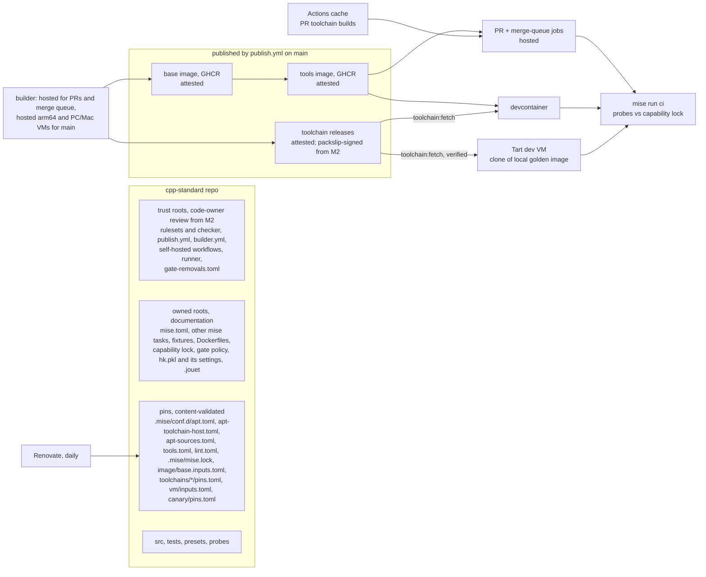
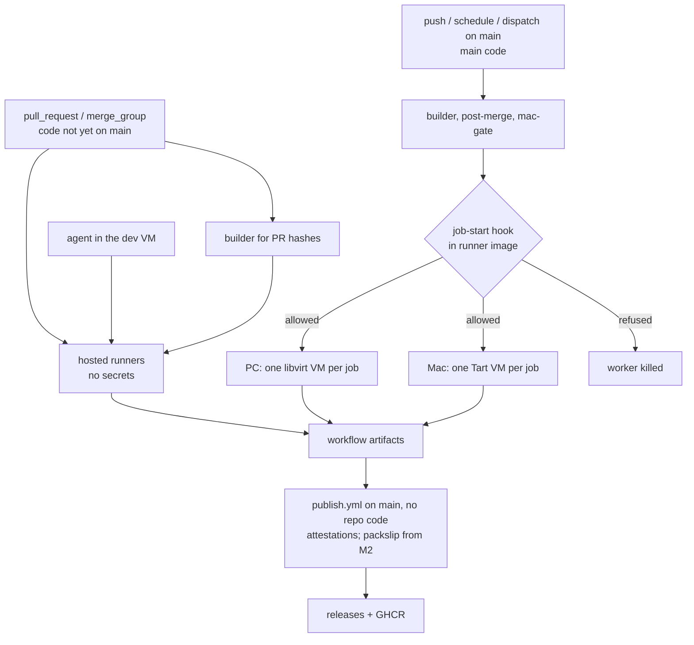

# cpp-standard: the C++ environment and project standard (Level 1)

- **Author:** ray-manaloto
- **Status:** in the Goldfish review of D99-D135 (Stages 5-9 done,
  2026-11-13). Two proposals wait for the owner: D106, that M0 (j) closes on
  the stand-in module, and D107, the reading of the older owner-review rules
  after D101.
- **Date:** 2026-11-13

--------------------------------------------------------------------------------

## Overview

`ray-manaloto/cpp-standard` is a public repository in the free `ray-manaloto`
GitHub organization; it was switched to public during setup (D95). It holds:

1. **A written standard** for setting up a C++ project: compilers and their
   roles, standard libraries, build presets, dependencies, tests, coverage,
   sanitizers and analysis tools.
2. **A reference project.** It uses C++20 named modules and `import std`. It
   contains one small module written by the owner: an encoder for FIX-style
   tagged fields, generated with C++26 static reflection.
3. **A reflection canary.** It builds and tests pinned versions of upstream
   projects that use C++26 reflection. It starts with glaze, and adds
   reflect-cpp, simdjson and rosetta once glaze is green (D47).
4. **One mise bootstrap project** that builds the whole environment from one
   configuration: a Tart macOS VM, plus Ubuntu 26.10 arm64 and amd64 container
   images.
5. **One gate.** `mise run ci` gives the same result, for the tier-1 checks the capability lock lists (G3), locally and in GitHub
   Actions.

Level 1 ends on 2026-11-27 (D21). The glaze FIX Orchestra project then starts
on top of this standard, in its own repository. Level 2, a separate
brainstorm, decides what glaze FIX implements. The critical path to that date
is Linux-first (D44, D53, §10).

**Inputs:**

- [concepts_brief.md](level-1/concepts_brief.md);
- [decisions-log.md](level-1/decisions-log.md), D1 to D135. "Dnn" in this
  document means row Dnn of that log;
- the reports in [level-1/research/](level-1/research/), and
  [goldfish_brainstorm_report.md](level-1/goldfish_brainstorm_report.md);
- the review reports:
  [zoom_out_report.md](level-1/zoom_out_report.md),
  [zoom_out_reaudit_report.md](level-1/zoom_out_reaudit_report.md),
  [comprehension_report.md](level-1/comprehension_report.md),
  [critic_report.md](level-1/critic_report.md),
  [goldfish_review_report.md](level-1/goldfish_review_report.md) and
  [intermediate_zoom_out_report.md](level-1/intermediate_zoom_out_report.md).

Research went to primary docs first, then GitHub issues and PRs, example
projects and offline clones; findings cite their source in the decisions
log or here.

Where this design differs from `concepts_brief.md`, this design wins. The
owner confirmed these three differences; the decisions log records the rest:

- the reference project includes the owner's reflection module (D22);
- updates are daily, with p2996 automated (D31, D32, D34);
- the implementing agent does the work, and asks the owner only for steps
  that need a person (D57).

### Glossary

#### Process terms

| Term | Meaning |
|---|---|
| **EGM** | The Elephant-Goldfish Model, the design process used here. One drafting agent (the "Elephant") writes the design. Fresh-context reviewers (the "Goldfish") review it in stages. `/egm-drift-report` later compares a design with the code and lists where they differ. |
| **Milestones** | **M0**: the spike, throwaway pass/fail experiments (a)-(j), split into M0-Linux, which blocks M1a and ends 2026-11-16, and M0-Mac, which runs in parallel and feeds M3 (§10, D84). The runner tests are not in M0; they form the [M2 entry gate](#m2-entry-gate) (D77). **M1a**: the critical path. **M1b**: work around it that can be cut. **M2**: amd64 and the PC runner; M2 entry turns on code-owner review for the trust roots, and packslip signing (D108, D111). **M3**: the Mac VM, runner and toolchains. **M4**: the canary. **M5**: tier-2 tools and the perf task (the digest moved to M1b, D84). |
| **Level 1 / Level 2** | Level 1 is this environment standard, ending 2026-11-27. Level 2 is the glaze FIX project built on it. |
| **The gate** | `mise run ci` and nothing else (§5). "The post-merge macOS run" is `mac-gate.yml`; the Linux run after merge is `post-merge.yml`. |
| **Agent session** | One live Claude or Codex session working in this repository. The cap on them is in `review/cap.toml` and starts at 3 (§9). |
| **the setup agent** | The owner's agent session that manages the dotfiles repository. It is the only session that installs or changes software and credentials on the owner's machines (Mac, PC), so every install step in this plan goes through it. |
| **Abbreviations** | **CUJ**: critical user journey. **CLT**: Apple's Command Line Tools. **SOH**: the FIX field separator, byte `0x01`. **GHCR**: GitHub Container Registry. **P2996** / **P3394**: the C++ proposals for static reflection and for annotations. |
| **Two-VM rule** | Apple's licence lets a Mac run at most two macOS VMs at once. The dev VM and one runner or golden-build VM share that limit (D68). |

#### Code, paths and pins

| Term | Meaning |
|---|---|
| **First-party code** | Everything under `src/` written for this repository. This is the code the 100% coverage rule measures. It does not include fixtures or third-party code. |
| **Owned roots** | The §6 list of files the owner owns (D51, D76), such as workflows, most mise tasks, the build scripts and the gate policy. Not a review gate (D101). It includes the trust roots. |
| **Trust roots** | The CODEOWNERS list whose change reaches the owner's hardware or signing identity, under code-owner review from M2 (§6 Trust roots, D108, D134). |
| **Pins** | Files that hold only versions, URLs, hashes or sizes. Renovate and agents may change them, and `pins:validate` checks their content (§3). |
| **Capability lock** | `cmake/capabilities.lock.json`: what each compiler can do in each environment (D42). Never called just "the lock". `.mise/mise.lock` is always named in full. |
| **Inputs hash** | The 16-hex value computed from an artifact's input files and `.mise/mise.lock` slices (§2). |
| **Artifact tag** | The name built from the inputs hash, such as `tools-arm64-<hash>` or `p2996-linux-arm64-<hash>`. Written as `<tag>` in task arguments and paths (§2). |
| **Release tag** | The git tag of a toolchain release. In M1a it is the artifact tag (D134); M2's packslip naming (D89) is part of the M2 design. |
| **Image tag** | The GHCR tag of an image, `<arch>-<hash>`, published only from `main`. PR and merge-group images use `pr-<n>-` tags that only their own jobs use (§2, D134). |
| **Toolchain pins** | `toolchains/<name>/pins.toml`, one file per toolchain shared by every OS: version or commit, source URL and sha256, `salt` and `host_tools`. Each OS adds its own host inputs to the hash (D85). |
| **Fetch rule** | How `toolchain:fetch` gets a toolchain in any job: `main`'s verified release for the hash, else the job's staged PR or merge-group copy, else a rebuild (§2 step 5). |
| **Leaf bump** | An update to an input that only the tools image or a single tool depends on, such as a new cmake. It is the opposite of a compiler or base-image change. |
| **The fence** | Self-hosted runners run only `main` code (§6 The fence, D48, D58). |
| **ut** | Boost.ext ut (`bext-ut`), the header-only C++ unit-test framework. |
| **Prior repositories** | A private prototype ("the prototype"), glaze-build-setup, cpp-core and the cpp-utilities catalogue each had their own build-preset setup. symphony-cpp built hash-tagged toolchains. dotfiles is the owner's current machine setup; dotfiles-legacy is its older version. cpp-core is a separate project, developed by agents on low-cost models. |

#### Machines and images

| Term | Meaning |
|---|---|
| **Golden image** | A local Tart VM named by its inputs hash. The Mac golden image is the base for both the Mac runner VMs and the dev VM (§3). The PC's runner VM image is its libvirt counterpart. |
| **Dev VM** | A clone of the Mac golden image where the owner and agents work. |
| **Runner VM** | A one-job clone of a golden image, made and deleted by gha-outrunner (D65). |

#### Tools

| Term | Meaning |
|---|---|
| **mise** | jdx's tool and task manager. It installs pinned tools, runs tasks, and bootstraps machines (`mise bootstrap`). |
| **hk** | jdx's git-hook and check runner. |
| **fnox** | jdx's secret manager. It reads secrets from Doppler and passes them to commands without printing them. |
| **packslip** | jdx's signed release manifest and its CLI. A release job signs a list of its files' digests with its workflow identity; `packslip install` checks the signer and digests before extracting. Here the standalone CLI installs the toolchains (`toolchain:fetch`) and mise itself in the base image (D59, D72, D73). |
| **jouet** | A command-line toolkit for coding agents, with test, commit and search commands, and rules that its hooks apply to agent tool calls (D64). |
| **gha-outrunner** | A small controller on GitHub's `actions/scaleset` client that runs each job in a fresh libvirt or Tart VM (D65). |
| **Context7, codebase-memory** | Two MCP servers available to agents. Context7 serves current library documentation. codebase-memory indexes this repository's code as a searchable graph. |

#### Identities

| Term | Meaning |
|---|---|
| **Owner's personal account** | The owner's personal GitHub account. |
| **Agent App** | A new GitHub App, `cpp-standard-agents`, that agents push and open PRs as (§6 Identities, D71, D134). |
| **PC runner App** | An existing org App whose only permission is registering self-hosted runners; it registers the M2 runners instead of an Administration-write PAT (D82, D117). |
| **Org-admin App** | An existing GitHub App with wide org-admin rights. It is not used here. |
| **Commit review** | Each agent commit is made only with a separate agent session's approval: a convention, not a guard (D120). |

## The Problem

The owner wants to grow as a low-level C++ developer, focused on C++26 static
reflection for performance work. Over the past weeks, much of the time went to
side issues instead.

- **Setups were rebuilt over and over.** There were four separate
  implementations of build presets (the private prototype, glaze-build-setup, cpp-core and the
  cpp-utilities catalogue).
- **The compiler source kept changing.** The compiler ruling flip-flopped
  between Homebrew, conda and apt.
- **Agent sessions collided.** Several agent sessions edited the same
  repositories and the shared dotfiles at once.
- **dotfiles grew too large.** It is now about 66,000 lines (counted with
  `tokei` on 2026-11-12 during the brainstorm), and only about a quarter of
  that is environment bootstrap.
- **Rules were never enforced.** Rulings such as "one lane at a time" were
  overtaken within days, because nothing enforced them.

The work stopped at the step that turns the FIX Orchestra XML into C++
structs for a C++26 glaze FIX serializer. It can't restart until the
environment underneath it stops moving.

The proposed fix is one place that defines and proves the environment, built
from one pinned configuration and isolated from the owner's other projects
and host setup. It must be checked by one command, finished by a fixed date,
and then used, not grown.

## Goals

- **G1. One pinned environment from one configuration, kept current.** A single mise bootstrap project builds a Tart macOS VM and
  Ubuntu 26.10 arm64 and amd64 images (D13, D25, D45).
  - Every input is pinned by version, hash or digest, and Renovate bumps
    them daily (§7). Images and toolchains are tagged by a hash of their
    inputs (D49).
  - Measure: the tags computed from a commit's inputs resolve to the same
    toolchain versions while their releases exist, so an old commit is
    reproduced by pulling, not rebuilding (a deleted release returns after
    a `salt` bump, D72).
  - Accepted limit: the Mac golden image is local only, and depends on the
    cirruslabs vanilla image staying available by digest.
- **G2. Three compilers, each with a written role** (D1, D3, D6, D25). §1
  has the table.
  - **LLVM/clang 23 with libc++:** the daily compiler, with the tier-1
    sanitizer checks.
  - **GCC 16.2 with libstdc++:** the second gate compiler; it runs Valgrind
    and compiles reflection code.
  - **clang-p2996 with its own libc++:** the reflection reference compiler.
  - Measure: the §1 table holds for every environment, as recorded in the
    capability lock.
- **G3. One gate, `mise run ci`, identical locally and in CI** (§5, D19,
  D37, D42).
  - Measure: the same commit gives the same result in the devcontainer, the
    dev VM and Actions for every tier-1 check that the capability lock lists
    for the environments being compared, and every applicable must-fail fixture fails.
- **G4. Reflection learning on real code.**
  - **The owner's module (D22):** a FIX-shaped encoder of about 100 lines.
    Tag numbers come from P3394 annotations. It builds on GCC 16 and
    clang-p2996, with 100% coverage, and seeds glaze FIX.
  - **The reflection canary (D20, D47)** shows the compilers and libraries
    cope with real reflection code.
  - Measure: the encoder is green in the gate on both reflection compilers;
    the canary's glaze row is green or allow-listed.
  - Limit (D124): the 100% covers runtime code. Consteval code is checked by
    its `static_assert` tests, and how much of it they reach is not
    measured.
- **G5. Isolation from everything else** (D4, D17, D18).
  - By M3, the C++ work and its agents run in the Tart VM and the images;
    in M1a agents work on the host, and builds run in containers and
    hosted runners.
  - The host's agent setup, dotfiles and the parked C++ projects are not
    build dependencies; the host keeps only credentials (§6, D65, D70, D71).
  - D17 is provisional until M0 (a): if agents can't work inside the VM,
    they stay on the host (Risks).
  - Measure: CUJ 1 changes no file outside the VM.
- **G6. No collisions between agents** (D23). One worktree and branch per
  agent, and a GitHub merge queue into `main` (§9).
  - Measure: every first-parent commit on `main` is a merge-queue merge,
    checked by the digest once it exists (M1b). The agent count joins the
    measure when `review:cap` exists (M5, D113).
- **G7. Visible progress, finished on a date** (D14, D21, D44).
  - Level 1 is a checklist of gate items in `gate-items.toml`, each ticked
    only by a green check in the newest completed `main` run of
    `post-merge.yml` (D119), or of `mac-gate.yml` for macOS items (D46).
    The daily digest shows it (§9).
  - On 2026-11-27 the green tier-1 items form the standard; the rest become
    dated tickets, in the cut order (D53). Measure: the checklist then.
- **G8. Enough CI capacity at no cost, without exposing the owner's
  hardware** (D16, D48). The repository is public. §6 holds the fence.
  - Measure: no paid runner minutes are used, and the negative tests at the
    M2 entry gate (D58, D77, D122) show no non-`main` job or SHA starts on
    the PC or Mac.

## Non-Goals

- **glaze FIX itself**, the Orchestra XML-to-C++ generator and the
  serializer: Level 2 designs them; Level 1 gives only the encoder seed.
- **cpp-core**, a separate project with its own later brainstorm.
- **The parked projects** (D4): the private prototype, cpp-utilities,
  cmake_template, modern_cpp_project_template, cpp-playground and
  hftuniversity; pieces are copied in only when needed, with a link.
- **The glaze worktrees and spikes**, which move to glaze FIX in Level 2.
- **Cleaning up the host's agent setup, the owner's existing rulings, and
  the rest of dotfiles** (D18); only dotfiles' C++ parts retire.
- **A project-template generator** (the mise "cookiecutter").
- **Windows.**
- **Performance results used as claims, and the tooling for them** (D46).
  Level 1 has the metrics standard (§8) and one unprivileged task,
  `perf:instructions`. Hardware counters, the privileged perf container and
  macOS profilers move to Level 2.
- **A vcpkg binary cache** (D52). The only dependency, ut, is header-only.
- **Upstream changes to mise or Renovate.** The three drafted posts stay
  unposted until the owner decides. Level 1 works around the gaps.

## Open Questions

- **Q1. Clean-up for the public repository.** The repository is already
  public, so these are follow-ups:
  - Scrub local paths, session ids, internal account names and internal
    tool names from all of `docs/designs/`.
  - rosetta lists no license, so it is built for testing and not
    redistributed.
  - Check the FIX Orchestra license before glaze FIX goes public.
- **Q2. The mise and Renovate upstream posts.** The three drafts are ready
  and verified on 26.10. When, if at all, to post them is the owner's call.
- **Q3. License.** Settled: the owner chose MIT, committed as `LICENSE` in
  setup step 3.
- **Q4. When the post-merge macOS run becomes a required check** (D46).
  The owner decides by hand, or later by a rule such as "N consecutive
  green daily runs"; until then the owner fixes or reverts a red run.
- **Q5. macOS resilience, for M3** (D113). Should `toolchain:fetch` fall
  back, on macOS only, to the newest signed `main` release marked stale,
  when a merged bump breaks the Mac build? Should Renovate and toolchain
  PRs get an advisory hosted macOS build before merge?
- **Q6. Renovate's identity** (D104, D124). Which identity runs the daily
  Renovate, and where its credential lives. Not a repository secret, which
  same-repo PR workflows could read; the Mend-hosted Renovate app is the
  leading option. Due before M1b.
- **Q7. Does M0 (j) close on the stand-in module?** (D106, proposed:
  yes). The owner decides at the M0 exit review on 2026-11-16.
- **Q8. How the older owner-review rules read after D101** (D107,
  proposed). Text that depends on it is marked "proposed".

Settled questions are at the end of the Technical Plan
([Settled questions](#settled-questions)).

## Critical User Journeys (CUJs)

### CUJ 1: Fresh Mac to a green gate

- **Given**: An Apple Silicon Mac with only Tart and git installed, and
  the cpp-standard repository URL.
- **When**: The owner clones the pinned Tart macOS image and runs the
  pinned mise installer and `mise bootstrap --from <repo>?ref=<sha>` inside
  the VM. They then run `mise run ci`.
- **Then**:
  - The VM gets the mise tools, including the LLVM release tarball, from
    `.mise/mise.lock`. `mise run toolchain:fetch` installs GCC 16.2 and
    clang-p2996 and checks they were published by `main`'s `publish.yml`
    (§2 step 5; CUJ 1 runs from M3). If Mac GCC was cut, reflection is gated
    on p2996 only.
  - Every tier-1 check runs for the macOS compiler set and passes, and the
    probes match the capability lock.
  - No file outside the VM changes.

### CUJ 2: The Linux image, locally and in CI

- **Given**: A commit on any branch of cpp-standard.
- **When**: `mise run artifact:tag` computes the base and tools tags from the
  commit's image inputs (§2). If either tag is missing, the builder builds
  it on hosted runners for arm64 (and amd64 from M2).
- **Then**:
  - The same tools tag is the devcontainer image and the CI job
    `container:`, checked with `image:verify` on every pull of a `main`
    image; a PR-built `pr-` image is used only by that PR's jobs (D59,
    D134).
  - A non-root user can run every tool. `toolchain:fetch` installs the
    toolchains when the job starts (§2 step 5).
  - `mise run ci` gives the same result in the devcontainer and in GitHub
    Actions.

### CUJ 3: The owner writes reflection code

- **Given**: The devcontainer, or the dev VM, and the reference project.
- **When**: The owner edits the reflection encoder module and runs `mise run
  ci`.
- **Then**:
  - The module builds with GCC 16 `-freflection` and with clang-p2996. It
    is not built with plain LLVM.
  - Its ut tests and `static_assert` tests pass.
  - Each compiler's own coverage tool reports 100% under the consteval
    rule in §5.
  - The sanitizers pass.

### CUJ 4: A dependency update arrives

- **Given**: Renovate finds new versions of pinned inputs: mise tools, apt
  packages, GitHub Actions, or a toolchain input such as the p2996 commit.
- **When**: Renovate opens its daily PRs (D31, D61).
- **Then**: the §7 merge rule decides. Linux artifacts build on hosted
  runners before merge, Mac toolchains after (D62). A red PR does not
  merge.

### CUJ 5: Two agents work at once

- **Given**: Two agents, each on its own branch and worktree.
- **When**: Both finish and ask to merge.
- **Then**: The merge queue tests each one on top of `main` and the PRs
  ahead of it, on hosted runners (D61). Neither merges unless the required
  Linux checks pass. From M5 the digest flags an agent count over the cap
  (§9, D113).

### CUJ 6: Daily review

- **Given**: The scheduled digest workflow (daily by default), and from M5
  the `review:cap` report (D113).
- **When**: It runs `mise run review:digest`.
- **Then**: The owner gets the gate checklist and the other items listed in
  §9, all with no model calls. `/egm-drift-report` runs only if code under
  a design doc changed.

--------------------------------------------------------------------------------

## Technical Plan (Architecture)

This section describes how the pieces fit together. Decisions D26 to D135 were
made while drafting and reviewing it. The file-by-file list is in Detailed
Implementation. What is unproven, and the accepted risks, are in
[Risks & Mitigations](#risks--mitigations).

### Architecture at a glance

The diagram shows the M2 state. In M1a there are no self-hosted runners,
`main` builds on hosted runners, and toolchain releases are attested, not
yet packslip-signed (D111, D116).



There is one configuration: `mise.toml` with five conf.d pins fragments
(§3) and a lock file. It produces three environments. Images and
toolchains are tagged by the hash of their inputs. Each artifact tag is
published once, from `main`, by `publish.yml`. Code not yet on `main` never runs
on a self-hosted runner; agent code runs on hosted runners and in the dev VM
(on the Mac host before M2, D127). All three environments run the same
`mise run ci`, which checks the probes against the committed capability lock.

### 1. Compilers: one table

| | macOS VM (arm64) | Ubuntu 26.10 arm64 | Ubuntu 26.10 amd64 |
|---|---|---|---|
| **LLVM/clang 23 + libc++** | LLVM release tarball via mise `github:` (D38) | apt.llvm.org `resolute-23`, exact pins, in the base image (D27, D45) | same |
| **GCC 16.2.0 + libstdc++** | source build, Homebrew recipe + Darwin patch (D33) | Ubuntu archive `g++-16`, in the base image (D25) | same |
| **clang-p2996 + libc++** | source build (D30) | source build with compiler-rt (D32) | same |

Checks for each compiler and kind of project:

| Check | clang 23 | GCC 16.2 | clang-p2996 |
|---|---|---|---|
| Builds reflection code | no (no P2996 upstream) | yes, `-freflection` | yes, `-freflection-latest` |
| Builds non-reflection code | yes | yes | yes |
| Coverage tool (gcov mode, D88) | `llvm-cov gcov` | `gcov` | `llvm-cov gcov` (M0 (c), (j) passed, D105, D106) |
| ASan + UBSan | Linux yes; macOS pending M0 (d) | Linux yes; macOS pending M0 (e), with `detect_leaks=0` | Linux yes (M0 (c) passed, D105); macOS pending M3 |
| TSan | Linux yes; macOS pending M0 (d) | Linux only | Linux yes (M0 (c) passed locally, D105); macOS pending M3 |
| Valgrind | no | Linux only | no |
| clang-tidy | Linux clang image, non-reflection targets | no | no |

The configure-time probes (D39) fill in the actual values for each
environment. The committed capability lock (D42) is the expected state. A
probe result that differs from the capability lock fails tier 1. A legitimate
change is accepted by regenerating the capability lock in the same PR; the
diff shows the change, and the required checks are the gate (D101). Renovate
PRs that change it wait for the owner (§7 merge rule). A PR that removes a capability
also needs a matching entry in `gate-removals.toml`, or
`gate:policy` fails (D115).

**macOS entries (D78).** From M3, the agent runs `caps:update` in the dev
VM and adds the macOS entries to the same PR; before M3 the capability lock
has none. On `main`, a macOS mismatch turns the post-merge macOS run red.

### 2. The builder: images and toolchains by inputs hash (D49)

Images and the two toolchains that no package source can pin (GCC on macOS,
clang-p2996 everywhere) use one pattern. It is the inputs-hash pattern from
dotfiles-legacy `p2996_hash.py` and the private prototype's toolchain check; symphony-cpp
published toolchains as `<version>-<arch>-<inputs sha256>` the same way (D68).

1. **Inputs.**

   | Artifact | Hash covers |
   |---|---|
   | base image | `image/base.Dockerfile`, `image/base.inputs.toml` (Ubuntu digest, exact mise version, packslip signer key id, packslip image digest), `.mise/conf.d/apt.toml`, `.mise/conf.d/apt-toolchain-host.toml` and `.mise/conf.d/apt-sources.toml` (D69, D73, D75, D86, D90) |
   | tools image | the base tag, `image/tools.Dockerfile`, `.mise/conf.d/tools.toml`, the linux-`<arch>` slice of `.mise/mise.lock`, and the `.mise/locks/**` sidecars the slice names (D68, D74, D90) |
   | runner image (PC qcow2) | the tools tag, `runner/pc/**`, `runner/hook/job-started.sh` and the pinned actions/runner version (D90) |
   | Mac golden image | `vm/inputs.toml` (Tart base digest and sizes), `image/base.inputs.toml` (the same mise pin), `.mise/conf.d/tools.toml`, the macos-arm64 slice of `.mise/mise.lock`, `.mise/tasks/vm/golden`, `runner/hook/job-started.sh` and the actions/runner version (D68, D74, D86, D90) |
   | toolchain, Linux | the shared `toolchains/<name>/pins.toml`, `toolchains/<name>/build.sh`, the Linux patches under `toolchains/<name>/linux/` (D105), `.mise/conf.d/apt-toolchain-host.toml`, `.mise/conf.d/apt-sources.toml`, and the slice `.mise/mise.lock#linux-<arch>:<host_tools>` (D75, D85, D90) |
   | toolchain, macOS | the shared `toolchains/<name>/pins.toml`, `toolchains/<name>/build.sh`, the Mac recipe patches under `toolchains/<name>/macos/`, `vm/inputs.toml`, and the slice `.mise/mise.lock#macos-arm64:<host_tools>` (D85) |

   - **One shared pins file per toolchain (D85).** `toolchains/<name>/pins.toml`
     holds only data used by every OS (fields in §3 `pins:validate`); GCC
     adds a `[macos]` table with the Darwin patch, its libraries, the CLT
     and SDK versions. Every flag and argument lives in `build.sh`. A bump is
     one PR, and `salt` is bumped only to republish a deleted release (D72).
   - **Host versions come from the pins, not from a generated file (D75).**
     Linux toolchains build inside the current base image, and the host
     packages that shape a compiler live in
     `.mise/conf.d/apt-toolchain-host.toml`, so the toolchain hash follows
     them and nothing else in the base. On macOS the smoke test records the
     Tart digest and CLT patch level.
   - **Not inputs:** python and the rest of the tools image.
2. **Tag.** `mise run artifact:tag <name>` computes the inputs hash: the
   blob id of each listed file at the commit (`git rev-parse <sha>:<path>`,
   so no filters apply), combined as the sha256 of the sorted
   `path\0blob\n` lines, truncated to 16 hex characters. A `.mise/mise.lock`
   slice is one more line: its key is `.mise/mise.lock#<platform>:<tools>` and its
   value is the sha256 of the canonical JSON (sorted keys, no spaces) of the
   lock entries for those tools on that platform (D85). The full tag is the
   name plus the hash: `base-<arch>-<hash>`, `tools-<arch>-<hash>` and
   `<toolchain>-<os>-<arch>-<hash>`. Every consumer computes the tag itself,
   from git; no file records it. Each row lists the files the build reads or
   its Dockerfile COPYs. In addition to those files, every hash covers
   `.mise/tasks/artifact/build`, and a toolchain hash also covers
   `apt.toml` if its `build.sh` bootstraps with an apt compiler. The
   Dockerfiles COPY only the conf.d fragments and the lock, never
   `mise.toml`. Two files are left out on purpose:
   - `mise.toml`, so that a settings change does not rebuild every
     artifact; an `[env]` change that affects build output is therefore not
     in the hash (accepted limit, D134);
   - `builder.yml`, because it only calls `artifact:build`.

   Each hash also starts with the line `schema = 1`, bumped when the
   hashing rule changes (D90). `artifact:tag` has golden-vector tests in
   `tests/artifact_tag/`.
   - **Toolchain releases (D134).** In M1a a toolchain release's git tag is
     its artifact tag, so `toolchain:fetch` finds it with one
     `GET /releases/tags/<artifact tag>` (tags are unique; drafts are not
     returned), authenticated with `GITHUB_TOKEN` in Actions. How M2 maps an
     artifact tag to packslip's `<project>-v<version>` release (D89) is part
     of the M2 design.
3. **Build.** `builder.yml`'s triggers are in its file-plan row (D61, D112).
   It takes no ref or SHA input and builds `github.sha`; only `GITHUB_TOKEN`
   and the owner can dispatch (§6 Trust roots, D134). On `merge_group` it
   saves each toolchain it builds to `actions/cache` on the queue ref. From
   M2, `publish.yml` dispatches `post-merge.yml` and `mac-gate.yml` after it
   publishes, so they never start before `main`'s toolchains exist (D112).
   Each missing tag builds where the code is allowed to run (D48):
   - PR and merge-queue builds of Linux images and toolchains run on hosted
     runners (arm64, and amd64 from M2);
   - `main` builds of Linux toolchains run on hosted arm64 runners, and from
     M2 in PC runner VMs (amd64);
   - macOS toolchains build only from `main`, in Mac runner VMs, after merge
     (D62, D85); the red post-merge macOS build is the backstop.
4. **Publish (D59, D72, D98, D114).** In M1a, `publish.yml` releases each
   toolchain archive with a build-provenance attestation. The archive
   carries its own `inputs-hash.txt`, because an attestation binds a digest
   to a workflow, not to a tag (D111, D116, D131). packslip signing, the
   packslip check on use and the merge-group artifact leg arrive in M2
   (D111).

   Tasks prepare files; workflow steps call the Actions. The build job's
   token is read-only, with no OIDC. `mise run artifact:build <tag>` builds
   and smoke-tests the artifact into `dist/<tag>/` (file plan); a workflow
   step uploads it as an artifact (`retention-days: 7`), in PR and
   merge-group jobs also saves the toolchain to `actions/cache` (key
   `toolchain-<tag>`), and on `main` dispatches `publish.yml` with its run
   id.

   `publish.yml` runs no repository code (D114). It refuses the run unless it
   is a `builder.yml` run from `push`, `schedule` or `workflow_dispatch` on
   `main` whose head SHA is on `main`'s history, so a PR build is never
   signed. It downloads the artifact by run id, computes the names inline
   from `inputs-hash.txt` and the pins (`artifact:names` is the same
   computation, for tests and local use), and publishes with workflow steps:

   - **On `main`:** a toolchain becomes a GitHub Release tagged with its
     artifact tag; if the tag exists, it exits. The order is fixed, because
     immutable releases lock assets once published: delete any stale draft
     for the tag, create a draft, upload, publish (D131). Images are pushed
     to `ghcr.io/ray-manaloto/cpp-standard/<base|tools>:<arch>-<hash>` and
     attested (`push-to-registry: true`). From M2, `jdx/packslip` also
     signs toolchains keyless as `publish.yml` at `refs/heads/main`, and the
     M1a attestation stays alongside until the owner decides otherwise
     (D114, D116). `publish.yml` is the only workflow with `contents:
     write`, `attestations: write` or `id-token: write`, and the only one
     that pushes non-`pr-` images.
   - **For PRs and the merge queue (D134):** no toolchain release is
     published. Images go only under `:pr-<n>-<arch>-<hash>` (PR) and
     `:pr-<n>-mq-<arch>-<hash>` (merge group, `<n>` parsed from
     `gh-readonly-queue/main/pr-<n>-<sha>`). They are unattested and used
     only by that PR's own jobs; `main`, the runners, the dev VM and the
     devcontainer never use them. Jobs on `main`'s image use `container:`
     with the digest `image:verify` checked.
   - **Release protections (M1b):** immutable releases, and a tag ruleset
     that blocks deleting or moving toolchain tags. A deleted release can't
     be republished, so recovery is a PR that bumps the toolchain's `salt`.
5. **Fetch and verify (D72, D83, D91, D122).** One fetch rule for every
   job. In Actions, workflow steps first stage a copy into
   `.cache/toolchains/<tag>/`: in a PR job, and in an M1a merge-group job,
   `actions/cache/restore` with the key `toolchain-<tag>` (the merge group
   reads its own builder run's cache on the queue ref); from M2, a
   merge-group job instead downloads the PR builder run's artifact by
   `run-id` (file plan, `ci.yml`). Then `mise run toolchain:fetch` computes
   each toolchain's hash and takes the first source that has it:

   1. **`main`'s release** for that hash, the normal case. It looks the
      release up by its tag (step 2), runs `gh attestation verify` on the
      archive (`--signer-workflow` `publish.yml`, `--source-ref
      refs/heads/main`), and after extracting checks that the archive's
      `inputs-hash.txt` equals the computed hash (D131, D134). From M2 it
      installs with the standalone packslip CLI and the `main` identity
      (file plan, `toolchain/fetch`; D72, D121).
   2. **In a merge-group job:** the staged copy. A cache made on
      `refs/pull/<n>/merge` is not readable from the merge-group ref.
   3. **In a PR job:** the staged `actions/cache` entry.
   4. **Otherwise:** a rebuild. A miss is slow, and fails only when the
      rebuild passes the 3-hour `artifact-check` timeout.

   Outside Actions only sources 1 and 4 exist. A staged copy is checked
   against its `inputs-hash.txt` but carries no signature, which is allowed
   only because it serves PR and merge-group jobs on hosted runners with no
   secrets (D54). A poisoned PR toolchain can fake a green PR or queue
   result, but never becomes `main`'s release: the `main` builder always
   builds from source, and the post-merge gate goes red if a failure was
   hidden. In M1a the merge group's builder run builds an input-changing
   toolchain once and the gate jobs restore it (D61).

   **Jobs on `main`** never read a PR artifact or cache. In M1a,
   `post-merge.yml` takes `main`'s release, else rebuilds. From M2 it takes
   only `main`'s release, a missing release turns it red, and its `push`
   run is skipped unless the commit's tags exist; the run dispatched by
   `publish.yml` is the one that counts (D112).

   Every pull of a `main` image runs `image:verify` (D114); a tag existing
   proves nothing.
6. **Status.** The `builder.yml` PR status job posts a commit status per
   tag on each PR or merge-group head that needs it. The required
   `artifact-check` job passes when all of a PR's Linux tags are available
   to its gate jobs, as `main`'s release or the builder run's cache entry
   or artifact (D62), and times out after 3 hours naming the missing tag
   and the builder run (D61).
7. **Retention (D79, M1b).** A daily job deletes a closed PR's caches and
   `pr-` images; workflow artifacts expire after 7 days; `vm:golden` keeps
   the newest 2 local golden images. Nothing that a commit in `main`'s
   history references is deleted, so an old commit is reproduced by pulling
   while its releases exist (G1, D27). The Mac golden image is local only,
   so an older one is rebuilt from its `vm/inputs.toml` (the G1 limit).

### 3. The bootstrap project, image layers and the three environments

`mise.toml` is the bootstrap project (D13), and the owner owns it. It holds:

- **`[tasks]`:** settings only. Every task is a file under `.mise/tasks/`
  (D93); §6 lists which ones agents may edit;
- **`[settings]`:** a fixed `minimum_release_age` cutoff, so `mise lock`
  gives the same lock whenever it runs (M0 (i)), bumped with the pins, and
  `lockfile = true`; a pins PR that needs a release newer than the cutoff
  also moves the cutoff in this owned file, which D101 allows (the checks,
  not the owner, gate it); M1b's Renovate config does this;
- **`[hooks] postinstall`:** `hk install --mise` outside CI, so the hk git
  hooks (D102) are installed with the pinned tools;
- **`min_version`**, a floor, not a pin: it changes only when the config
  needs a newer feature. The exact mise version lives only in
  `image/base.inputs.toml` (D86).

`mise.toml` and `.mise/mise.lock` never name a toolchain version; `toolchain:fetch`
computes it (D72). All tools are locked in `.mise/mise.lock`, which is committed
with mode 644. Five pins fragments live in `.mise/conf.d/`, which mise loads
(M0 (f): mise bootstrap reads them; Renovate reads them only with a
`mise.managerFilePatterns` entry in `renovate.json5` (M1b); M1a's first
base build re-checks two legs, D53, D104):

- **`tools.toml`** (D74, D113): the exact-version tools Renovate bumps
  daily, apart from `lint.toml` so tool and lint edits don't collide and
  each image layer hashes only its own pins;
- **`lint.toml`** (D102): hk and the tools its builtins run;
- **`apt-sources.toml`** (D90): apt.llvm.org's `resolute-23` suite (Ubuntu
  26.04) with its key fingerprint, used deliberately on 26.10, which
  apt.llvm.org does not publish yet; clang 23.1.6 from it ran on
  `ubuntu:26.10` (D25), and M1a's first base build re-checks it (D104);
- **`apt-toolchain-host.toml`** (D75): the Ubuntu packages that shape a
  compiler, covered by the toolchain hash;
- **`apt.toml`**: the rest of the apt packages, including
  `libclang-rt-23-dev` for the `--coverage` runtime (D105).

The schema in Detailed Implementation shows each fragment's contents.

`pins:validate` (D51) is a required hosted check. It makes sure:

- `tools.toml` and `lint.toml` hold only `[tools]`, `apt-sources.toml` only
  `[bootstrap.apt.sources.*]`, and `apt.toml` and `apt-toolchain-host.toml`
  only `[bootstrap.packages]`;
- every name is in `pins-allowlist.toml`;
- every URL in `.mise/mise.lock`, `apt-sources.toml`, `image/base.inputs.toml`,
  `vm/inputs.toml`, `toolchains/*/pins.toml` and `canary/pins.toml` comes from
  an allowlisted host,
  and the apt key fingerprint is 40 hex characters;
- each `toolchains/*/pins.toml` holds only `upstream`, `source` (URL, sha256,
  commit), `host_tools` (each a name in `tools.toml`) and `salt`, plus the
  `[macos]` table for GCC (D85). Configure flags live in `build.sh`, not in
  `pins.toml`;
- `image/base.inputs.toml` holds only `ubuntu:26.10@sha256:<64 hex>`, an
  exact mise version (`YYYY.M.P`), a `ps1_` signer key id and
  `ghcr.io/jdx/packslip@sha256:<64 hex>` (D69, D86);
- `vm/inputs.toml` holds only the Tart image name and digest, and CPU,
  memory and disk sizes;
- `canary/pins.toml` holds only repository URLs and commit SHAs.

**Linux images** (D45, D49). Each Dockerfile is a few lines that only call
mise; there is no `mise oci build` (D13).

1. **base:** start from the image and digest in `image/base.inputs.toml`
   (passed as build arguments). Install mise with `packslip install
   github.com/jdx/mise --pin <mise_signer>`, run from a digest-pinned
   `ghcr.io/jdx/packslip` build stage, as in the mise cookbook (D73). Then run
   `mise bootstrap --skip tools --yes` with the three apt fragments, and
   check the result with `mise bootstrap packages status --missing`, which
   must exit 0 (D75).
2. **tools:** `FROM` the base tag, run `mise install --system --locked && mise
   reshim --system`, and add a non-root user.

Toolchains are not baked into images. `mise run toolchain:fetch` installs
them at the start of every job, and when a devcontainer or VM is created,
following the one fetch rule in §2 (D72, D83). The tag comes in as an
argument, so no `.git` directory is needed in a build.

**The macOS VM (D68).**

1. The **golden image**, a local Tart VM named by its inputs hash, is
   built by digest from Cirruslabs' `macos-golden-gate-vanilla` (their
   name), with the mise tools and the D58 hook.
2. Runner jobs get a one-job gha-outrunner clone (D65); the dev VM is a
   longer-lived clone of the same image.
3. A weekly job repeats CUJ 1 from the vanilla image.
4. Under the two-VM rule, golden-image builds take the runner slot; the
   disk budget is about 150 GB.

**Linux runs from inside the VM** (D48, D71). `mise run linux:run` pushes the
branch, opens or updates a draft PR for it as the agent App, so `ci.yml`
runs on hosted runners under the PR rules, and follows the run with `gh run
watch` (D130). Code not yet on `main` never reaches the PC this
way. The owner's own interactive Linux work uses the devcontainer on the PC,
opened from the Mac host terminal (D70).

### 4. Build configuration

- **Presets (D8).** The presets are hand-written in layers, one layer each
  for compiler, standard library, configuration and checks.
  - They use preset schema 13 and `${configurePresetName}` binary
    directories.
  - All targets in a build tree share the same flags, because CMake issue
    #28242 (Kitware's GitLab) makes per-target flags break module dependency
    scanning.
  - Agents may edit presets. `gate-policy.toml` (owned) states which flags
    each preset must keep, and the gate checks it (§5, D64).
- **Probes (D39).** `cmake/probes.cmake` starts from cpp-utilities
  `ProfileCheck.cmake`, with a link back to it. It runs at configure time:
  - `CMAKE_CXX_COMPILER_IMPORT_STD` and the modules JSON check whether
    `import std` works.
  - `try_compile` with `SOURCES_TYPE CXX_MODULE` tests named modules.
  - `check_source_compiles` and `check_source_runs` try a P2996 snippet: a
    reflection operator, `members_of`, and a P3394 annotation.
  - `check_compiler_flag` and `check_linker_flag` test each sanitizer,
    coverage and hardening flag.
  - `check_ipo_supported` and `check_pie_supported` check IPO and PIE.

  Each result switches its feature on or off. Reflection targets are built
  only where `CPPSTD_HAS_REFLECTION` is on. All results go to
  `capabilities.json`, and CI compares that file with the capability lock
  (D42).
- **Dependencies (D7, D52).** vcpkg runs in manifest mode with a pinned
  baseline.
  - Three hand-written triplets, one per compiler and standard library
    (D6, D113), copied from glaze-build-setup with a link back. Sanitizer
    triplets come with the first compiled dependency, in Level 2.
  - There is no binary cache in Level 1.
- **Cache (D9, D124).** sccache caches clang builds, but its module support
  is partial (mozilla/sccache#2650 is open; Risks), so module compiles are
  treated as uncached and the gate's clean build does not rely on sccache.
  GCC module compiles are not cached.

### 5. The gate: `mise run ci`

`mise run ci` runs the same steps everywhere:

1. configure, with the probes, then compare them with the capability lock;
2. check the gate policy (`gate:policy`, D64): every preset keeps the flags
   `gate-policy.toml` requires, and first-party code holds no
   coverage-exclusion marker of any tool (`GCOVR_EXCL`, `LCOV_EXCL`,
   `GCOV_EXCL`) (D88);
3. build;
4. run the ut tests and the `static_assert` tests;
5. run coverage with each compiler's own tool, in gcov mode: GCC builds with
   `--coverage` and reports with `gcov`; clang and p2996 build with
   `--coverage` and report with their own `llvm-cov gcov`: `llvm-cov-23`
   from the apt `llvm-23` package for clang, and the `llvm-cov` shipped in the
   p2996 toolchain archive, whose version matches its `.gcno` files (D88).
   gcovr, pinned in `tools.toml`, runs with `--gcov-executable "<llvm-cov>
   gcov"` once per compiler build tree, and each report must show 100%
   line coverage of first-party code, with no exclusions. Reports are not
   merged, so a line covered by one compiler does not count for another
   (D131). Compile-time-only code is not in the binary, so gcov-mode tools
   never count it; the `static_assert` tests check it (G4 limit, D88, D124).
   clang's source-based mode is not used (Alternatives);
6. run the sanitizer presets;
7. run Valgrind (Linux GCC only);
8. run clang-format (one pinned version on every OS) and clang-tidy (Linux
   clang image only) (D46);
9. run the hardening check;
10. upload SARIF.

These steps are tier 1, and they fail the build. Tier-2 tools only produce a
report (D19): IWYU, cppcheck, ClangBuildAnalyzer, mrdocs, Doxygen, clang-uml,
fuzzing and benchmarks. llvm-mca, BOLT and perf beyond `perf:instructions` wait for Level 2 (D46). A
tier-2 tool moves to tier 1 when it reports zero findings on the reference
project and the owner approves (D124). This is the one promotion rule.

**Negative controls (D37, D42).** The gate builds `fixtures/must-fail/`
separately. There is one must-fail fixture for each check in the list below,
and each must fail its own check:

- an uncovered line (once for each coverage tool);
- a coverage-exclusion marker, and a preset missing a required flag;
- an ASan overflow;
- a UBSan signed overflow;
- a TSan race;
- a Valgrind leak;
- a format violation;
- a tidy finding;
- a missing hardening flag.

Which fixtures apply in an environment comes from the capability lock, never
from live probes; a PR cannot drop a capability, and with it a fixture,
without a `gate-removals.toml` entry (D115). The same file must name any
removed fixture, `expected.toml` row, `required_flags` item or
`forbidden_markers` item, and from M2 that file is a trust root (D108).
A PR can still change the checker or the fixtures together with what they
check; the post-merge run and the digest show it (accepted, D134). If any
applicable fixture passes, the gate is red. The fixtures run on every PR and
merge group, and daily in `post-merge.yml` (D119, D134).

**Local hooks and the lint gate (D81, D102).** `hk.pkl` amends the jdx hk
package at the pinned hk version and runs hk builtins: jactionlint
(pedantic, strict exit), pinact, ghalint and zizmor (pedantic; offline in the hook, plus the
online audits in CI through the `online` profile) on workflows;
shfmt and shellcheck on shell and file tasks; ryl (YAML), jq, mise, tombi,
pkl, rumdl, typos and editorconfig-checker on config and docs; betterleaks
for secrets; and the hygiene checks. The tools are pinned in
`.mise/conf.d/lint.toml`. The same steps run on pre-commit, in `mise run
check`, and in the required `lint` job of `ci.yml` (`mise run check
--online`), so CI refuses what a local hook refuses, and also runs the
checks that need the GitHub API. M1a adds `gate:policy` as a further step;
`gate:policy` stays the real build gate.

**Edit-time guard (D64, M1b, cuttable).** jouet's `gate-guard` rules stop
an agent, before the edit lands, from adding coverage-exclusion markers or
removing required sanitizer flags (file plan, `.jouet/rules/gate-guard.toml`).
It is advisory: harnesses without jouet's hooks skip it, and `gate:policy`
is what enforces the rule.

**The reflection canary (D20, D47)** is not part of `mise run ci`. It runs as
its own daily report-only workflow on hosted runners. It starts with glaze on
GCC 16 and p2996, and adds reflect-cpp, simdjson and rosetta once glaze is
green. Known upstream failures are kept on the canary allowlist.

### 6. Where code runs, and who can change what (D48, D51, D58, D65)



#### The fence

Self-hosted runners run only `main` code; code not yet on `main` never
runs there. No human reviews ordinary `main` code: it has passed the
required checks (D101, D120). From M2, the trust roots that decide what
runs there, and with what identity, need the owner's code-owner review
(D108). Before M2 agents work on the Mac host and can reach its credentials
(accepted, D127); from M2 they run in the dev VM or as a separate macOS user
that cannot (an M2 entry condition, D127).

#### Branches and PRs do run before `main`

Every PR and merge group runs the full Linux gate on hosted runners.
`linux:run` opens a draft PR for a branch that has none (D130). Agents run the macOS
gate, and `caps:update`, in their dev VM from M3. The Mac runner never runs a PR's
code; the post-merge macOS run is the backstop (D78).

#### Hosted jobs

Every `pull_request` and `merge_group` job uses `persist-credentials: false`,
gets no secrets, and has the permissions in the job table below. A
same-repo PR runs its own workflow files, so it can add a job that requests
write permissions or is named like a required check: an accepted risk until
the M2 design (D54, D134), because such a job can fake a green PR or queue
result but cannot produce anything `main` trusts or reach a self-hosted
runner (Risks).

#### Runner-side enforcement (D58)

Workflow files choose their own runner, so routing alone is not a fence.
Each runner image sets `ACTIONS_RUNNER_HOOK_JOB_STARTED` to a read-only,
root-owned script. It allows a job only if:

- the repository is `ray-manaloto/cpp-standard`;
- `GITHUB_EVENT_NAME` is `push`, `schedule` or `workflow_dispatch`;
- `GITHUB_REF` is `refs/heads/main`;
- `GITHUB_WORKFLOW_REF` matches
  `ray-manaloto/cpp-standard/.github/workflows/(builder|post-merge|mac-gate).yml@refs/heads/main`.

Any missing or unknown value refuses the job. On refusal, the hook kills the
parent Runner.Worker and exits non-zero, because steps marked `always()`
still run after a failed hook (D58). The hook runs before any container
starts, and job `env:` can't change what it sees. It has no GITHUB_TOKEN
(Risks), so each self-hosted workflow's SHA check (D122, Trust roots) adds
what the hook cannot check.

The allowlist changes only when a runner image is rebuilt from `main`'s
tip; who runs that host job, and with what access, is part of the M2 design
(m2-trust-backlog.md, D134).

#### Runner VMs (D65)

gha-outrunner gives each job a fresh VM:

- on the PC, a libvirt KVM VM on a qcow2 overlay;
- on the Mac, a Tart clone.

The VM is destroyed after one job. Docker and `container:` jobs run inside
the VM; the host Docker socket is never exposed. The VMs are egress-only,
with no tailnet route.

#### Public repository and self-hosted runners (D95)

GitHub warns against self-hosted runners on public repositories, because a
fork's PR could run on them. Fork-PR workflows need approval for every
outside contributor (setup step 4), no self-hosted runner is registered
until M2, and the D58 hook refuses every non-`main` job either way.

#### Identities (D40, D52, D71)

- Agents push and open PRs as the agent App. It has contents,
  pull_requests and workflows write, on cpp-standard only. It had actions
  write until D134; the owner removes it in M1a, since `linux:run` now
  opens draft PRs (D130).
- gha-outrunner registers runners at the org level with the PC runner App,
  which has `organization_self_hosted_runners: write` and no repository
  Administration (D117, D131). The org has 20 public repositories, so the
  runners go in a dedicated runner group, `cpp-standard`, restricted to
  selected repositories (only cpp-standard), with public repositories
  allowed; GitHub Free organizations can create runner groups. The D58 hook
  still refuses every other repository.
- GITHUB_TOKEN never opens PRs.
- The Org-admin App is not used here. It can edit rulesets, so its key
  must stay out of agents' reach (Risks).

#### Credentials (D109)

Jobs receive only `GITHUB_TOKEN`, minted for each job. `publish.yml` also
gets an OIDC `id-token` to sign.

The daily settings check reads the rulesets with `GITHUB_TOKEN`, so it
cannot read the bypass list, which needs Administration write. Only the
owner, the Org-admin App (Risks) or a repository Administration holder,
which no App here is, can add a bypass actor (D131).

#### Credential storage (D65, D70, D71)

- **The agent App key** stays on the Mac host, behind `agent:token`, a git
  and gh credential helper that mints a one-hour App token (D71, D80, D84).
  From M3 a host job passes the token into the dev VM; the key never enters
  it (file plan, `runner/mac/agent-token.plist`).
- **The PC runner App's private key** stays on the hosts: an encrypted
  systemd credential on the PC, and a Keychain item on the Mac. The owner's
  setup agent sets it up from Doppler (D65, D117).
- **PC SSH and Docker access** exist only on the Mac host. The tailnet ACL
  lets only the Mac host's tag reach the PC's SSH (D70). From M2, agent
  sessions cannot read them (D127).

#### Job permissions (D60, D94)

Every workflow sets `permissions: {}` at the top and grants permissions per
job. A job that runs `toolchain:fetch` or `image:verify` also gets
`attestations: read`.

| Job | Event | Permissions |
|---|---|---|
| `ci.yml` checks | `pull_request`, `merge_group` | `contents: read`, `security-events: write`, `attestations: read`; the `artifact-check` job also `actions: read`, to read the builder run's cache and artifacts (D135); from M2, merge group adds `pull-requests: read` |
| `builder.yml` build | all | `contents: read` |
| `builder.yml` PR status | `pull_request`, `merge_group` | `contents: read`, `packages: write` (only `pr-<n>-` tags), `statuses: write`. It loads the build job's `image.tar` artifact and pushes the `pr-` tag. The cache action uses the runner's own token, so there is no `actions: write`. Accepted risk: an agent PR can push a `pr-` image and post a status on its own commit (D54) |
| `builder.yml` dispatch | `push`, `schedule`, `workflow_dispatch` on `main` | `actions: write`, to dispatch `publish.yml` (D114) |
| `publish.yml` | `workflow_dispatch` on `main`, from `builder.yml` | `contents: write`, `packages: write`, `attestations: write`, `id-token: write`, `actions: read`; from M2, `actions: write`, to dispatch the post-merge workflows (D112). Runs no repository code (D114) |
| `post-merge.yml`, `mac-gate.yml` | `push`, `schedule` and, from M2, `workflow_dispatch` from `publish.yml` (D112) on `main`. Each accepts a dispatch only from `publish.yml`'s `GITHUB_TOKEN` or the owner (D122, D134) | `contents: read`, `packages: read`, `attestations: read` |
| `retention.yml` | `schedule` | `packages: write` (only `pr-<n>-` versions), `actions: write`, to delete PR images and caches (D79) |
| `repo-verify.yml` | `schedule`, `workflow_dispatch` on `main` | `contents: read`, `actions: read` |
| `digest.yml` | `schedule` | `contents: read`, `actions: read`, `issues: write`, `pull-requests: read` |

#### Trust roots (D108, D134)

These files are the only ones that need a GitHub review, from M2 entry,
when self-hosted runners start; before M2 code-owner review is off (D101).
CODEOWNERS lists exactly these:

- the rulesets and their checker: `.github/CODEOWNERS`,
  `.github/rulesets/**`, `.mise/tasks/repo/rulesets` and
  `.github/workflows/repo-verify.yml`;
- the signer, `.github/workflows/publish.yml`, which runs no repository
  code (D114);
- the self-hosted workflows, `builder.yml`, `post-merge.yml` and
  `mac-gate.yml`, plus `runner/**`;
- the ratchet, `gate-removals.toml` (D115).

Everything else, including the build recipe, the gate tasks, `ci.yml` and
the pins, merges on green under the §7 merge rule; the required checks, the
fixtures and the ratchet are the guards, and the post-merge run catches
what slips through. Wider trust roots are the M2 design's work
([m2-trust-backlog.md](level-1/m2-trust-backlog.md), D134).

From M2, Renovate's weekly Action SHA batch waits for the owner (D118).
GitHub does not let an author approve their own PR, so trust-root changes
come from the agent App or Renovate, never the owner's login. The M2 entry
gate turns code-owner review on with `repo:rulesets --phase m2` (D108).

Only `GITHUB_TOKEN` and the owner can dispatch workflows: the agent App has
no `actions: write` (D134), and `builder.yml` takes no ref or SHA input.
`post-merge.yml` and `mac-gate.yml` accept a dispatch only from
`publish.yml`'s `GITHUB_TOKEN` or the owner, on `refs/heads/main`, and
check out the SHA of `publish.yml`'s verified builder run (D122, D134).
The one-VM-per-job fence contains what a self-hosted job runs (D65).

#### Owned roots (D51, D64, D76)

Owned roots are not a review gate (D101). They are the files the owner owns,
including the trust roots, listed as documentation in
`.github/owned-roots.txt` (file plan, marked **(O)**); the must-fail
fixtures run on every PR (§5, D134). The list: `.github/**`,
`renovate.json5`, `mise.toml`, `.mise/tasks/**` (except `linux/run`,
`doctor`, `perf/*`, `review/cap` and `vcpkg/bootstrap`), `fixtures/**`,
`cmake/capabilities.lock.json`, `gate-policy.toml`, `hk.pkl` and its
settings files (`.editorconfig`, `.rumdl.toml`, `.ryl.toml`, `_typos.toml`,
D102), `.jouet/**`, `toolchains/*/build.sh`, `toolchains/*/macos/**`,
`toolchains/*/linux/**`,
`image/*.Dockerfile`, `runner/**`, `pins-allowlist.toml` and
`gate-removals.toml`.

PRs merge under the §7 merge rule. The guards are the required checks (the
capability lock, the gate policy, the fixtures,
`pins:validate`), the merge queue and, from M2, the trust roots. The agent
rules' commit review (D120) and the owner's wait on major compiler bumps and
capability lock changes (D128) are conventions, not guards.

#### The repository settings are checked daily (D53, D60, D63, D100, D108, D109)

`mise run repo:rulesets --verify` checks that protections are present, and
never fails because one was added. It fails if:

- from phase `m2`, `main` does not require code-owner review (D108);
- `main` stops dismissing stale approvals;
- the merge queue is not required;
- the required checks differ from the `ci.yml` job names listed in the
  [M1a file plan](#m1a-the-critical-path) (D93);
- immutable releases or the toolchain tag ruleset are off (from M1b);
- a required workflow is disabled.

The agent App has no `actions: write`, so it cannot disable these checks
(D134).

#### Every merge goes through the merge queue (D23)

No one pushes to `main` directly. The `main` ruleset is configured with no
bypass actor; the daily check cannot read the bypass list (D109), so this
rests on who can administer the repository (Credentials). Every PR merges through the merge queue, which re-runs the required
checks on top of `main` and the PRs ahead of it. The daily settings check
fails if the queue stops being required.

### 7. Updates

- **Daily Renovate (D31, D61).**
  - Built-in managers cover mise tools, Docker digests and the vcpkg
    baseline, with tool bumps grouped into one daily PR; custom regex
    managers cover the other pins (file plan, `renovate.json5`).
  - A change to `apt-toolchain-host.toml` or a toolchain's `pins.toml`
    changes the toolchain hash, so the builder rebuilds the Linux toolchain
    in that PR; nothing is written back (D75, D85). One PR bumps every OS;
    macOS builds after merge.
  - The daily tools PR touches `tools.toml`, `lint.toml` and
    `.mise/mise.lock`, and the `minimum_release_age` cutoff in `mise.toml`
    when a release is newer than the cutoff (D74).
  - Action SHAs live in `.github/**` and are batched weekly. Before M2
    the batch merges on the checks (D107, proposed); from M2 it touches trust roots and
    waits for the owner (D118).
- **Merge rule (D50, D56, D101, D128).** This is the one statement of it;
  other sections point here.
  - **Every PR merges through the merge queue once the required checks
    pass.** Before M2 no PR needs a GitHub approval, since code-owner review
    is off (D101). From M2, a PR that touches a trust root also needs the
    owner's code-owner review (D108).
  - **A Renovate PR merges when** the gate is green in its own image, the
    capability lock is unchanged, and the fixtures pass.
    The owner confirmed this covers LLVM minor bumps, p2996 commits, GCC
    tarball and patch changes, and Ubuntu `g++-16` updates (D56). Compiler
    changes that no probe detects, such as codegen or new diagnostics, are
    guarded only by `-Werror` and the tests.
  - **The owner reviews major compiler bumps and capability lock changes
    (D56):** Renovate does not merge them, so they wait for the owner. This
    is a convention, not a guard: the agent App could queue such a PR
    (D128).
  - **The owner looks at owned-root changes after merge** (D101, D107,
    proposed), in the merged diffs and, from M1b, `review:digest`. There
    are no Mac-only pins (D85): a macOS-only breakage shows as a red
    post-merge macOS build, which the owner fixes or reverts.
- **Base upgrades (D36, D47).** In Level 1 this is a written process only:
  - build a new Ubuntu or Tart base next to the current one;
  - the owner merges the switch PR; Renovate does not merge it (D107,
    proposed);
  - the old base is kept 30 days.

### 8. Performance metrics (D35, D46)

This table is the standard. In Level 1 only the first row has a task:
`perf:instructions`.

| Metric | Where results are valid | Comparable across environments | Level |
|---|---|---|---|
| Instruction counts (Valgrind callgrind and cachegrind) | Linux images | yes, deterministic | 1 |
| llvm-mca reports | anywhere | yes, static | 2 |
| Generated assembly diffs | anywhere | yes, static | 2 |
| perf hardware counters, wall-clock time | PC on bare metal, owner-run, never on a runner | no | 2 |
| xctrace, samply | macOS VM | no, VM only | 2 |

### 9. Agents, collisions and the daily digest

- **Isolation.** Each agent works in its own worktree and branch (D23), and
  the merge queue serializes merges into `main`.
- **The cap (M5, D113).** `review/cap.toml` caps agent sessions, starting
  at 3. `mise run review:cap` counts them on a schedule and posts the
  count as the agent App to a pinned `digest` issue.
- **Agent tooling (D41)** is project skills, codebase-memory and Context7, fnox
  placeholders, and jouet's hooks and `gate-guard` rules (D64). Plugins are
  added only with the owner's approval.
- **Daily digest.** `mise run review:digest` runs in Actions and calls no
  model. This is the one list of what it reports:
  - the gate checklist (`gate-items.toml`), each item open or closed, from
    the newest `post-merge.yml` results (D119);
  - merged commits;
  - red runs;
  - Renovate PRs waiting for the owner;
  - merged PRs that touch owned roots (D107, proposed);
  - capability lock changes;
  - the repository settings check;
  - tier-2 reports;
  - missing post-merge runs for `main` commits, from M2 (D112);
  - the agent count, once `review:cap` exists (M5, D113);
  - whether every first-parent `main` commit is a merge-queue merge (G6).
- **Drift reports.** `/egm-drift-report` runs only when code under a design
  document changed (D14).

### 10. Order of work, critical path and cuts (D44, D53)

#### Critical path (M1a)

The critical path to glaze FIX, targeted to be green by 2026-11-27:

1. the Linux arm64 base and tools images, through the hosted builder;
2. GCC 16 and clang-p2996 on Linux;
3. the owner's encoder module;
4. tier-1 `mise run ci` for those presets, with the capability lock, the gate
   policy and the fixtures;
5. the merge queue, the CODEOWNERS file listing the trust roots (enforced
   from M2, D108), the repository settings check and
   `pins:validate`;
6. the M1a trust work, and nothing more (D77, D111, D134): `main`-only
   publishing, attested toolchain releases with `toolchain:fetch`, image
   attestations with `image:verify`, `pr-` images, and `agent:token`
   (D80, D84).

#### M1b

M1b holds the rest of the trust and upkeep work: immutable releases and
the toolchain tag ruleset, retention (D79), the jouet gate-guard (D81),
Renovate polish (Action SHA batching) and the daily digest,
`review:digest`. For risks detected by a CI run, the failed run is the signal until the
digest exists.

#### Later milestones

Each has its own part of Detailed Implementation:

- **M2:** amd64 and the PC runner, behind the [M2 entry gate](#m2-entry-gate)
  ([M2](#m2-amd64-and-the-pc-runner)).
- **M3:** the Mac VM, the Mac runner and the Mac toolchains
  ([M3](#m3-the-mac-vm-runner-and-toolchains)).
- **M4:** the reflection canary ([M4](#m4-the-canary)).
- **M5:** tier-2 tools and the one perf task
  ([M5](#m5-tier-2-tools-and-the-one-perf-task)).

#### Cut order

If time runs short, items are cut in this order, first cut
first, and each becomes a dated ticket (D77, D84). Each item is cut on its
date trigger if it is not green by then:

1. the jouet gate-guard (2026-11-20);
2. Renovate polish (2026-11-20);
3. the daily digest (2026-11-21);
4. retention (2026-11-21);
5. immutable releases and the toolchain tag ruleset (2026-11-22);
6. the M5 `perf:instructions` task (2026-11-22);
7. canary projects beyond glaze (2026-11-23);
8. tier-2 tools (2026-11-23);
9. the PC runner, so amd64 runs only on hosted runners (2026-11-23);
10. Mac GCC (two days after the first M0-Mac (e) attempt, at the latest
    2026-11-24);
11. the Mac runner together with Mac p2996 (fallback: build p2996 by hand in
    the dev VM) (2026-11-25);
12. the Mac dev VM with LLVM, and with it the Tart shared-directory broker
    (2026-11-25);
13. amd64 on hosted runners (2026-11-26).

#### M0 results

M0 (D24, D53) is split in two (D84). **M0-Linux** ((b), (c), (f), (g), (h),
(i), (j)) blocks M1a and ends on 2026-11-16. **M0-Mac** ((a), (d), (e)) runs
in parallel, does not block M1a, and feeds M3. The evidence for each is in
`spikes/m0/README.md`; the M0 file plan lists each spike's files.

- **(a)** *(M0-Mac)* Agents in the Tart VM, with Tart installed and the base
  image pulled by digest. **Result:** pending.
- **(b)** gcov on GCC named modules. **Result:** passed on the stand-in
  module (D106, proposed).
- **(c)** clang-p2996 with compiler-rt. **Result:** passed;
  `libclang-rt-23-dev` joins the toolchain inputs (D105).
- **(d)** *(M0-Mac)* The LLVM release tarball with the VM's SDK.
  **Result:** pending.
- **(e)** *(M0-Mac)* A first Mac GCC source build, and GCC ASan on macOS
  with `detect_leaks=0`. **Result:** pending.
- **(f)** Whether mise bootstrap and Renovate read `.mise/conf.d/`.
  **Result:** passed on the spike evidence; M1a's first base build re-checks
  the two legs that need it (D104).
- **(g)** clang-format on `^^` and `[: :]`. **Result:** the fallback was
  taken: `// clang-format off` around splices (D103).
- **(h)** A cold p2996 build with compiler-rt in `ubuntu:26.10` on the
  `ubuntu-26.04-arm` runner (D67). **Result:** passed: 58.6 minutes, peak
  disk about 47 GiB, 682 MiB packed against the 10 GB cache (run
  43509894509, D105).
- **(i)** The packslip and cache leg (D72, D75, D83). **Result:** passed on
  2026-11-13. Since D111 it is split (D121): the M1a legs stand (a cache
  saved on a PR ref is not readable from a merge-group ref; `mise bootstrap
  packages status --missing` exits 0; regenerating `.mise/mise.lock` on the
  Mac host and in the base container gives identical `.mise/locks/**`, D99).
  The packslip and merge-group `run-id` legs are evidence for the M2 entry
  gate, which re-proves them for `publish.yml`. The test release and its tag
  are deleted before M1b turns on immutable releases.
- **(j)** Coverage in gcov mode (D88) at 100% on GCC 16 and p2996 with no
  markers, and the uncovered-line fixture fails on each. **Result:** passed
  on the stand-in module (`spikes/m0/bj/`), so the fallback (p2996 coverage
  report-only) is not taken; M1a PR 5 re-proves it on the real modules
  (D106, proposed).

#### M2 entry gate

The M2 entry gate (D77) holds the runner tests that M0 used to carry, and
the conditions for turning on self-hosted runners:

- the runner hook refuses a branch PR job, a job with `env:
  GITHUB_REF=refs/heads/main`, a `container:` and `services:` job, a job
  whose steps are all `always()`, and a job from another repository in the
  org, all before any container starts (D58);
- gha-outrunner runs one job in a libvirt VM and deletes it, with Docker
  inside and the runner credential not readable from the job (D65);
- the PC runner App registers runners at the org level, with
  `organization_self_hosted_runners: write` and no repository
  Administration, into the `cpp-standard` runner group, which the API shows
  restricted to cpp-standard; no Administration-write PAT is created, and if
  neither gha-outrunner nor actions/scaleset accepts App credentials, M2
  waits for the owner (D82, D117, D131);
- `packslip install --identity` for `publish.yml` at `refs/heads/main`
  installs a test release, a branch-signed one is refused, and the
  merge-group `run-id` artifact leg works (D111, D114);
- each runner image carries the D58 hook, and the self-hosted workflows
  refuse a dispatch from anyone but `publish.yml`'s `GITHUB_TOKEN` or the
  owner (D122, D134);
- the M2 trust design, started from
  [m2-trust-backlog.md](level-1/m2-trust-backlog.md), is written and
  reviewed (D134);
- agent sessions cannot read the PC SSH key, the runner App key, the
  Org-admin App key, the Docker context, or any fnox or Doppler profile that
  can fetch them (D127);
- the owner reads `git log -p <setup commit>..HEAD` for the trust-root paths
  once, since they were ungated until M2 (D131); then `repo:rulesets --phase
  m2` turns code-owner review on and `repo-verify` passes at `m2` (D108).

#### M0-Linux exit review

The M0-Linux exit review on 2026-11-16 applies the agreed cuts and
confirms D106 (Q7). M0-Mac results go into M3; a failed M0-Mac check triggers its
cut-order item early.

### Settled questions

| Question | Answer | Decisions |
|---|---|---|
| Mac GCC | Built from source with the Darwin patch; GCC runs in all three environments. | D26, D33 |
| Linux LLVM | apt.llvm.org in the base image; minor bumps merge without review when the capability lock is unchanged. | D27, D45, D50 |
| Runner fence | Code not yet on `main` runs on hosted runners and in the dev VM; a job-start hook in each runner image refuses everything but `main`'s allowlisted workflows. | D28, D48, D51, D58 |
| Agents in the VM | Provisional, not settled: planned (D17), closes at M0 (a), which is pending; they reach Linux only through hosted runs. | D29, D70 |
| p2996 | Built by the hash-keyed builder on every platform, with daily checks. | D30, D32, D49 |
| Renovate | Daily; merges under the §7 merge rule. | D31, D50, D61, D128 |
| Performance | The metrics table is the standard; only instruction counts are in Level 1. | D35, D46 |
| Ubuntu upgrades | Side by side, a written process in Level 1. Who merges the switch PR is open (Q8). | D36, D47, D107 (proposed) |
| Probe results | Compared against a committed capability lock. | D42 |
| Artifact trust | `publish.yml`, which runs no repository code, is the only signer. Attestations for images and, in M1a, toolchain tarballs; packslip for toolchains from M2; `main`-only publishing; one fetch rule (§2 step 5). | D59, D60, D72, D83, D111, D114, D116 |
| Runner VMs | gha-outrunner, one VM per job, on the PC and the Mac. | D65 |

## Alternatives Considered

The owner, who is also the author, rejected every entry unless it says
otherwise. Each names the section it relates to and the deciding decision.

### From the brainstorm (concepts_brief.md)

- **One compiler for Level 1, or all three everywhere** (§1, D1, D3). No
  single compiler covers reflection, libstdc++ and sanitizers, and plain
  clang 23 can't compile P2996.
- **conda-forge GCC on macOS** (§1). It pairs GCC with libc++, which
  miscompiles `std::string` and `std::println` (the private prototype ADR
  0005; ctng-compilers patch 0002).
- **One coverage tool for every compiler** (§5, D3, D88). `.gcno`/`.gcda`
  files need a matching tool version, so GCC uses `gcov` and clang and p2996
  their own `llvm-cov gcov`; gcovr only formats the output.
- **clang source-based coverage (`-fprofile-instr-generate`)** (§5, D88).
  On clang 23.1.5 it counts `constexpr` functions used only in
  `static_assert` as uncovered, so 100% would need markers.
- **Coverage-exclusion markers for compile-time code** (§5, D47, D88).
  gcov-mode tools never count code not in the binary, so markers would only
  hide untested code.
- **Merging the old setup repos into cpp-standard, or keeping the private
  prototype active** (D4). They are parked; pieces are copied in with a link.
- **cpp-standard as documentation only, or the standard kept in dotfiles**
  (D5, D18). Documentation alone doesn't prove the standard works, and
  dotfiles is being cut down.
- **A preset or triplet generator** (Pkl, or the cpp-utilities catalogue)
  (§4, D8, D52). Hand-written layered files need no generator to review.
- **ccache** (§4). It doesn't support C++20 named modules ([ccache PR
  #1523](https://github.com/ccache/ccache/pull/1523) is still a draft).
- **`mise oci build`** (§3). It ignores `[bootstrap.apt.sources]`, so the
  build fails with `E: Unable to locate package clang-23`.
- **A plain Dockerfile pipeline outside mise** (§3, D13). The
  one-configuration goal needs a mise bootstrap project.
- **A private repository on hosted runners only** (§6, D16). The Free plan's
  2,000 minutes a month don't cover cold p2996 builds for two architectures
  (about 2 × 30 × 59 ≈ 3,500 minutes, M0 (h)).
- **Host-native development** (§3, D17). It brought the collisions and the
  dotfiles coupling in The Problem.
- **Forking mise** (§3). mise releases about daily and `bootstrap.rs`
  changes often (`level-1/research/mise-upstream-asks.md` §4); the
  `--skip tools` + `install --system` workaround works, and requests go to
  Issues or Discussions.
- **Every tool gating CI, or only four checks gating** (§5, D19). Modules
  and reflection break most tier-2 tools
  (`level-1/research/tooling-build-analysis.md`), and four checks leave
  tidy, Valgrind, UBSan and hardening unguarded.

### From drafting the Technical Plan

- **GCC on Linux only** (§1, D26). Reflection and libstdc++ code must be
  tested on macOS too.
- **Homebrew GCC in the VM, or a Homebrew gcc bottle by URL** (§1, D33).
  Homebrew installs only its current gcc, and bottles disappear.
- **Homebrew LLVM on macOS** (§1, D38). It can't be pinned on a fresh VM.
- **LLVM release tarballs on Linux as well** (§1, D38). It would reopen
  D27; apt.llvm.org supplies separate libc++ packages and debug symbols.
- **conda-forge clang through mise `conda:`** (§1). D12 chose apt for
  Linux LLVM, and conda GCC on macOS miscompiles
  (`level-1/research/mise-images.md` §5).
- **The `vsavkov/clang-p2996` image** (§2). Third-party, Ubuntu 24.04 and
  stale (`level-1/research/p2996-linux.md`).
- **Hosted macOS runners for the macOS gate** (§6). The OS and SDK aren't
  controlled, and the toolchain inputs need the pinned Tart base
  (`level-1/research/tart-macos.md` §4).
- **A weekly Renovate batch, or one PR per dependency** (§7, D31). Weekly
  falls behind; one PR per dependency means dozens a week.
- **Dependabot** (§7). It has no mise support
  (`level-1/research/external-image-examples.md` §3).
- **Weekly p2996 updates** (§7, D32). Daily checks build only when the head
  moves.
- **Automerge everything green, or review everything** (§7, D34, D50).
  Automerging lock changes or major compiler bumps lets a weakened check
  merge unseen, so those Renovate PRs still wait for the owner (D56, D101);
  reviewing every PR brings back the churn.
- **An in-place or manual Ubuntu base bump** (§7, D36). A red in-place bump
  blocks every image update, and a manual one is forgotten.
- **Only the four negative controls from the review** (§5, D37). That
  leaves clang-tidy, Valgrind, UBSan and hardening unguarded.
- **Agents pushing as the owner's account, or through the org-admin App**
  (§6, D28, D40). The first can't be told apart from the owner; the second
  can rewrite the fence.

### From the review stages

- **Fixtures that skip on live probe results, a hand-kept expected table,
  report-only probes, or the preset matrix as the expected table** (§4, §5,
  D42). They hide a lost check, need hand edits, enforce nothing, or miss
  capabilities like `import std`, IPO and PIE.
- **Routing self-hosted jobs by actor, or by changed path with a
  conditional Environment** (§6, D43, D48). An approval doesn't change the
  actor, GitHub can't require approval only for some paths, and either way
  unmerged code reached the owner's hardware.
- **Routing alone as the fence** (§6, D58). A workflow file chooses its own
  runner, so the runner must refuse.
- **Self-hosted runners registered to a separate repository** (§6, D58).
  The strongest boundary, but a second repository and cross-repository
  checkouts and statuses before 2026-11-27.
- **Treating pins files as data that needs no check** (§3, D51). A mise
  conf.d fragment can define tasks, env and hooks; pins are validated by
  content.
- **A digest file updated by bot PRs, `toolchains/lock.toml`, and
  toolchains baked into images** (§2, D43, D49). They duplicated the inputs
  hash, needed bot write-backs, and baking created a build cycle and a daily
  image rebuild.
- **Tag existence and a sha256 annotation as proof** (§2, D59). A PR
  workflow could pre-publish a tag `main` would trust, and the same
  publisher writes the annotation.
- **GitHub attestations instead of packslip for toolchains** (§2, D59, D72,
  D111). M1a attests as a stopgap (D116); from M2 packslip is jdx-first
  (D10, D11) and its signed manifest checks every file's digest at install.
- **PR toolchain prereleases** (§2, D72). They add a second store next to
  `main`'s releases; `actions/cache` shares PR builds without publishing.
- **A hand-written `linux.inputs.toml`, or per-OS inputs files per
  toolchain** (§2, D66, D85). A copy of the apt pins drifts, and a separate
  macOS file got its own daily PR; one shared `pins.toml` plus each OS's
  host inputs gives each OS its own hash from one bump.
- **The PR-artifact (`run-id`) leg in M1a** (§2, D83, D111). Rejected for
  M1a; it comes with packslip signing in M2.
- **An exact mise version in `min_version`** (§3, D86). It would block
  Renovate's daily mise bump until `mise.toml` changed.
- **Toolchain hash including the base tag** (§2, D66). Unrelated base
  changes would rebuild the toolchains about daily.
- **One pins file for both image layers** (§3, D49). A leaf bump would
  change a base input.
- **Installing toolchains through mise's `packslip:` backend** (§2, D72).
  `mise install --locked` needs a lock entry per exact version, so every
  bump needs a write-back PR.
- **A `.N` build number and a daily `toolchain:audit`** (§2, D72). `.N`
  can't be computed from git; a `salt` bump recovers a deleted release.
- **`toolchain-env.lock.json`, exported from the base image** (§2, D75). It
  duplicates the apt pins and needs a write-back from an image that doesn't
  exist yet.
- **Folding `[tools]` into `mise.toml`** (§3, D74, D113). `tools.toml`
  changes daily and hashes into the tools image on its own.
- **`mac-probe.yml`, PR runs on the real Mac** (§6, D78). A fence
  exception; the dev VM's `caps:update` and the post-merge run cover it.
- **The Ubuntu digest in the Dockerfile** (§3, D69). In
  `image/base.inputs.toml`, `pins:validate` checks it and Renovate bumps it
  without touching a recipe file.
- **Gating LLVM bumps by version distance** (§7, D50). The capability lock
  catches a lost capability directly.
- **Serializing input-changing PRs in the merge queue** (§7, D61). It needs
  a separate queue rule and lowers throughput.
- **A vcpkg binary cache in GHCR** (§4, D52). The only dependency is
  header-only, and the cache needs a token in PR jobs.
- **Dropping the PC runner** (§6, D48). It runs native amd64 builds and
  heavy post-merge jobs without hosted limits, for `main` work only.
- **The owner owning every path, code-owner review on every owned root, or
  presets as owned roots** (§5, §6, D51, D64, D101). The owner would approve
  most agent PRs and become the bottleneck; the required checks, the merge
  queue and the D115 ratchet cover owned roots instead.
- **The owner pushing workflow files instead of the App, or agents working
  from a fork** (§6, D52, D54, D60). Fork PRs could also target self-hosted
  runners; the owner accepted the remaining risk (Risks).
- **`linux:run` dispatching `ci.yml` on a branch** (§3, D130). A branch
  dispatch is outside the PR rules; a draft PR keeps one path.
- **Agents using the PC's Docker over SSH** (§3, D70). Docker access is
  root on the PC.
- **Runner VM controllers other than gha-outrunner** (§6, D65): incuse
  (early and Linux-only), runscaler (no libvirt), microvm-github-runners
  (NixOS only), our own on `actions/scaleset` (code to own), Actuated (paid,
  Linux-only).
- **Sysbox containers, or a runner container with the Docker socket or no
  `container:` support** (§6, D65). Sysbox stops at Ubuntu 24.04 and shares
  the host kernel; the socket is root on the host; jobs need `container:`.
- **A Mac-first critical path, or no cut order** (§10, D44). It puts the
  two least-proven items on the path to 2026-11-27.
- **Publishing the Mac golden image to GHCR** (§3, D49). Its only consumer
  is the Mac, and pushing it needs a token there or a multi-GB transfer.
- **Trust roots under code-owner review from M1a** (§6, D108). Before M2 no
  self-hosted runner exists; the owner reads the trust-root history once at
  M2 entry instead.
- **A required check that the agent's commit review happened** (§6, D101,
  D120). The agent that writes a commit could also write its review record.
- **The inputs hash as the release's prerelease part** (`16.2.0-h.<hex>`)
  (§2, D89). Hash order is random, so a newer build could sort below an
  older one; in M1a the git tag is the artifact tag instead (D134).

## Risks & Mitigations

| Risk | Kind | Trigger or check | Mitigation or fallback | Decision |
|---|---|---|---|---|
| Agents can't work inside the Tart VM | unproven | M0 (a) | Agents stay on the host; builds and tests still run in the VM and containers | D17 |
| Mac GCC depends on Iain Sandoe's Darwin patch, which is not upstream | dependency | a new macOS SDK breaks the patch | Revert the bump; a last-good fallback is open question Q5 (M3); Mac GCC is in the cut order; Mac reflection gating runs on p2996 only | D33, D53 |
| Mac GCC has no TSan or LSan, and ASan hangs with `detect_leaks=1` | limit | libsanitizer disables them for `aarch64-*-darwin2*` | TSan on the Mac runs only on clang; GCC ASan uses `detect_leaks=0` after M0 (e) | D33 |
| Coverage of GCC modules and p2996 holds only on the M0 stand-in module | unproven | M1a PR 5 on the real encoder and core modules | If M1a PR 5 fails, GCC's gcov report is the 100% gate for reflection code and p2996 coverage is report-only (D106, proposed) | D53, D88, D106 |
| The Mac LLVM tarball may not work with the VM's SDK | unproven | M0 (d) | Its libc++ and compiler-rt are checked before M3 | D38 |
| macOS regressions stay on `main` until fixed or reverted | accepted | post-merge macOS run is red | One shared pins file per toolchain, so a bump that breaks only macOS merges; the owner fixes or reverts it. The failed run is the signal, and the digest lists it once it exists | D46, D50, D62, D85 |
| A new toolchain hash waits hours for the builder | limit | `artifact-check` pending | The 3-hour timeout names the missing tag and the builder run | D49, D61 |
| A hosted p2996 build with compiler-rt runs out of disk or time | limit | a cold build on a hosted arm64 runner | M0 (h) passed with room to spare; fallbacks are `/mnt`, only the needed runtimes, or a larger hosted runner | D67, D105 |
| The fence depends on the runner hook and image being intact | accepted | M2 entry-gate negative tests; images rebuilt only from `main` | Read-only root-owned hook; worker killed on refusal; images built from attested tools tags | D58 |
| The hook can't call the API (no token) | limit | actions/runner#2813 | It checks event, ref, workflow and repository only; each self-hosted workflow's SHA check covers a dispatch with a PR SHA | D58, D122 |
| Agent-edited workflows run before merge | accepted | a same-repo PR changes `.github/**` | Before merge they can't reach the PC or Mac (D58) or produce anything `main` trusts (D59). They can still touch PR artifacts, caches and `pr-` images, fake a green PR result, overwrite a `main` GHCR tag (refused by `image:verify`) or delete a release (a `salt` bump recovers it) | D54, D60, D72, D134 |
| An agent PR changes an allowlisted self-hosted workflow, and its code runs on the PC and Mac | mitigated | a PR changes `post-merge.yml`, `mac-gate.yml` or `runner/**` | Trust roots under code-owner review from M2 entry (D108); changes merged before M2 are read once at M2 entry (D131) | D48, D53, D101, D108 |
| An agent PR weakens a probe and regenerates the capability lock to match | mitigated | a PR changes `cmake/probes.cmake` and `cmake/capabilities.lock.json` together | `gate:policy` fails on a removed capability without a `gate-removals.toml` entry, a trust root from M2 (D108, D115); a PR that also weakens the checker shows in the post-merge run and the digest | D42, D115, D134 |
| Before M2, a merged agent PR can change what `publish.yml` publishes | accepted | a PR changes `publish.yml` or a build input | `toolchain:fetch` verifies the `publish.yml` attestation everywhere, so a hand-published release is refused (D116); `publish.yml` itself is gated from M2 (D108) | D108, D111, D116 |
| A disabled required workflow goes unnoticed | mitigated | a workflow is disabled | The agent App has no `actions: write` (D134); the daily settings check fails on a disabled workflow | D60, D71, D134 |
| packslip's `--identity` doesn't pin the `publish.yml` ref | unproven | M2 entry gate (M0 (i) proved it for `builder.yml`) | Keep the M1a attestation verify (D116) as the toolchain trust check | D72, D114, D121 |
| A PR job's toolchain cache is evicted | limit | `actions/cache` miss | The fetch rule (§2 step 5) falls back to a rebuild, which fails only past the 3-hour `artifact-check` timeout | D72, D83 |
| A self-hosted workflow is dispatched at a PR's code | mitigated | a `workflow_dispatch` from someone other than `publish.yml` or the owner | Only `GITHUB_TOKEN` and the owner can dispatch (§6 Trust roots); the M2 entry gate tests it | D122, D134 |
| A release with `main`'s tag is not `main`'s build | mitigated | a release created by hand with the artifact tag | The tag is unique and `toolchain:fetch` verifies the attestation and the `inputs-hash.txt` inside the archive; a failed check rebuilds, which is slow, not wrong | D122, D131, D134 |
| In M1a, every input-changing PR rebuilds its toolchain in the merge group | scale | a toolchain input change in the queue | Gate jobs wait for `artifact-check`; the merge-group artifact leg arrives in M2; tool bumps are grouped | D61, D111 |
| apt.llvm.org drops `resolute-23`, or its packages stop installing on 26.10 | dependency | an apt.llvm.org change | The base image is pinned by digest and the capability lock catches a changed compiler; the fallback is building clang 23 with the hash-keyed builder, as for p2996 | D27, D45 |
| 100% coverage does not count consteval code | limit | code that runs only at compile time | gcov-mode tools never see it; it is tested with `static_assert`, and G4 states the limit | D88, D124 |
| sccache does not reliably cache clang module compiles | limit | mozilla/sccache#2650 is open | Module compiles are treated as uncached, and the gate's clean build does not rely on sccache (§4) | D9, D124 |
| The dev VM's CPU features differ from the Mac host's | accepted | `caps:update` in the VM gives a different capability lock than the post-merge run | The capability lock diff is in the PR, and the post-merge run on the Mac runner is the backstop (D101: no approval gate) | D78, D101 |
| The PC runner and its stack cost more than they return before 2026-11-27 | scale | M2 entry gate slips | The PC runner is cut before Mac GCC; amd64 keeps running on hosted runners | D77 |
| The packslip and attestation trust rests on GitHub's OIDC identity for `publish.yml` on `main` | accepted | a `main` compromise or a change to GitHub's OIDC claims | The ruleset, required checks and merge queue protect `main`; `publish.yml` runs no repository code and is a trust root from M2 | D59, D108, D114 |
| The PC runner App's key leaks from a host | accepted | a host is compromised | The App can only register runners, so it cannot change rulesets (D117); never in a VM; M2 does not start with the Administration-write PAT | D65, D117 |
| gha-outrunner is young (v1.2.0, 7 stars on 2026-11-12), and its libvirt runner runs as root inside the VM | dependency | M2 entry gate | Vendor or fork it if it stalls; root inside a one-job VM is contained by the VM; incuse and runscaler are the fallbacks | D65 |
| VM boot adds about 25-60 seconds per self-hosted job (estimate, unmeasured until M2) | limit | every self-hosted job | Only `main` jobs use self-hosted runners | D65 |
| jouet's edit-time rules can be bypassed | accepted | an agent edits jouet's config, or uses a harness without hooks | The gate's policy check is the enforcement; `/etc/jouet/rules` is an optional later owner step | D64 |
| Undetected compiler changes merge without review | accepted | codegen or new diagnostics with an unchanged capability lock | `-Werror` and the tests | D56 |
| Merge-queue input combinations stall the queue | limit | two input-changing PRs queued together | The builder runs on `merge_group`; tool bumps are grouped | D61 |
| Hosted concurrency (about 20 jobs, GitHub's Free-plan limit; to be checked at M1a), Renovate PR volume | scale | many PRs at once | One grouped tools PR a day; Action SHAs weekly | D31, D61 |
| Apple's limit of two macOS VMs, and the Mac disk | scale | golden build while the dev VM and a runner VM run | Golden builds take the runner slot; about 150 GB budget; retention keeps 2 local images | D68, D79 |
| GHCR and release storage grows | scale | daily builds | PR caches and images are deleted with their PR and artifacts expire after 7 days; `main`'s storage grows by design and is free for public packages | D53, D79 |
| The `main` ruleset is changed or weakened | accepted | daily `repo:rulesets --verify` | The failed run shows it, and the digest does from M1b; a disabled check shows only as a missing digest (§6) | D53, D63 |
| The Org-admin App's key can edit rulesets and add a bypass actor | accepted | its key is reachable from an agent session | It is not used here; its key is part of the D127 risk before M2 and of the D127 condition from M2 | D109, D127 |
| A merged pin or tool change swaps the source of a signed toolchain or image | accepted | a PR changes a toolchain commit or adds a tool within the allowlist | Pins merge on green (D101) within the host allowlist, and the change is visible in the digest; stronger source checks are M2 design work (D134) | D101, D134 |
| Agents on the Mac host can reach the PC SSH key, the Docker context and the App keys | accepted | before M2 | From M2 agents run in the dev VM or as a separate macOS user without them (D127, an M2 entry condition) | D70, D127 |
| A new PR job named like a required check satisfies it | accepted | a same-repo PR adds a workflow | The job can only fake a PR or queue result; nothing it makes is trusted by `main`, and the post-merge run on `main` catches a faked result; pinning a check to one workflow needs Enterprise Cloud | D54, D134 |
| Ubuntu 26.10 is an interim release, supported to about July 2027, and the archive drops superseded exact versions | dependency | end of support, or a pinned package version leaves the archive | Old bases are reproduced only by pulling their images; the move to the next release is a base upgrade (§7) | D27, D36 |

## Detailed Implementation

All paths are relative to the repository root. The list is grouped by
milestone, and each milestone lands as one or more PRs through the merge
queue. This section lists files and their purpose, not their contents; a
schema or pseudocode is shown only where it settles a decision. Where a
row's file contents are not given (a data schema, a module API, a test
runner), the PR that adds the file defines them in its description, and its
tests and commit review check them (D134, D135). Owned roots are marked
**(O)**. Pins, which `pins:validate` checks, are marked **(P)** (D51).

### GitHub and host setup (steps 1-8 before M1a, steps 9-10 in M1a PR 6)

The implementing agent does this through `gh` / `gh api` and mise tasks. The
owner is asked only for steps that need a person: 2FA, a browser
confirmation, billing, or hardware (D57). Until step 6, the agent works under
the owner's own `gh` login on the Mac host; from step 6 it uses the agent App.

The steps run in this order (D95, D97, D100, D101). Each ends with a "Done when" check.
The merge queue, rulesets and attestations need a public repository on the
Free plan, and a public repository exposes every pushed branch and its
history. So nothing unscrubbed is ever pushed.

1. **The first commit.** An empty root commit on `main`, reviewed by a
   separate agent session (the commit review) and pushed. Done when `git ls-remote origin main` shows it.
2. **Q1 scrub and Q3 licence, locally (D97).** `docs/designs/**` is scrubbed
   of local paths, user names, session ids, private repository names and
   internal tool names, and private working notes are removed. The pattern
   list lives only in `.git/info/scrub-patterns.txt` in the owner's
   checkout, which git never pushes. The scrubbed design is squashed into
   one new commit on a fresh `design/level-1` branch from `main`, so no
   unscrubbed version is in any pushed history. The owner picks the
   licence. Done when `rg -f .git/info/scrub-patterns.txt docs/` finds
   nothing on the squashed branch and `LICENSE` holds the licence the owner
   chose. Nothing is pushed yet.
3. **The bootstrap commit on `main`**, pushed directly while no ruleset
   exists: `LICENSE`, `.gitignore` (`.cache/`, `dist/`,
   `.devcontainer/.env`), a minimal `builder.yml`, a stub `ci.yml`
   whose jobs carry the final required names (D93) and pass,
   `.github/rulesets/main.json`, `.mise/tasks/repo/rulesets` and
   `.mise/tasks/agent/token`. These files are the first versions of their
   M1a rows; M1a PRs replace them. Done when both workflows have run green
   on `main`. Since then the M0 (i) spike has replaced `builder.yml` on
   `main`: jobs `build`, `mq-fetch`, `publish`, `branch-sign` and
   `mise-checks`, packslip signing as `builder.yml@refs/heads/main`, and
   `id-token: write` on `publish` and `branch-sign`. M1a PR 2 replaces it
   (M1a table).
4. **Public, then fork-PR approval (D95).** `gh repo edit --visibility public
   --accept-visibility-change-consequences`, then the fork-PR approval
   setting (`gh api -X PUT
   repos/{repo}/actions/permissions/fork-pr-contributor-approval` with
   `all_external_contributors`; GitHub refuses it on a private repository).
   Done when `gh api repos/{repo}` shows `"visibility":
   "public"` and the approval policy reads `all_external_contributors`.
5. **The `main` ruleset with the merge queue, without required checks**:
   `mise run repo:rulesets --phase bootstrap`. The ruleset holds dismiss
   stale approvals, no force-push and the merge queue. Done when
   `repo:rulesets --verify --phase bootstrap` passes; that phase skips the
   required-check list and the M1b and M2 settings.
6. **The agent App** (D40, D52, D71), through GitHub's App-manifest flow
   (`docs/runbooks/agent-app.md`).
   - **First, CODEOWNERS (D100),** by a PR from the owner's login, allowed
     because code-owner review is off until M2 (§6 Trust roots). It is in
     place when `gh api repos/{repo}/codeowners/errors` reports no errors.
     M1a PR 6 replaces it with the trust roots (D108).
   - **Manifest:** contents, pull_requests, workflows and actions write,
     installed on cpp-standard only. M1a PR 6 removes actions write (D134,
     step 9).
   - **The owner confirms once** in the browser, as GitHub requires (2FA).
   - **Exchange** the returned code through
     `gh api -X POST /app-manifests/{code}/conversions`.
   - **Store the private key** on the Mac host only, in the login Keychain
     (item `cpp-standard-agent-app`), behind `agent:token`. It is never
     printed, never enters the VM, and no Actions job holds it.

   Done when `agent:token` mints a token and `gh api
   /installation/repositories` with it lists only cpp-standard.
7. **M0 (i).** A test PR that changes a toolchain input goes through the
   merge queue; the agent then deletes its test release and tag. `main.json`
   requires the `ci.yml` job names (D93, D101), applied with
   `repo:rulesets --phase m1a`; until M1a the jobs are stubs, plus the real
   `lint` job (D102). Done when the M0 README line for (i) passes.
8. **The design PR.** Push the squashed `design/level-1` and merge it
   through the queue. Done when `main` contains `docs/designs/`.
9. **No admin credential and no agent dispatch (D109, D134),** with M1a PR
   6.
   - The `audit` environment holds `RULESETS_PAT`, an
     Administration-write PAT that let the daily check read the bypass list
     (D92). D109 dropped that read. After the owner's OK on the exact names,
     the owner deletes the environment and its secret. Done when `gh api
     repos/{repo}/environments` lists no `audit` environment.
   - The owner removes the Actions permission in the agent App's settings
     (a manifest applies only when an App is created), and PR 6 changes
     `docs/runbooks/agent-app.manifest.json` and `agent-app.md` to match.
     Done when `gh api /app`, with the App's JWT, shows no `actions`
     permission.
   - The agent deletes any `m0i-linux-arm64-*` release and tag left by the
     M0 (i) spike. Done when `gh release list` and `git ls-remote --tags`
     show none.
10. **The settings check runs.** After M1a PR 6 merges: done when
    `repo-verify.yml`, run by `workflow_dispatch`, passes `--verify
    --phase m1a` with `GITHUB_TOKEN`.

**Tart on the Mac** runs in parallel with steps 1-10, because M0-Mac (a)
needs it. Installing Tart is the owner's setup agent's prerequisite, because
it is the only session that installs software on the owner's machines; it
is not part of this plan. This plan's part: the implementing agent pulls
`macos-golden-gate-vanilla:27.2` by digest. The owner is needed only if
macOS shows a permission prompt. Done when `tart list` shows the digest.

Runner setup comes later: the PC in M2, the Mac in M3. Until M2, every job
runs on hosted runners.

### M0: spike files (on `main`, results go into M1a)

The M0 spikes were merged to `main` through the queue. Their files stay
until M1a PR 3 has copied the `scc.h` patch into `toolchains/p2996/linux/`;
PR 3 then deletes them (M1a table).

| File | What and why |
|---|---|
| `spikes/m0/README.md` | One pass/fail line for each M0 check (a)-(j) in §10, each linked to its log. It ends with the M0 exit review: which cuts from the D53 cut order apply (the full order and trigger dates are in §10, D53, D84). Kept after the spike code is deleted. |
| `spikes/m0/{bj,f,g,h,i}/**` | The spike code. M1a takes the p2996 recipe from `h/build.sh` and `h/smoke.sh`, and the patch from `h/patches/`. Deleted by M1a PR 3. |
| `.github/workflows/spike-m0-bj.yml`, `spike-m0-h.yml` | The spike workflows, triggered by `pull_request` on `main`. Deleted by M1a PR 3, with the `spikes/**/mise.toml` glob in `hk.pkl`. |

**M0 pass lines (D93).** Each check passes only on its stated evidence:

- (b) a named module test reports 100% under gcov on GCC 16. Passed on the
  stand-in (D106), so GCC coverage needs no non-module test target;
- (c) p2996 builds compiler-rt, and an ASan test and a `--coverage` test
  both pass;
- (f) `mise config ls` loads `mise.toml` and every `.mise/conf.d/*.toml`
  as written in the schema below; `mise bootstrap packages status
  --missing` exits 0 in the built base; a test Renovate run opens a PR for
  a `conf.d` pin; fallback: `mise.toml` `include =` files;
- (g) clang-format keeps `^^T` and `[: e :]` unchanged. It failed, so the
  fallback applies: `// clang-format off` around splices, recorded in
  `docs/standard/build.md` (D103);
- (h) a cold p2996 build fits the runner's free disk with at least
  10 GB spare and finishes inside 6 hours (the job limit); fallbacks:
  build under `/mnt`, only the needed runtimes, or a larger hosted runner
  for arm64 from `main`;
- (j) passed on a stand-in, without taking its fallback (D106, to be
  confirmed at the exit review on 2026-11-16);
- (a), (d), (e) and (i) as listed in §10.

### M1a: the critical path

**PR order (D93).** Each PR goes through the merge queue, and the next starts
only when its check holds. The "PR" column of the table below gives every
M1a file its PR and says whether the PR adds it (new), changes the version
on `main` (change) or deletes it. The `ci.yml` stub jobs become real in the
PR that first needs them, and each PR's check is that job, green in the
merge group (D135):

1. pins, `.mise/mise.lock`, `pins:validate` and `artifact:tag` with its
   golden vectors. `ci.yml`'s `pins-validate` job becomes real. Check:
   `pins-validate` and the vectors pass;
2. the Dockerfiles, `builder.yml` (replacing the M0 (i) spike),
   `publish.yml`, `artifact:*` and `image:verify`. `artifact-check` and
   `resolve` become real. Check: the base and tools images are attested
   on GHCR and `image:verify` passes on them;
3. `toolchains/p2996/*` and `toolchain:fetch`, then the deletion of the M0
   spike files. Check: an attested `main` release (no packslip signature
   until M2) installs, passes `gh attestation verify` and matches its
   `inputs-hash.txt` (D111, D116, D131);
4. CMake, presets, probes, the capability lock, `gate-policy.toml`,
   `gate:policy`, the fixtures, `src/cppstd/core.cppm`, `post-merge.yml`
   and `gate-items.toml`. `gate-linux-arm64` and `must-fail` become real.
   Check: both jobs green on GCC and clang;
5. `src/fix/encoder.cppm` and its tests. Check: 100% coverage on GCC and on
   p2996 (M0 (j) took no fallback, D106);
6. the final `ci.yml` (no `workflow_dispatch`, gate jobs on arm64),
   CODEOWNERS with the trust roots (replacing the step 6 version, D108),
   the full `repo:rulesets`, `gate-removals.toml` with its `gate:policy`
   check (D115), `agent:token` tests, `repo-verify.yml` and the App
   manifest without actions write. Check: setup steps 9 and 10 pass.

M1a is done when every PR above has merged and two runs are green on every
M1a preset and applicable must-fail fixture: the merge-group `ci.yml` run
of the last M1a PR, and the `post-merge.yml` run for `main`'s tip. The M1a
presets are `gcc16`, `p2996` and `clang23`, each with `coverage`,
`asan-ubsan` and `hardening`, plus `tsan` where the capability lock allows
it and `valgrind` on `gcc16`. M1b is done when each of its rows is green,
or cut at its §10 cut date.

| File | PR | What and why |
|---|---|---|
| `README.md` | PR 6, new | What cpp-standard is (the Overview in five lines), with CUJ 1 and CUJ 2 as copy-paste steps, and links to `docs/standard/`. |
| `AGENTS.md` | PR 6, change | Today it holds only the EGM notes. PR 6 adds a `## Workflow facts` section: the build, test and lint commands (`mise run ci`, `mise run ci:fast`), one worktree per agent (D23), the agent App identity, the owned-roots list (D51), and the fence (D48). |
| `LICENSE` | setup step 3 | Chosen by the owner (Q3); already on `main`. |
| `mise.toml` **(O)** | PR 1, change | `min_version`, `[settings]` (`minimum_release_age`, `lockfile`) and the `[hooks] postinstall` that installs the hk hooks (§3, D69, D102). Never names a toolchain version (D72). Tasks are file tasks only, under `.mise/tasks/` (D93). |
| `.mise/conf.d/apt-sources.toml` **(P)** | PR 1, new | `[bootstrap.apt.sources.llvm]` only: `uris = "https://apt.llvm.org/resolute/"`, `suites = "llvm-toolchain-resolute-23"`, `components = "main"`, the key URL and fingerprint `6084F3CF814B57C1CF12EFD515CF4D18AF4F7421`. A base and toolchain hash input (D90). |
| `.mise/conf.d/tools.toml` **(P)** | PR 1, new | `[tools]` only (D74), with exact versions: cmake, ninja, python, `uv`, mold, sccache, `gh`, packslip, gcovr, `"pipx:clang-format"`, jouet, fnox and the tier-2 tools. `uv` is needed because without it `mise lock` silently skips the PyPI sidecars and the uv line in `mise.lock` (M0 (i)). vcpkg is not a mise tool (no registry entry): it is a git checkout at the `vcpkg-configuration.json` baseline, done by `mise run vcpkg:bootstrap` (D93). |
| `.mise/conf.d/lint.toml` **(P)** | PRs 2 and 4, change | `[tools]` only (D102): hk, at the `hk.pkl` package version, and the tools its builtins run. Already on `main`; the PRs that add Dockerfiles and C++ add their linters (D102). |
| `.mise/tasks/vcpkg/bootstrap` | PR 4, new | The `vcpkg:bootstrap` task: clones microsoft/vcpkg at the `vcpkg-configuration.json` baseline commit into `.cache/vcpkg` and runs its bootstrap script. Agent-editable (§6) (D93). |
| `.mise/conf.d/apt-toolchain-host.toml` **(P)** | PR 1, new | `[bootstrap.packages]` only, all `os = ["linux"]`: `g++-16`, binutils, make and a pinned `libc6-dev`. A toolchain hash input (D75). |
| `.mise/conf.d/apt.toml` **(P)** | PR 1, new | `[bootstrap.packages]` only, all `os = ["linux"]`: the rest of the apt packages (schema below). |
| `.mise/mise.lock` **(P)** | PR 1, change | The lock mise writes for `conf.d` files (mise 2026.11.8 `src/lockfile.rs:2676-2683`), from `mise lock --platform macos-arm64,linux-x64,linux-arm64`, with `uv` on PATH. `artifact:tag` maps the Docker arch `amd64` to `x64`. Copied into images with `COPY --chmod=644` (mise writes it 600). Holds no toolchain (D72). Its PyPI sidecars under `.mise/locks/**` are pins too (D90). |
| `image/base.inputs.toml` **(P)** | PR 1, new | The Ubuntu image and digest, the mise version, the `ghcr.io/jdx/packslip` digest, and mise's packslip signer key (`ps1_…`) for the mise install (D69, D73). |
| `pins-allowlist.toml` **(O)** | PR 1, new | Allowed tool names, apt package names and URL hosts for `pins:validate`. |
| `.mise/tasks/pins/validate` **(O)** | PR 1, new | The D51 content check, for every pins file listed in §3. |
| `.mise/tasks/artifact/tag` **(O)** | PR 1, new | Prints the tag for `base`, `tools`, `runner-pc` or `<toolchain>-<os>-<arch>` from the inputs listed in §2. Golden-vector tests in `tests/artifact_tag/` (D90). |
| `.mise/tasks/artifact/check` **(O)** | PR 2, new | The required PR check. It passes when every Linux tag the PR needs exists, with the 3-hour timeout (D61, D62). |
| `.mise/tasks/artifact/build` **(O)** | PR 2, new | Builds one missing tag: an image layer, or a toolchain's `build.sh`. It runs the smoke test, records the build-tool versions, and writes `dist/<tag>/`: for a toolchain, `<tag>.tar.zst` with `inputs-hash.txt` at its root; for an image, `image.tar` and `image.txt`. Workflow steps upload it as `toolchain-<tag>` or `image-<tag>` (§2); the PR status job pushes a PR's `image.tar` as its `pr-` tag, and `publish.yml` pushes `main`'s. It holds no token (D98). |
| `.mise/tasks/artifact/names` **(O)** | PR 2, new | Prints the release tag, release title and image references for a tag (§2, D98), for tests and local use. `publish.yml` computes the same values inline and never runs it (D114); a test checks the two agree. |
| `.github/workflows/publish.yml` **(O)** | PR 2, new | Dispatched by `builder.yml` on `main` with the build run id. Refuses any run id that is not a `builder.yml` run from `push`, `schedule` or `workflow_dispatch` on `main` with its head on `main`'s history; a negative test dispatches it with a PR run id (D114). Downloads the artifact, computes names inline, attests toolchain tarballs and images (M1a, D116), and from M2 signs toolchains with `jdx/packslip@<commit sha>` (`attest: false`) and dispatches the post-merge workflows (D112). Runs no repository code. A trust root (D108, D114). |
| `.mise/tasks/toolchain/fetch` **(O)** | PR 3, new | Computes each toolchain's hash, finds the release by its tag (`GET /releases/tags/<artifact tag>`, D134), and installs it. In M1a it checks the tarball's attestation (`gh attestation verify --signer-workflow publish.yml --source-ref refs/heads/main`, D116) and, after extracting, the archive's `inputs-hash.txt` (D131); from M2 it installs with `packslip install … --identity https://github.com/ray-manaloto/cpp-standard/.github/workflows/publish.yml@refs/heads/main` (§2, D111, D114). If no release matches, it installs from `.cache/toolchains/<tag>/` (filled by workflow steps, D91); if that is empty, it rebuilds (D72, D83). |
| `.mise/tasks/image/verify` **(O)** | PR 2, new | Runs `gh attestation verify oci://<image>@<digest> --repo ray-manaloto/cpp-standard --signer-workflow ray-manaloto/cpp-standard/.github/workflows/publish.yml --source-ref refs/heads/main` before any non-PR image use, and prints the digest. In CI a `resolve` job picks the image: `main`'s attested `tools:<arch>-<hash>` if it exists, verified here; else, in a PR or merge-group job only, the run's own unattested `pr-` image (D54). It passes the digest as a job output; container jobs use `image@digest`, never a tag. Negative test: `tests/image_verify/` checks that an image signed from a branch ref is refused (D59, D93, D98). |
| `toolchains/p2996/build.sh` **(O)** | PR 3, new | Starts from the proven `spikes/m0/h/build.sh` (run 43509894509), with a link: the full CMake line, including `-DCOMPILER_RT_DEFAULT_TARGET_ONLY=ON` (D105), the patch loop, compiler-rt, libcxx, libcxxabi, libunwind and the `llvm-cov` and `llvm-profdata` tools (D88). All CMake arguments live here. The smoke test starts from `spikes/m0/h/smoke.sh` and runs a P2996 `members_of` program with ASan and coverage. The macOS branch comes in M3. |
| `toolchains/p2996/pins.toml` **(P)** | PR 3, new | Shared by Linux and macOS (D85): `upstream = "21.0.0-p2996"`, the commit (`562409c7942690d59ea470762515f88f24b16e23`), source URL and sha256, `salt`, and `host_tools = ["cmake", "ninja"]`. Renovate bumps the commit in one PR for every OS (D32). |
| `toolchains/p2996/macos/**` **(O)** | M3, new | The macOS patches from dotfiles (D30), with a link; a macOS hash input. |
| `toolchains/p2996/linux/**` **(O)** | PR 3, new | The Linux patches: the `linux/scc.h` removal (llvm/llvm-project 3dc4fd6), copied from `spikes/m0/h/patches/`, until p2996 rebases past it (D105); a Linux hash input. |
| `spikes/m0/{bj,f,g,h,i}/**`, `.github/workflows/spike-m0-bj.yml`, `.github/workflows/spike-m0-h.yml` | PR 3, delete | The M0 spike code and workflows, deleted once the patch above is copied. `spikes/m0/README.md` stays (D135). |
| `image/base.Dockerfile`, `image/tools.Dockerfile` **(O)** | PR 2, new | The two layers (§3). `FROM ubuntu@sha256:<digest>` and `FROM base@sha256:<digest>`, both from build arguments, never a tag. |
| `.devcontainer/devcontainer.json`, `.devcontainer/compose.yaml` | PR 6, new | `initializeCommand` runs `mise run image:verify tools --env-file .devcontainer/.env`, which writes the verified `CPPSTD_TOOLS_IMAGE=ghcr.io/ray-manaloto/cpp-standard/tools@sha256:<digest>`; `dockerComposeFile` reads `image: ${CPPSTD_TOOLS_IMAGE}` from that `.env`, so the pulled image is the one verified (a devcontainer `image` can't take a computed value). `postCreateCommand` runs `toolchain:fetch` and `doctor`. Runs as the non-root user and mounts an sccache volume (D93). |
| `CMakeLists.txt` | PR 4, new | Requires CMake 4.5, includes `cmake/probes.cmake`, and adds `src/`, `tests/` and `fixtures/must-fail/` (the fixtures only when `CPPSTD_MUST_FAIL=ON`). |
| `CMakePresets.json`, `cmake/presets/{base,compilers,checks,matrix}.json` | PR 4, new | Schema 13, layered (§4). `base.json` sets Ninja, `build/${configurePresetName}`, the vcpkg toolchain, and sccache for clang only. `compilers.json` defines `clang23`, `gcc16` and `p2996`; the reflection flag is `-freflection` on `gcc16` and `-freflection-latest` on `p2996` (M0 (j)). `checks.json` defines `coverage`, `asan-ubsan`, `tsan`, `valgrind` and `hardening`, with uniform flags because of CMake issue #28242 (Kitware's GitLab). `matrix.json` holds the visible presets. |
| `cmake/probes.cmake` | PR 4, new | Taken from cpp-utilities `catalogue/cmake/ProfileCheck.cmake`, with the `ProfileCommon`, `ProfileOverrides` and `profile-data.cmake` files it depends on (D4, with the link in the header), and changed to probe and adapt (D39). It sets one `CPPSTD_HAS_<X>` per probe and writes `build/<preset>/capabilities.json`. The `CPPSTD_HAS_REFLECTION` probe tests `__cpp_impl_reflection` (GCC 16) or `__has_feature(reflection)` (p2996, which does not define the standard macro), never the standard macro alone (D105). |
| `cmake/capabilities.lock.json` **(O)** | PR 4, new | The expected capabilities for each environment and preset, with no volatile version strings (D42). |
| `gate-policy.toml` **(O)** | PR 4, new | The flags each preset must keep, after preset inheritance is resolved: `[preset.<name>] required_flags = [...]`, matched against the resolved `CMAKE_CXX_FLAGS` and linker flags from `cmake --preset <name> -N`, and `forbidden_markers = ["GCOVR_EXCL", "LCOV_EXCL", "GCOV_EXCL"]` (D64, D88). |
| `.mise/tasks/gate/policy` **(O)** | PR 4, new | The tier-1 policy check: required preset flags, and no coverage-exclusion marker in `src/**` or `tests/**`. Reuses cpp-utilities `_profile_undone_in` (a CMake function, `ProfileOverrides.cmake:178`) through `cmake -P`, with a link. Fixtures in `fixtures/must-fail/policy-*` (D64, D88). From PR 6 it also measures removals against `git merge-base HEAD origin/main` and fails on one with no `gate-removals.toml` entry (D115). |
| `.mise/tasks/caps/update` **(O)** | PR 4, new | Merges the `capabilities.json` artifacts that each environment's CI job uploads into the capability lock (D53). |
| `vcpkg.json`, `vcpkg-configuration.json` | PR 4, new | Manifest mode and the pinned baseline (D7). The first dependency is `bext-ut`. There is no binary cache (D52). |
| `triplets/*.cmake` | PR 4, new | `arm64-linux-gcc16`, `arm64-linux-p2996-libcxx` and `arm64-linux-clang23-libcxx`; amd64 copies from M2. Sanitizer triplets wait for the first compiled dependency (D113). Copied from glaze-build-setup, with a link (D52). |
| `.clang-format`, `.clang-tidy` | PR 4, new | The tier-1 lint configuration (D46). |
| `src/cppstd/core.cppm` | PR 4, new | A small named module using `import std`. Its tests in `ci.yml` show modules and 100% coverage on all three compilers. |
| `src/fix/encoder.cppm` | PR 5, new | The owned reflection module (D22), about 100 lines. It encodes a struct with P3394 tag annotations into FIX `tag=value<SOH>` text using P2996. It is built only where `CPPSTD_HAS_REFLECTION` is on. |
| `tests/core_test.cpp` (PR 4), `tests/fix_encoder_test.cpp` (PR 5) | PRs 4 and 5, new | ut and `static_assert` tests. Code that runs only at compile time is covered by the `static_assert` tests and not counted by gcov-mode tools; there are no exclusion markers (D47, D88). |
| `docs/standard/coverage.md` | PR 4, new | The gcov-mode rule for each compiler, why source-based mode is not used, and what to do with runtime code that a test can't reach: test it or remove it (D88). |
| `fixtures/must-fail/` **(O)** | PR 4, new | One directory per fixture, one for each tier-1 check in §5. `expected.toml` maps each fixture to its check, and the capability lock decides where each applies (D42). |
| `.mise/tasks/ci/_default` **(O)**, `.mise/tasks/ci/fast` **(O)**, `.mise/tasks/ci-must-fail` **(O)**, `.mise/tasks/doctor` | PR 4, new | `ci` is the gate (§5), and `ci:fast` runs one preset. `ci` does not run the fixtures; `ci-must-fail` runs the applicable ones. `doctor` prints tool versions, artifact tags, capability files and `mise bootstrap packages status --missing`. |
| `.github/workflows/ci.yml` **(O)** | PRs 1, 2, 4 and 6, change | Runs on `pull_request` and `merge_group` only (D130), on hosted runners only, with the §6 permissions. Jobs, whose names are the required checks (D93): `lint` (runs `mise run check --online`, the hk gate plus its `online` profile, D102), `pins-validate`, `artifact-check`, `resolve` (runs `image:verify`, outputs the digest), `gate-linux-arm64` (container `tools@<digest>`; the fetch-rule steps, `toolchain:fetch`, `mise run ci`), `must-fail` (every PR and merge group, D134; `mise run ci-must-fail` in the same container). `gate-linux-arm64` and `must-fail` have `needs: [artifact-check, resolve]`, so they fetch after the builder has finished and use the resolved digest (D123). On `main` today every job but `lint` is an `echo` stub on `ubuntu-24.04`, and the file still has `workflow_dispatch`. PR 1 makes `pins-validate` real, PR 2 `artifact-check` and `resolve`, PR 4 `gate-linux-arm64` and `must-fail`; PR 6 drops `workflow_dispatch` and runs the gate jobs on arm64. |
| `hk.pkl` **(O)** | PRs 3, 4 and 6, change | The lint gate: hk builtins on pre-commit, `mise run check` and the `lint` job (D102). PR 3 drops the `spikes/**/mise.toml` glob. PR 4 excludes `fixtures/must-fail/**` from every step, because the fixtures break the rules on purpose, and adds `gate:policy` (D81). |
| `.mise/tasks/check` **(O)** | on `main` | `mise run check [--fix] [--online]`: `hk check` (or `hk fix`) on every file (D102). |
| `.editorconfig`, `.rumdl.toml`, `.ryl.toml`, `_typos.toml` **(O)** | on `main` | Settings for the hk steps: shfmt indents, Markdown rules, YAML rules and spell-check exceptions (D102). |
| `.github/workflows/builder.yml` **(O)** | PR 2, change | Replaces the M0 (i) spike on `main`: its `mq-fetch`, `publish`, `branch-sign` and `mise-checks` jobs, the `PROJECT: m0i-linux-arm64` env, every `id-token: write` grant, and the header comment that its path must not change. The one trigger list (D112): `push` to `main`, a schedule, `workflow_dispatch`, PRs that change an input, and `merge_group` (D61). A `concurrency:` group per artifact tag keeps two runs from building the same tag at once (D135). The build job frees disk first and probes GHCR for the tag, treating any probe error other than "not found" as a failure; both steps come from dotfiles-legacy `dotfiles/.github/workflows/build-publish.yml` (the probe at lines 205-216, and `jlumbroso/free-disk-space` pinned by SHA at line 221), with a link (D90). In M1a every hash builds on hosted runners. From M2, `main` hashes build in PC runner VMs; from M3, macOS hashes build in Mac runner VMs. On `main` it dispatches `publish.yml` and holds no `id-token` (D114). A trust root, because from M2 it runs on the self-hosted runners (D108). |
| `gate-items.toml` **(O)** | PR 4, new | The Level 1 gate checklist: each item, its environment and the preset or check that proves it. `post-merge.yml` ticks it, `review:digest` shows it (D119). |
| `.github/owned-roots.txt` **(O)** | PR 6, new | The §6 owned-roots globs, one per line. Documentation only (D101, D134). |
| `.github/workflows/post-merge.yml` **(O)** | PR 4, new | Runs `mise run ci` and the must-fail fixtures for each M1a preset and uploads the results JSON that ticks `gate-items.toml` (D119). Triggers: `push` to `main` (from M2 only for commits whose artifact tags, from `artifact:tag`, already exist), a schedule, and, from M2, `workflow_dispatch` from `publish.yml` (D112). Hosted runners until M2, then the PC for heavy Linux jobs. A trust root (D108). |
| `.github/CODEOWNERS` **(O)** | PR 6, change | The owner on the §6 trust roots only (D108). First version in setup step 6 (D100); M1a PR 6 replaces it with the trust roots. `main` requires code-owner review for it from M2. |
| `.github/rulesets/main.json` **(O)** + `.mise/tasks/repo/rulesets` **(O)** | PR 6, change | The rulesets as files. `repo:rulesets --phase bootstrap\|m1a\|m1b\|m2` applies them through `gh api`; today the task accepts only `bootstrap` and `m1a`, and PR 6 adds `m1b` and `m2`. `--verify --phase <p>` checks the §6 list for that phase: `bootstrap` skips the required-check list and the M1b and M2 settings, `m1a` adds the required checks, `m1b` adds immutable releases and the tag ruleset, `m2` adds code-owner review (D108). It checks that protections are present, never that one is absent. `--verify` runs on `GITHUB_TOKEN`, so PR 6 removes its two reads that need more: the bypass list and the org-admin count (`orgs/<org>/members?role=admin`). The owner-run `--apply` keeps the org-admin count check (D109, D135). First version in setup step 3 (D53, D60, D63, D97). |
| `.github/workflows/repo-verify.yml` **(O)** | PR 6, new | Runs `repo:rulesets --verify --phase <current>` daily and on `workflow_dispatch` with `GITHUB_TOKEN` (D109). The current phase is a literal in this file; the M1b and M2 PRs that apply those phases bump it (D135). A trust root (D108). |
| `gate-removals.toml` **(O)** | PR 6, new | One entry per removal of a capability-lock capability, a must-fail fixture or `expected.toml` row, a `required_flags` item or a `forbidden_markers` item: what, environment, reason, link. `gate:policy` fails on a removal without one (D115). A trust root (D108). |
| `docs/standard/compilers.md`, `build.md`, `checks.md` | PR 6, new | `compilers.md`: the §1 tables and roles. `build.md`: presets, probes, the capability lock, triplets, sccache, and the `// clang-format off` rule around splices (D103). `checks.md`: tiers, coverage, the gate policy and fixtures. |
| `docs/runbooks/agent-app.md`, `docs/runbooks/agent-app.manifest.json` | PR 6, change | The App-manifest steps, and the token path into the dev VM. PR 6 removes actions write from the manifest and the runbook's permission table, to match the live App (setup step 9, D134). |
| `.mise/tasks/agent/token` **(O)** | PR 6, change | M1a: a git and gh credential helper on the Mac host. It reads the App key from the Keychain item `cpp-standard-agent-app`, signs a 9-minute JWT with `openssl` (RS256), finds the installation with `GET /repos/ray-manaloto/cpp-standard/installation`, and mints a one-hour installation token, cached until 5 minutes before expiry. Agents run `gh` through `GH_TOKEN=$(mise run agent:token)`; git uses it as `credential.helper`. The key is never printed. PR 6 adds the test: `tests/agent_token/` checks the token's repository list and that the key never reaches stdout. Fallback: the owner's own `gh` login (D71, D80, D84). The launchd job and Tart shared directory come in M3 with `vm/dev`. |

### Schema of the configuration (M1a)

```toml
# mise.toml (O)
min_version = "<floor>"   # oldest mise that can read this file; not a pin (D86)
[settings]
minimum_release_age = "<date>"   # fixed cutoff, bumped with the pins (M0 (i))
lockfile = true
[hooks]
postinstall = '[ -n "${CI:-}" ] || hk install --mise'   # skipped in CI (D102)
# tasks are file tasks under .mise/tasks/ only (D93): check, ci/_default, ci/fast, ci-must-fail,
# caps/update, doctor, artifact/*, toolchain/*, image/*, vm/*, linux/run, review/*, repo/*,
# pins/validate, gate/policy, agent/token, vcpkg/bootstrap, perf/instructions,
# runner/pc-image, canary
# no [tools], no apt source and no toolchain version here (D72, D74, D90)

# .mise/conf.d/apt-sources.toml (P), the only section allowed (D90):
[bootstrap.apt.sources.llvm]
uris = "https://apt.llvm.org/resolute/"
suites = "llvm-toolchain-resolute-23"
components = "main"   # a string, not an array (mise apt_sources.rs:44)
key = "https://apt.llvm.org/llvm-snapshot.gpg.key"
fingerprint = "6084F3CF814B57C1CF12EFD515CF4D18AF4F7421"

# .mise/conf.d/tools.toml (P), the only section allowed; every version exact:
[tools]   # cmake, ninja, python, uv (mise lock needs it), mold, sccache, gh, packslip, gcovr,
          # "pipx:clang-format" (23.x), jouet, fnox, tier-2 tools
"github:llvm/llvm-project" = { version = "23.1.5", os = ["macos"] }   # D38; apt has 23.1.6 on Linux

# .mise/conf.d/lint.toml (P), the only section allowed (D102); every version exact:
[tools]   # hk (= the hk.pkl package version), jactionlint, zizmor, pinact, ghalint,
          # shellcheck, shfmt, typos, rumdl, tombi, pkl, "aqua:owenlamont/ryl", jq,
          # editorconfig-checker, betterleaks

# .mise/conf.d/apt-toolchain-host.toml (P), the only section allowed (D75):
[bootstrap.packages]
"apt:g++-16" = { version = "16.2.0-3ubuntu1", os = ["linux"] }
"apt:binutils" = { version = "2.47-6ubuntu1", os = ["linux"] }  # M0 (f), D105
"apt:make" = { version = "4.4.1-3", os = ["linux"] }  # M0 (f), D105
"apt:libc6-dev" = { version = "<exact>", os = ["linux"] }

# .mise/conf.d/apt.toml (P), the only section allowed, same table form:
# apt.llvm.org (the set proven in spike-m0-bj.yml, D105): clang-23, clang-tools-23, llvm-23,
#   libc++-23-dev, libc++abi-23-dev, libclang-rt-23-dev
# Ubuntu archive: valgrind, bison, flex, m4, texinfo

# image/base.inputs.toml (P)
image = "ubuntu:26.10@sha256:<64 hex>"
mise = "<exact mise version>"   # the only mise pin, first value 2026.11.8 (D99); the Mac golden image reads it too (D73, D86)
mise_signer = "ps1_<key id>"    # packslip key for the mise install
packslip_image = "ghcr.io/jdx/packslip@sha256:<64 hex>"

# toolchains/<name>/pins.toml (P), shared by every OS (D85), same fields everywhere:
upstream = "<semver>"           # e.g. "16.2.0", or "21.0.0-p2996"; packslip versioning from it is M2 (D89, D134)
source = { url = "<url>", sha256 = "<64 hex>", commit = "<sha, p2996 only>" }
host_tools = ["cmake", "ninja"] # exact .mise/mise.lock entries hashed per platform
salt = 0                        # bumped only to republish a deleted release (D72)
# [macos] table only for gcc-macos: tarball, patch, deps, CLT, SDK major
```

### M1b: around the critical path (can be cut)

| File | What and why |
|---|---|
| `renovate.json5` **(O)** | Daily (D31). Automerge follows §7. Tool bumps grouped (D61). Action SHAs are batched weekly. Custom regex managers cover `apt.toml` and `apt-toolchain-host.toml` (`deb` datasource, following dotfiles-legacy), `image/base.inputs.toml` (Ubuntu digest, mise version, packslip digest; D86), the `toolchains/*/pins.toml` refs and tarballs (one PR for every OS; D85), the `ubuntu:YY.MM` tag and the canary refs. A `mise.managerFilePatterns` entry that matches `.mise/conf.d/*.toml` (the exact regex is in `spikes/m0/README.md`, (f)) lets the mise manager find the `conf.d` fragments; without it the manager finds no files (M0 (f), D104). Which identity runs Renovate is open question Q6 (D124), due before M1b. No `postUpgradeTasks` (D75). |
| `.mise/tasks/review/digest` **(O)** + `.github/workflows/digest.yml` **(O)** | The no-model daily digest (§9), moved from M5 to M1b with cut position 3 (D84). The cadence is a workflow input (D14). |
| `.github/workflows/retention.yml` **(O)** | Daily: for each PR closed (merged or not) more than 1 day ago and not reopened, deletes its `pr-<n>-` GHCR versions (`DELETE /orgs/ray-manaloto/packages/container/<pkg>/versions/<id>`, `packages: write`, needed since PR images use `pr-` tags again, D134) and its caches (`gh cache delete --ref refs/pull/<n>/merge`, `actions: write`). PR builder artifacts expire on their own (`retention-days: 7`). Never deletes anything `main`'s history references. Test: a dry-run mode lists what it would delete, checked against a fixture PR (D79). |
| `.github/rulesets/toolchain-tags.json` **(O)** | The tag ruleset that blocks deleting or moving toolchain tags; applied with immutable releases by `repo:rulesets` (D59, D77). |
| `.jouet/project.toml` **(O)** | Written by the `jouet-init` skill once `mise run ci` exists. It maps full, focused and affected checks to `ci`, `ci:fast` and the preset for the files that changed (D41). |
| `.jouet/rules/gate-guard.toml` **(O)** | Denies agent edits that add a coverage-exclusion marker (regex `(GCOVR\|LCOV\|GCOV)_EXCL` in `new_string`, `content` and `edits`, for `src/**` and `tests/**`) or remove a required sanitizer flag from `CMakePresets.json` or `cmake/presets/*.json` (D88). Test: `.jouet/rules/tests/` with one denied and one allowed edit for each rule. Trusted with `jouet trust` only after a reviewed PR (D64). Based on the owner's setup agent's validated example. |
| `.claude/skills/*`, `.agents/skills/*`, `.mcp.json`, `fnox.toml`, `.claude/settings.json` | `.claude/skills/*` and `.agents/skills/*`: project skills copied from dotfiles, with links; `.agents/skills/egm-check/` is already on `main`. The per-machine links mise makes to tool skills (`.agents/skills/.mise-skills.json`, `.agents/skills/hk-*` and, until project skills land, the `.claude/skills` link) stay git-ignored; the `.gitignore` lines are already on `main` (D102). `.mcp.json`: codebase-memory and Context7. `fnox.toml`: secret references as placeholders only. `.claude/settings.json`: jouet's hooks. No plugin entries until the owner approves each one (D41). |
| `.mise/tasks/linux/run` | Pushes the branch, opens or updates a draft PR as the agent App so `ci.yml` runs under the PR rules, and follows the run with `gh run watch` (D48, D71, D130). |

### M2: amd64 and the PC runner

| File | What and why |
|---|---|
| `spikes/m2/README.md` | The M2 entry gate (§10, D77): the runner-hook negative tests, one positive test (a `main` `builder.yml` job is accepted), the gha-outrunner one-job VM test, the PC runner App registering runners in place of the PAT (D117), `packslip install --identity` for `publish.yml` and the merge-group `run-id` leg (D111, D114), `repo:rulesets --phase m2` applied with `repo-verify` green at `m2` (D108), the M2 trust design, written from `docs/designs/level-1/m2-trust-backlog.md`, reviewed (D134), and agents running in the dev VM or as a separate macOS user, with no read access to the host keys and profiles (D127). M2 starts only when all of these pass. |
| `.github/workflows/builder.yml` **(O)** | Adds amd64 images and toolchains. |
| `runner/hook/job-started.sh` **(O)** | The D58 job-start hook, baked read-only into every runner image. |
| `runner/pc/outrunner.yaml` **(O)** | gha-outrunner configuration for the PC: libvirt provisioner, the golden qcow2 image under a stable alias, labels, `max_runners: 2`. It registers runners with the PC runner App's credential, not a PAT (D117). gha-outrunner reads only a PAT today (`main.go:115`), so the M2 gate proves App credentials work, through gha-outrunner or `actions/scaleset`; if neither accepts them, M2 waits and the owner decides (D117). The systemd unit passes the credential with `LoadCredentialEncrypted=github-token:<path>`, and gha-outrunner reads `$CREDENTIALS_DIRECTORY/github-token` itself, with no wrapper (`config.go:150-170`) (D65, D96). |
| `runner/pc/golden.md` + `.mise/tasks/runner/pc-image` **(O)** | Builds the PC runner's qcow2 golden image from `main`'s attested tools tag, with the runner, the QEMU guest agent, Docker and the hook. gha-outrunner starts the runner as root through the guest agent, so a wrapper runs it as the `runner` user (or sets `RUNNER_ALLOW_RUNASROOT=1` inside the one-job VM, decided in the M2 gate). `/actions-runner/.env` holds `ACTIONS_RUNNER_HOOK_JOB_STARTED` (D96). |
| `docs/runbooks/pc-runner.md` | Sets up the PC: KVM, libvirt, gha-outrunner as a systemd service, a dedicated libvirt network (gha-outrunner uses the network named `default`, so that network is the filtered one) with egress-only nftables rules and no tailnet route for VMs, the tailnet ACL for SSH from the Mac host only (D70), and the PC runner App's key set up by the owner's setup agent (D117). |

### M3: the Mac VM, runner and toolchains

| File | What and why |
|---|---|
| `vm/inputs.toml` **(P)** | The Tart base and its digest, plus the CPU, memory and disk sizes. A base change follows the D36 written process. |
| `.mise/tasks/vm/golden` **(O)** | Builds the local golden image from the vanilla base by digest, bootstraps the mise tools, installs the hook, and names it by hash (D49, D68). It keeps the newest 2 golden images and deletes older ones (D79). |
| `.mise/tasks/vm/dev` **(O)** | The `vm:dev` task: makes the dev VM from the golden image. |
| `runner/mac/agent-token.plist` **(O)** | The launchd job that runs `agent:token` every 50 minutes and writes a one-hour token into the dev VM's read-only Tart shared directory, read by the same credential helper inside the VM (D71, D84). |
| `runner/mac/outrunner.yaml` **(O)** | gha-outrunner configuration for the Mac: Tart provisioner, one clone per job, `max_runners: 1` (the two-VM rule). It registers runners with a runner App credential, as on the PC (D117). The LaunchAgent runs a wrapper that reads the credential from the Keychain with `security find-generic-password -w` and exports it. gha-outrunner's `token_file` option is not used, because it would need the credential in a plain file. Tart has no network option in gha-outrunner, so egress filtering is the host's pf rules on the Tart bridge (D65, D96). The M3 gate: one Tart job runs and the clone is deleted, the hook refuses a branch job, the credential is not readable from the job. |
| `.github/workflows/mac-gate.yml` **(O)** | The post-merge macOS run, after merge to `main` and daily, plus the weekly CUJ 1 run from vanilla. It is not a required check until Q4. |
| `docs/runbooks/mac-runner.md` | gha-outrunner as a LaunchAgent, the Keychain item, the egress-only network policy, and the two-VM rule. |
| `toolchains/*/build.sh`, `toolchains/*/macos/**` **(O)** | The macOS p2996 and GCC builds through the builder. If late, Mac GCC is cut before the Mac runner (D53). |
| `toolchains/gcc-macos/build.sh` **(O)** | The configure and build steps of Homebrew's `gcc.rb`, without Homebrew, and with a link to the formula revision. All configure arguments live here. It runs a three-stage bootstrap. The smoke test builds a C++26 `-freflection` program and an ASan program (`detect_leaks=0`), and records the exact Tart digest and CLT patch level. Built in M3; the first version is written on the M0 spike branch for M0-Mac (e), and lands here in M3 (D84). |
| `toolchains/gcc-macos/pins.toml` **(P)** | `salt`, `host_tools`, and a `[macos]` table: the GCC tarball, Darwin patch, gmp, mpfr, mpc, isl, zstd and zlib (each with URL and sha256), the CLT version and the SDK major (D85). |
| `toolchains/gcc-macos/README.md` | Why this exists, its limits (no upstream port, the iains patch, no TSan or LSan, ASan hanging with `detect_leaks=1`), and the fallback (reverting the bump, or p2996-only reflection gating on the Mac; a last-good artifact fallback is open question Q5). It is not a hash input. |

### M4: the canary

| File | What and why |
|---|---|
| `canary/pins.toml` **(P)** | Each project's repository and pinned commit. glaze comes first. reflect-cpp, simdjson and rosetta are added once glaze is green (rosetta is build only, not redistributed, because it lists no licence, D20). |
| `canary/allowlist.toml` **(O)** | The canary allowlist: known upstream failures, each linked to its issue. |
| `.mise/tasks/canary`, `.github/workflows/canary.yml` **(O)** | Builds each project at its pin from source with the cpp-standard presets, and runs its tests. It runs daily, is report-only, and runs on hosted runners. |

### M5: tier-2 tools and the one perf task

| File | What and why |
|---|---|
| `.mise/tasks/perf/instructions` | Callgrind and cachegrind on a named test binary in the Linux image. No privileges (D46). |
| `.mise/tasks/review/cap` + `review/cap.toml` | Counts local agent sessions against the cap in `review/cap.toml` (starts at 3) and posts the count as the agent App to the pinned `digest` issue (D23, D113). |
| `docs/standard/tools.md`, `docs/standard/perf.md` | The tier-2 tools and when each moves to tier 1. The D35 metrics table, with Level 2 marked. |

### Files changed elsewhere

- `docs/designs/*`: this design, the brief, the decisions log and the review
  reports. They were scrubbed in setup step 2 (Q1, D97).
- dotfiles retires its C++ parts (D18), drops the runner PAT reference and
  host credentials (D65), and installs Tart. This is the owner's setup
  agent's work, outside this plan.
- Optional, owner's call: jouet's enforced rules in `/etc/jouet/rules`, which
  needs root (D64).

--------------------------------------------------------------------------------

Drafted with EGM.
