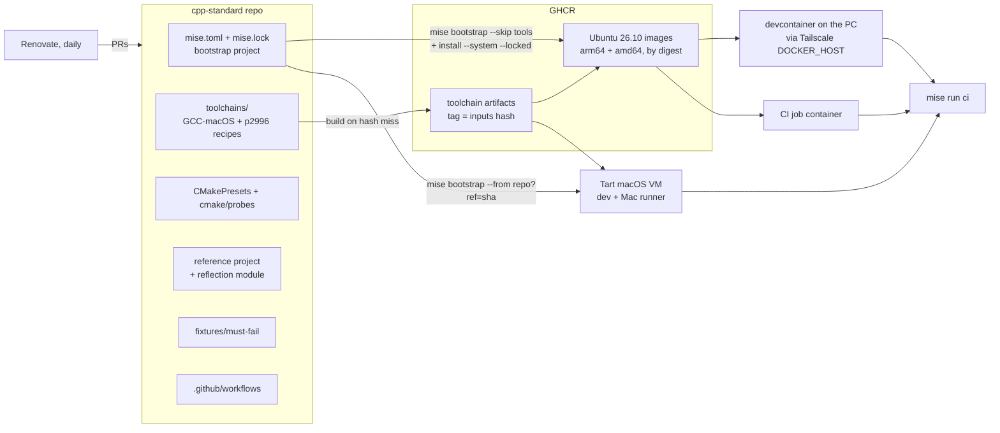
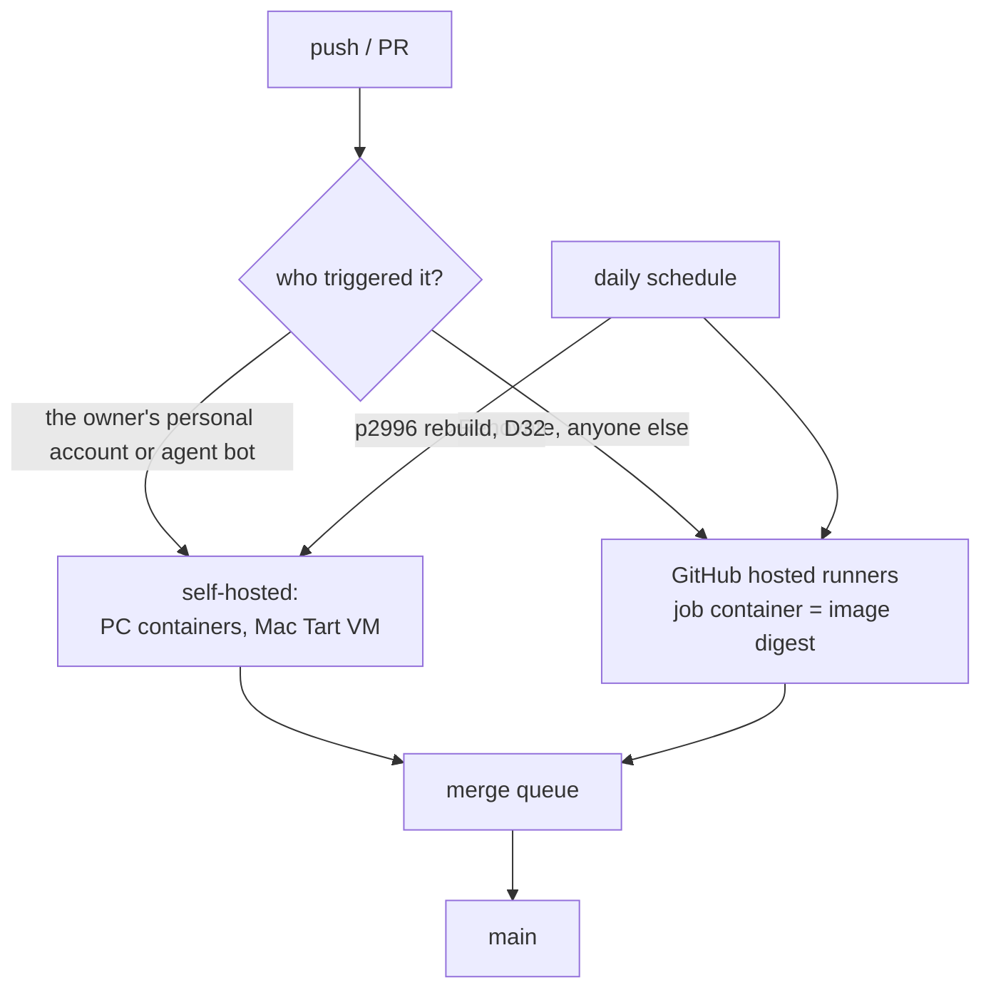

# cpp-standard: the C++ environment and project standard (Level 1)

*   **Author:** ray-manaloto
*   **Status:** Draft
*   **Date:** 2026-11-13

--------------------------------------------------------------------------------

## Overview

`ray-manaloto/cpp-standard` is a public repository in the free `ray-manaloto`
GitHub organisation. It holds:

1. **A written standard** for setting up a C++ project: compilers and their
   roles, standard libraries, build presets, dependencies, tests, coverage,
   sanitizers and analysis tools.
2. **A reference project.** It uses C++20 named modules and `import std`. It
   contains one small module written by the owner: an encoder for FIX-style
   tagged fields, generated with C++26 static reflection.
3. **A reflection canary.** It builds and tests pinned versions of upstream
   projects that use C++26 reflection: glaze, reflect-cpp, simdjson and
   rosetta.
4. **One mise bootstrap project** that builds the whole environment from one
   configuration: a Tart macOS VM, plus Ubuntu 26.10 arm64 and amd64 container
   images.
5. **One gate.** `mise run ci` gives the same result locally and in GitHub
   Actions.

Level 1 ends on 2026-11-27 (D21). The glaze FIX Orchestra project then starts
on top of this standard, in its own repository. Level 2, a separate
brainstorm, decides what glaze FIX implements.

Inputs: `concepts_brief.md`, decisions D1 to D41 in `decisions-log.md`, the
reports in `research/`, and `goldfish_brainstorm_report.md`.

Where this design differs from `concepts_brief.md`, this design wins. The
owner confirmed three such differences:
- the reference project includes the owner's reflection module (D22);
- updates are daily, with p2996 automated (D31, D32, D34);
- the implementing agent does the work, and asks the owner only for steps
  that need a person.

## The Problem

The owner wants to grow as a low-level C++ developer, focused on C++26 static
reflection for performance work. Over the past weeks, most of the time went to
side issues instead.

- **Setups were rebuilt over and over.** There were four separate
  implementations of build presets (the private prototype, glaze build-setup, cpp-core and the
  cpp-utilities catalogue).
- **The compiler source kept changing.** The compiler ruling flip-flopped
  between Homebrew, conda and apt.
- **Agent sessions collided.** Several agent sessions edited the same
  repositories and the shared dotfiles at once.
- **dotfiles grew too large.** It is now 66,000 lines, and only about a
  quarter of that is environment bootstrap.
- **Rules were never enforced.** Rulings such as "one lane at a time" were
  overtaken within days, because nothing enforced them.

The work stopped at the step that turns the FIX Orchestra XML into C++
structs for a C++26 glaze FIX serializer. It can't restart until the
environment underneath it stops moving.

The proposed fix is one place that defines and proves the environment, built
from one pinned configuration and isolated from the owner's other projects
and host setup. It must be checked by one command, finished by a fixed date,
and then used, not grown.

## Goals

*   **G1. One pinned environment from one configuration.** A single mise
    bootstrap project builds a Tart macOS VM and Ubuntu 26.10 arm64 and amd64
    images (D13, D25).
    - Every input is pinned by version, hash or digest.
    - Renovate proposes updates to those pins.
    - Measure: rebuilding from the same commit gives the same toolchain
      versions, and the only exception is the expiring apt.llvm.org builds
      (D12, provisional).
*   **G2. Three compilers, each with a written role** (D1, D3, D6, D25).
    - **LLVM/clang 23 with libc++** is the daily compiler and runs the
      sanitizer gate.
    - **GCC 16.2 with libstdc++** is the second gate. It runs Valgrind and
      also compiles reflection code.
    - **clang-p2996 with its own libc++** is the reflection reference
      compiler.
    - Code that uses reflection is not built with plain LLVM, because
      upstream clang 23 does not support P2996.
*   **G3. One gate, `mise run ci`, identical locally and in CI.**
    - **Tier 1 fails the build** (D19): build, ut tests, 100% line coverage
      measured separately for each compiler with its own tool (gcov or
      llvm-cov), ASan/UBSan/TSan, clang-format, clang-tidy on plain-clang
      targets, Valgrind on Linux GCC, hardening flags, and SARIF upload.
    - **Tier 2 runs and reports only.** A tier-2 tool moves to tier 1 once it
      runs cleanly.
    - **Negative controls:** the gate must also prove its own checks fail
      when they should. That means fixtures that must fail: an uncovered line,
      an ASan overflow, a TSan race and a format violation. This came from the
      Goldfish review and is provisional.
*   **G4. Reflection learning on real code.**
    - **The owner's module (D22):** a FIX-shaped encoder of about 100 lines.
      Tag numbers come from P3394 annotations. It builds on GCC 16 and
      clang-p2996, with 100% coverage, and seeds glaze FIX.
    - **The reflection canary (D20)** shows the compilers and libraries cope
      with real reflection code.
*   **G5. Isolation from everything else** (D4, D17, D18).
    - The C++ work and its agents run in the Tart VM and the images.
    - The host's global agent setup, dotfiles and the parked C++ projects are
      not dependencies.
    - D17 is provisional until the M0 spike reports. If agents can't work
      inside the VM, they stay on the host, and only builds and tests run in
      the VM and containers.
*   **G6. No collisions between agents** (D23). One worktree and branch per
    agent, and a GitHub merge queue into `main`.
*   **G7. Visible progress, finished on a date** (D14, D21).
    - Level 1 is a checklist of gate items. An item is ticked only by a green
      `mise run ci` on `main`.
    - A daily digest with no model calls shows the checklist and anything
      off-track.
    - On 2026-11-27, whatever tier-1 items are green form the standard.
      Unfinished items become dated tickets.
*   **G8. Enough CI capacity at no cost** (D16). The repository is public.
    - Heavy jobs run on self-hosted runners: the PC in containers, and the
      Mac in a Tart VM.
    - Those runners are fenced to the owner's pushes.
    - Hosted runners take over once things are stable.

## Non-Goals

*   **glaze FIX itself.** This covers the Orchestra XML-to-C++ generator and
    the serializer. Level 2 designs them. Level 1 only provides the owner's
    small encoder module as a seed.
*   **cpp-core.** It keeps running on free models and gets its own brainstorm
    later.
*   **The parked projects** (D4): the private prototype, cpp-utilities,
    cmake_template, modern_cpp_project_template, cpp-playground and
    hftuniversity. Pieces of them are copied in only when needed, with a link
    to the source.
*   **The glaze worktrees and spikes.** They move into the glaze FIX repo in
    Level 2.
*   **Cleaning up the host's agent setup, the existing rulings, and the rest of
    dotfiles** (D18). dotfiles' C++ parts retire, and nothing else changes in
    Level 1.
*   **A project-template generator** (the mise "cookiecutter"). It is a
    separate later project.
*   **Windows, and bare-metal performance numbers inside the VM.**
    Benchmarking and profiling on real hardware are covered by an open
    question below. No benchmark result from Level 1 counts as a performance
    claim.
*   **Upstream changes to mise or Renovate.** The three drafted posts stay
    unposted until the owner decides. Level 1 works around the gaps.

## Open Questions

Q1 to Q8 were settled while drafting the Technical Plan:
- **Q1. Mac GCC:** D26 and D33.
- **Q2. Linux LLVM:** D27.
- **Q3. Runner fence:** D28.
- **Q4. Agents in the VM:** D29, which still depends on M0.
- **Q5. p2996:** D30 and D32.
- **Q6. Renovate:** D31 and D34.
- **Q7. Performance numbers:** D35.
- **Q8. Ubuntu upgrades:** D36.

These remain open:

*   **Q9. Before going public.**
    - Scrub local paths, session ids and internal tool names from
      `docs/designs/level-1/`.
    - rosetta lists no licence, so it is built for testing and not
      redistributed.
    - Check the FIX Orchestra licence before glaze FIX goes public.
*   **Q10. The mise and Renovate upstream posts.** The three drafts are ready
    and verified on 26.10. When, if at all, to post them is the owner's call.
*   **Q11. Probe results in the digest (suggested, D39).** Should the daily
    digest show a change in any compiler's capability report?
*   **Q12. Licence.** cpp-standard needs a `LICENSE` before it goes public.
    The choice is the owner's.

## Critical User Journeys (CUJs)

### CUJ 1: Fresh Mac to a green gate

*   **Given**: An Apple Silicon Mac with only Tart, Docker and git installed,
    and the cpp-standard repository URL.
*   **When**: The owner clones the pinned Tart macOS image and runs the
    pinned mise installer and `mise bootstrap --from <repo>?ref=<sha>` inside
    the VM. They then run `mise run ci`.
*   **Then**: The VM gets the macOS toolchain (the LLVM release tarball, and the
    GCC 16.2 and clang-p2996 artifacts from GHCR) plus the mise tools from
    `mise.lock`. Every tier-1 check runs for
    the macOS compiler set and passes. No file outside the VM changes.

### CUJ 2: The Linux image, locally and in CI

*   **Given**: A commit on any branch of cpp-standard.
*   **When**: The image workflow builds `ubuntu:26.10@sha256` plus `mise
    bootstrap --skip tools` plus `mise install --system --locked` for arm64
    and amd64, and publishes the result to GHCR by digest.
*   **Then**: The same digest is used as the devcontainer image and as the
    CI job `container:`. A non-root user can run every tool. `mise run ci`
    gives the same result in the devcontainer and in GitHub Actions.

### CUJ 3: The owner writes reflection code

*   **Given**: The devcontainer, or the VM, and the reference project.
*   **When**: The owner edits the reflection encoder module and runs `mise run
    ci`.
*   **Then**: The module builds with GCC 16 `-freflection` and with
    clang-p2996. It is not built with plain LLVM. Its ut tests pass. Each
    compiler's own coverage tool reports 100%, and the sanitizers pass.

### CUJ 4: A dependency update arrives

*   **Given**: Renovate finds new versions of pinned inputs: mise tools, apt
    packages, image digests, GitHub Actions or the p2996 commit.
*   **When**: Renovate opens its daily PRs (D31).
*   **Then**: CI runs on hosted runners (D28). A leaf bump merges itself if
    green; a compiler bump waits for the owner (D34). If red, it lands in the daily digest and nothing
    merges.

### CUJ 5: Two agents work at once

*   **Given**: Two agents, each on its own branch and worktree.
*   **When**: Both finish and ask to merge.
*   **Then**: The merge queue tests each one on top of `main` in turn. Neither
    can break `main`. The daily digest flags any agent count over the cap.

### CUJ 6: Daily review

*   **Given**: The scheduled digest workflow, at the configured cadence
    (daily by default).
*   **When**: It runs `mise run review:digest`.
*   **Then**: The owner gets the gate checklist, with each item open or
    closed. They also get merged commits, red runs, waiting Renovate PRs and
    tier-2 reports, all with no model calls. `/egm-drift-report` runs only if
    code under a design doc changed.

--------------------------------------------------------------------------------

## Technical Plan (Architecture)

This section describes how the pieces fit together. Decisions D26 to D39 were
made while drafting it; they are in `decisions-log.md`. The file-by-file list
is in Detailed Implementation.

### Weak points first

These parts of the plan are not proven yet. Each has a check or a fallback.

1. **Agents inside the Tart VM (D17) depend on M0.** If M0 fails, agents run
   on the host. Builds and tests still run in the VM and the containers.
2. **Mac GCC depends on a patch that is not upstream.** Upstream GCC has no
   aarch64-darwin port. The Mac build uses Iain Sandoe's Darwin patch, the
   same one Homebrew uses (D33). If a new macOS SDK breaks the patch, Mac GCC
   stays on its last good build until the patch catches up.
3. **Mac GCC has no TSan or LSan.** libsanitizer turns both off for
   `aarch64-*-darwin2*`. On the Mac, TSan runs only on clang.
4. **"Probe and adapt" (D39) can switch a check off without anyone
   noticing.** Two things guard against this. The must-fail fixtures (D37)
   turn the gate red when a check stops reporting. Compiler bumps also need
   the owner's review (D34).
5. **clang-p2996 sanitizer and coverage runtimes are untested.** M0 (c)
   builds p2996 with compiler-rt. Until that passes, p2996 builds and runs
   tests but has no sanitizer or coverage gate.
6. **The Mac LLVM tarball has not been tried in the VM** (D38). M0 checks
   that its libc++ and compiler-rt work with the VM's SDK.
7. **Performance counters may not reach the VM** (D35). Only the PC on bare
   metal gives hardware-counter and timing numbers that count.

### Architecture at a glance



There is one configuration, `mise.toml`, and its lock file. It produces three
environments. Toolchains that no package source can pin are built once per
inputs hash and stored in GHCR. All three environments run the same
`mise run ci`.

### 1. Compilers: one table

This table answers Goldfish blocker 6: which compiler runs where, and for
what.

| | macOS VM (arm64) | Ubuntu 26.10 arm64 | Ubuntu 26.10 amd64 |
|---|---|---|---|
| **LLVM/clang 23 + libc++** | LLVM release tarball via mise `github:` (D38) | apt.llvm.org `resolute-23`, exact pins (D27) | same |
| **GCC 16.2.0 + libstdc++** | source build, Homebrew recipe + Darwin patch (D33) | Ubuntu archive `g++-16` (D25) | same |
| **clang-p2996 + libc++** | source build (D30) | source build with compiler-rt (D32) | same |

Checks for each compiler and kind of project:

| Check | clang 23 | GCC 16.2 | clang-p2996 |
|---|---|---|---|
| Builds reflection code | no (no P2996 upstream) | yes, `-freflection` | yes, `-freflection-latest` |
| Builds non-reflection code | yes | yes | yes |
| Coverage tool | llvm-cov | gcov | llvm-cov (after M0 c) |
| ASan + UBSan | yes | yes | after M0 c |
| TSan | yes | Linux only | after M0 c |
| Valgrind | no | Linux only | no |
| clang-tidy | non-reflection targets | no | no |

The configure-time probes (D39) fill in the actual "yes" and "no" values for
each environment. The table records what we expect. When a probe disagrees
with the table, a fixture shows it (D37).

### 2. Toolchains we build: inputs hash, cache, triggers

Two toolchains have no package source that can be pinned: GCC on macOS and
clang-p2996 on all three platforms. cpp-standard builds both. We reuse the
inputs-hash pattern from dotfiles-legacy `p2996_hash.py` and the private
prototype's toolchain check.

1. **Inputs file.** Each toolchain has a recipe directory. It holds the build
   script and an inputs file that lists every pinned input.
   - **GCC on macOS:** the GCC tarball and its sha256; the Darwin patch;
     gmp, mpfr, mpc and isl (built in-tree from checksummed tarballs); make;
     the Command Line Tools version; the SDK; the Tart base image digest; the
     configure arguments; the architecture.
   - **clang-p2996:** the commit SHA; the builder image digest (Linux) or the
     Tart image digest plus Command Line Tools (macOS); the CMake cache
     arguments, including the compiler-rt runtimes; the architecture.
2. **Hash.** A mise task hashes the recipe and the inputs file into one
   string. The artifact's GHCR tag is
   `toolchain-<name>-<os>-<arch>-<hash>`.
3. **Cache check.** If that tag already exists, the build is skipped and the
   artifact is pulled. If it doesn't exist, the toolchain is built once,
   smoke-tested, pushed with its sha256, and recorded in a lock file in the
   repo that the environments read.
4. **Triggers.** All three triggers below share the cache, so a commit is
   never built twice.
   - Renovate checks daily and opens a PR only when an input changed.
   - p2996 also has a daily scheduled rebuild on the PC (D32).
   - `workflow_dispatch` builds on demand.
5. **Where each build runs.**
   - Linux amd64 builds run on the PC.
   - Linux arm64 builds run on hosted arm64 runners.
   - macOS builds run on the self-hosted Mac runner in the Tart VM, because
     the OS and SDK are inputs and hosted macOS runners don't match them.
     Every macOS toolchain bump needs the owner's approval (D34), so that
     approval is what lets the job reach a self-hosted runner.

### 3. The bootstrap project and the three environments

`mise.toml` is the bootstrap project (D13). Its sections:

- **`[tools]`** lists cmake 4.5, ninja, sccache 0.19, vcpkg, the tier-1 and
  tier-2 tools, and LLVM on macOS. All of them are locked in `mise.lock`,
  which is committed with mode 644.
- **`[bootstrap.apt.sources.llvm]`** lists apt.llvm.org `resolute-23` with
  its key fingerprint.
- **`[bootstrap.packages]`** lists the exact apt pins: `clang-23`,
  `libc++-23-dev`, `g++-16`, valgrind and the rest. Each has
  `os = "linux"`. The few macOS-only packages have `os = "macos"`.
- **`[tasks]`** holds `ci`, `toolchain:*`, `image:*`, `vm:*` and `review:*`.

**The Linux image.** The image build follows the four steps below, in a
Dockerfile of about ten lines with no logic of its own. There is no
`mise oci build` (D13).
1. Start from `ubuntu:26.10@sha256:…`.
2. Install the pinned mise.
3. Run `mise bootstrap --skip tools --yes`.
4. Run `mise install --system --locked && mise reshim --system`, then copy in
   the GHCR toolchain artifacts.

The workflow builds this for arm64 and amd64 and pushes it to GHCR. Workflows
and the devcontainer refer to it only by digest. GHCR retention keeps every
digest that `main` has referenced (D27).

**The macOS VM.** The VM is built and used in four steps.
1. Clone `macos-golden-gate-vanilla` by digest.
2. Inside the VM, install the pinned mise and run
   `mise bootstrap --from <repo>?ref=<sha>`.
3. Pull the toolchain artifacts: GCC, p2996 and the LLVM tarball through
   mise.
4. Use one clone for development and one for the CI runner. Apple allows
   two VMs.

**Linux containers from inside the VM (D29).** A macOS guest can't run
Docker. The VM's mise tasks set `DOCKER_HOST=ssh://<pc>` over Tailscale and
run the Linux images on the PC. The Mac host stays untouched (D18).

### 4. Build configuration

- **Presets (D8).** The presets are hand-written in layers, one layer each
  for compiler, standard library, configuration and checks.
  - They use preset schema 13 and `${configurePresetName}` binary
    directories.
  - All targets in a build tree share the same flags, because of CMake bug
    #28242.
  - Reflection targets get only the GCC and p2996 presets.
- **Probes (D39).** `cmake/probes.cmake` starts from cpp-utilities
  `ProfileCheck.cmake`, with a link back to it. It runs at configure time:
  - `CMAKE_CXX_COMPILER_IMPORT_STD` and the modules JSON check whether
    `import std` works.
  - `try_compile` with `SOURCES_TYPE CXX_MODULE` tests named modules.
  - `check_source_compiles` and `check_source_runs` try a P2996 snippet: a
    reflection operator, `members_of`, and a P3394 annotation.
  - `check_compiler_flag` and `check_linker_flag` test each sanitizer,
    coverage and hardening flag.
  - `check_ipo_supported` and `check_pie_supported` check IPO and PIE.

  Each result switches on its feature, and all results are printed as one
  capability report.
- **Dependencies (D7).** vcpkg runs in manifest mode with one triplet per
  compiler and standard library, and a pinned baseline.
- **Cache (D9).** sccache caches clang builds, including module builds. GCC
  module compiles are not cached.

### 5. The gate: `mise run ci`

`mise run ci` runs the same steps everywhere:
1. configure, with the probes;
2. build;
3. run the ut tests;
4. run coverage with each compiler's own tool, which must report 100% line
   coverage of the owned code;
5. run the sanitizer presets;
6. run Valgrind (Linux GCC only);
7. run clang-format and clang-tidy;
8. run the hardening check;
9. upload SARIF.

These steps are tier 1 and they fail the build. Tier-2 tools only produce a
report (D19).

**Negative controls (D37).** The gate builds `fixtures/must-fail/`
separately and expects each fixture to fail its own check. There is one
fixture for each tier-1 check:
- uncovered line (once for each coverage tool);
- ASan overflow;
- UBSan signed overflow;
- TSan race;
- Valgrind leak;
- format violation;
- tidy finding;
- missing hardening flag.

If any fixture passes, the gate is red. The fixtures run in the daily build,
and on every PR that bumps a compiler or changes gate config.

**The reflection canary (D20)** is not part of `mise run ci`. It runs as its
own daily report-only workflow on hosted runners (D28). It builds glaze,
reflect-cpp, simdjson and rosetta at pinned commits on GCC 16 and p2996.
Known upstream failures are kept on an allow-list.

### 6. CI topology and the runner fence (D16, D28)



- **Agents push as a separate bot identity.** A ruleset and CODEOWNERS
  require the owner's review on `.github/**`, the `mise.toml` tasks, the
  image and toolchain recipes, and the probe and preset files.
- **Self-hosted runners are single-use and hold no secrets.**
- **Renovate PRs and the canary run only on hosted runners.**
- **The daily p2996 rebuild needs one condition.** Its scheduled job runs as
  whoever last edited the cron, so the fence holds only while that is the
  owner.
- **Every merge goes through the merge queue (D23).**

### 7. Updates

- **Daily Renovate (D31).**
  - Built-in managers cover mise tools, Actions SHAs, Docker digests and the
    vcpkg baseline.
  - Custom regex managers cover the `[bootstrap.packages]` apt pins (the
    `deb` datasource), the p2996 and canary git refs, the GCC tarball and
    Darwin patch, and the `ubuntu:YY.MM` tag.
- **Merge rule (D34).** Leaf bumps merge themselves when the queue is green.
  Compiler bumps and changes to gate config wait for the owner.
- **Base upgrades (D36).** A new Ubuntu or Tart base is built next to the
  current one, and the owner approves the switch. The old base is kept 30
  days.

### 8. Performance metrics (D35)

| Metric | Where it counts | Comparable across environments |
|---|---|---|
| Instruction counts (Valgrind callgrind and cachegrind) | Linux images | yes, deterministic |
| llvm-mca reports | anywhere | yes, static |
| Generated assembly diffs | anywhere | yes, static |
| perf hardware counters, wall-clock time | PC on bare metal | no; VM and container timings are marked "virtualized" |
| xctrace, samply | macOS VM | no, VM only; M0 checks whether counters reach the guest |

### 9. Agents, collisions and the daily digest

- **Isolation.** Each agent works in its own worktree and branch (D23), and
  the merge queue serializes merges into `main`.
- **Daily digest.** `mise run review:digest` runs on a schedule and calls
  no model. It reports:
  - the gate checklist;
  - merged commits;
  - red runs;
  - Renovate PRs waiting for the owner;
  - tier-2 reports;
  - the agent count from `review:cap`.
- **Drift reports.** `/egm-drift-report` runs only when code under a design
  document changed (D14).

### 10. Order of work

The milestones are M0 to M5 from the brief. The M0 spike (D24) now also
covers three new checks:
- whether the LLVM tarball works with the VM's SDK (D38);
- whether PMU counters reach the guest (D35);
- a first Mac GCC source build (D33).

Every gate item has to be green on `main` by 2026-11-27 (D21) to count
toward the standard.

## Alternatives Considered

### From the brainstorm (concepts_brief.md)

*   **One compiler for Level 1, or all three everywhere.** Rejected by
    author. Each compiler gets a fixed role instead (D1), because a single
    compiler can't cover reflection, libstdc++ and sanitizers together.
*   **conda-forge GCC on macOS.** Rejected by author. It is built against
    libc++, which miscompiles `std::string` and `std::println` (found in the private
    prototype; ctng-compilers patch 0002).
*   **One coverage tool for every compiler.** Rejected by author. gcov and
    llvm-cov read different instrumentation, so each compiler uses its own
    tool (D3).
*   **Merging the old setup repos into cpp-standard, or keeping the private prototype
    active.** Rejected by author. They are parked, and pieces are copied in
    with a link when needed (D4).
*   **cpp-standard as documentation only, or the standard kept in dotfiles.**
    Rejected by author. Documentation alone doesn't prove the standard works,
    and dotfiles is being cut down (D5, D18).
*   **A preset generator** (Pkl, or the cpp-utilities catalogue). Rejected by
    author. Four generator attempts came first; hand-written layered presets
    are simpler to read and review (D8).
*   **ccache.** Rejected by author. It doesn't support C++20 named modules
    (ccache manual; PR #1523 is still a draft).
*   **`mise oci build`.** Rejected by author. It ignores
    `[bootstrap.apt.sources]`, and the build fails with
    `E: Unable to locate package clang-23` (`src/oci/builder.rs:365`).
*   **A plain Dockerfile pipeline outside mise.** Rejected by author. The
    one-configuration goal needs a mise bootstrap project (D13). The ten-line
    Dockerfile only calls mise.
*   **A private repository on hosted runners only.** Rejected by author. The
    Free plan gives 2,000 minutes a month, which a p2996 build alone uses up
    (D16).
*   **Host-native development.** Rejected by author in favour of isolation
    in a VM (D17). The M0 spike decides whether agents can also run there.
*   **Forking mise.** Rejected by author. mise takes no outside PRs, so
    requests go to Discussions, drafted but not posted.
*   **Every tool gating CI, or only four checks gating.** Rejected by
    author. There are two tiers, and a tool moves up when it runs clean
    (D19).

### From drafting the Technical Plan

*   **GCC on Linux only.** Rejected by author (D26). GCC 16.2 is needed in
    all three environments, so reflection and libstdc++ code is tested on
    macOS too.
*   **Homebrew GCC in the VM, with the VM image digest as the record.**
    Rejected by author (D33). Homebrew installs only its current gcc. The
    pin would then live in a VM image of 30 GB or more, rebuilt whenever
    Homebrew moves on.
*   **Installing a Homebrew gcc bottle by URL and checksum.** Rejected by
    author (D33). Bottles disappear when Homebrew moves on, and installing
    them this way is outside Homebrew's supported path.
*   **Homebrew LLVM on macOS.** Rejected by author (D38). It has the same
    problem as Homebrew GCC: it can't be pinned on a fresh VM.
*   **LLVM release tarballs on Linux as well.** Rejected by author (D38). It
    would reopen D27, and apt.llvm.org supplies separate libc++ packages and
    debug symbols.
*   **A weekly Renovate batch, or one PR per dependency.** Rejected by
    author (D31). Weekly lets expired apt pins break image rebuilds for days.
    One PR per dependency means dozens of PRs a week.
*   **Weekly p2996 updates.** Rejected by author (D32). Daily checks with a
    cache keyed by SHA cost little more and deliver reflection fixes sooner.
*   **Automerge everything green, or review everything.** Rejected by author
    (D34). Automerging compiler bumps lets a weakened check merge unseen.
    Reviewing every PR brings back the churn Level 1 is meant to end.
*   **Fail-closed probes against an expected-capability table, or probes
    that only report.** Rejected by author (D39) in favour of probe and
    adapt. The table needs updating at every legitimate capability change,
    and a report-only probe enforces nothing. The D37 fixtures cover the
    risk.
*   **An in-place or manual Ubuntu base bump.** Rejected by author (D36). An
    in-place bump that goes red blocks every daily image update. A manual
    bump is easy to forget.
*   **Only the four negative controls from the review, or running them on
    every PR.** Rejected by author (D37). Four fixtures leave clang-tidy,
    Valgrind, UBSan and hardening unguarded. Running them on every PR costs
    minutes on PRs that can't break a check.
*   **Agents pushing as the owner's personal account.** Rejected by author (D28). The fence
    then can't tell agent pushes from the owner's.
*   **Agents pushing through the existing org-admin App.** Rejected by
    author (D40). Its org-admin, secrets and members write would let one
    misled agent rewrite the rulesets that form the fence.

## Detailed Implementation

All paths are relative to the repository root. The list is grouped by
milestone, so each group can land as its own PR through the merge queue. No
file contains code in this document; schemas and pseudocode are shown where
they settle a decision.

### GitHub and host setup (before M1)

The implementing agent does this through `gh` / `gh api` and mise tasks. The
owner is asked only for steps that need a person: 2FA, a browser
confirmation, or hardware.

1. **The agent App** (D40) uses GitHub's App-manifest flow.
   - `.mise/tasks/repo/agent-app` writes the manifest: contents and
     pull_requests write, installed on cpp-standard only.
   - It opens the org's "create from manifest" page. **The owner confirms
     once in the browser** (GitHub requires that, and 2FA).
   - The task exchanges the returned code through
     `gh api -X POST /app-manifests/{code}/conversions`.
   - It pipes the private key straight into `mise run secret:set
     CPP_STANDARD_AGENT_APP_KEY`, so the key is never printed.
   - It installs the App on cpp-standard.
2. **Runners via the PC runner App** (D40). The runner tasks request
   short-lived registration tokens through `gh api`, with the labels
   `self-hosted, pc, linux, x64` and `self-hosted, mac, macos, arm64`.
3. **Repository settings, through `gh`:**
   - visibility public once Q9's scrub is done
     (`gh repo edit --visibility public`);
   - the merge queue and the rulesets (`mise run repo:rulesets`);
   - GHCR cleanup, through a scheduled workflow that keeps every digest
     `main` referenced, because GHCR has no retention API.
4. **Tart on the Mac.** The implementing agent installs it with `brew` and
   pulls `macos-golden-gate-vanilla:27.2` by digest (M0 a). The owner is
   needed only if macOS asks for a permission prompt.

### M0: spike files (throwaway branch, results go into M1)

| File | What and why |
|---|---|
| `spikes/m0/README.md` | One pass/fail line for each M0 check: agents in the VM (D17), gcov on GCC named modules, p2996 with compiler-rt, LLVM tarball with the VM's SDK (D38), PMU counters in the guest (D35), and the first Mac GCC build (D33). Each line links to its log. The spike code is deleted after M0. Only this README is kept, as the record. |

### M1: the bootstrap project, the arm64 image, the gate and the owned module

| File | What and why |
|---|---|
| `README.md` | What cpp-standard is (the Overview in five lines), CUJ 1 and CUJ 2 as copy-paste steps, and links to `docs/standard/`. |
| `AGENTS.md` | A `## Workflow facts` section for the owner's workflow: the build, test and lint commands (`mise run ci`, `mise run ci:fast`), one worktree per agent (D23), the agent App identity (D40), and "never edit `.github/**`, `toolchains/**` or `cmake/probes.cmake` without the owner". |
| `LICENSE` | The repository's licence, chosen by the owner (open question Q12). It must exist before the repository goes public. |
| `mise.toml` | The bootstrap project (D13). Its sections are listed below. |
| `mise.lock` | The output of `mise lock` for the macOS, linux-x64 and linux-arm64 platforms. It is committed with mode 644. |
| `toolchains/lock.toml` | One entry for each built toolchain artifact: name, os, arch, inputs hash, GHCR reference with digest, and sha256. The image build and the VM bootstrap read only this file to fetch toolchains. |
| `.mise/tasks/toolchain/hash` | Hashes a recipe directory (its build script plus `inputs.toml`) in sorted order with field separators, as `p2996_hash.py` does, and prints the hash. |
| `.mise/tasks/toolchain/ensure` | Takes a toolchain name and platform. If the GHCR tag `toolchain-<name>-<os>-<arch>-<hash>` exists, it pulls it. Otherwise it builds, smoke-tests, pushes, and updates `toolchains/lock.toml`. |
| `toolchains/p2996/inputs.toml` | The p2996 commit (`562409c7`), the builder image digest (Linux) or the Tart base digest and CLT version (macOS), the CMake cache arguments with `LLVM_ENABLE_RUNTIMES` including compiler-rt, libcxx, libcxxabi and libunwind, and the architectures. Renovate bumps the commit (D32). |
| `toolchains/p2996/build.sh` | The build steps from `research/p2996-linux.md`, plus compiler-rt. The macOS recipe comes from dotfiles (D30), with a link to its source. The smoke test compiles a P2996 `members_of` program, plus ASan and coverage on it. |
| `toolchains/gcc-macos/inputs.toml` | The values listed under D33: the GCC tarball URL and sha256, the Darwin patch URL and sha256, and the gmp, mpfr, mpc and isl tarballs with their sha256 values (built in-tree), plus the make version, CLT version, SDK version, Tart base digest, configure arguments and architecture. |
| `toolchains/gcc-macos/build.sh` | The configure and build steps of Homebrew's `gcc.rb`, without Homebrew, and with a link to the formula revision they came from. It runs a three-stage bootstrap. The smoke test builds a C++26 `-freflection` program and an ASan program. |
| `toolchains/gcc-macos/README.md` | Why this exists: upstream GCC has no aarch64-darwin port, so the build depends on the iains patch, and libsanitizer has no TSan or LSan on aarch64 Darwin. It also says what to do when a new SDK breaks the patch (stay on the last good artifact). |
| `image/Dockerfile` | About ten lines. `FROM ubuntu:26.10@sha256:…`, install the pinned mise, copy in `mise.toml`, `mise.lock` and `toolchains/lock.toml`, run `mise bootstrap --skip tools --yes`, run `mise install --system --locked`, run `mise reshim --system`, run `mise run toolchain:fetch`, and create a non-root user. There is no other logic, so the image is defined by mise (D13). |
| `.devcontainer/devcontainer.json` | Uses the image by digest. Runs as the non-root user. Mounts an sccache volume. The `postCreate` step is `mise run doctor`. |
| `CMakeLists.txt` | The root project. It requires CMake 4.5, includes `cmake/probes.cmake`, and adds `src/`, `tests/` and `fixtures/must-fail/` (the fixtures only when `CPPSTD_MUST_FAIL=ON`). |
| `CMakePresets.json` | Schema 13. It only includes the layered files below. |
| `cmake/presets/base.json` | Generator Ninja, `binaryDir` set to `build/${configurePresetName}`, the vcpkg toolchain file, and the sccache launcher for clang presets only. |
| `cmake/presets/compilers.json` | Hidden presets `clang23`, `gcc16` and `p2996`. Each sets the compiler paths, its standard library and its vcpkg triplet. |
| `cmake/presets/checks.json` | Hidden presets `coverage`, `asan-ubsan`, `tsan`, `valgrind` and `hardening`. Each sets flags that are the same for every target, because of CMake bug #28242. |
| `cmake/presets/matrix.json` | The visible presets, one per allowed pair from the Technical Plan §1 tables (for example `gcc16-asan-ubsan`). Reflection targets are switched off in `clang23-*` presets through a cache variable. |
| `cmake/probes.cmake` | Taken from cpp-utilities `catalogue/cmake/ProfileCheck.cmake` (D4; the link is in the file header) and changed from fail-closed to probe and adapt (D39). It probes `import std`, a module `try_compile`, a P2996 snippet, a P3394 annotation snippet, each sanitizer and coverage flag at both compile and link, the hardening flags, IPO and PIE. It sets one `CPPSTD_HAS_<X>` cache variable per probe and writes `build/<preset>/capabilities.json`. |
| `vcpkg.json`, `vcpkg-configuration.json` | Manifest mode with the pinned baseline (D7). The first dependency is `bext-ut` for tests. |
| `triplets/*.cmake` | One triplet for each compiler and standard library pair, so vcpkg ports are built with the same compiler and standard library as the project (D6, D7). |
| `.clang-format`, `.clang-tidy` | The tier-1 lint configuration. clang-tidy checks only targets the plain-clang preset can build. |
| `src/cppstd/core.cppm` | A small named module that uses `import std`. It proves modules and coverage work on all three compilers. |
| `src/fix/encoder.cppm` | The owned reflection module (D22), about 100 lines. It encodes a struct whose fields carry P3394 tag annotations into FIX `tag=value<SOH>` text, using P2996 reflection. It is built only in the GCC and p2996 presets. |
| `tests/core_test.cpp`, `tests/fix_encoder_test.cpp` | ut tests. These are the code that the 100% line-coverage rule measures. |
| `fixtures/must-fail/CMakeLists.txt` + one directory per fixture | The D37 fixtures. `fixtures/must-fail/expected.toml` maps each fixture to the check that must fail and the presets it applies to. The TSan fixture is skipped where `CPPSTD_HAS_TSAN` is off, and that skip is printed. |
| `.mise/tasks/ci` | The gate. For each preset available on this OS it runs configure, build, test, coverage, sanitizers, Valgrind (Linux GCC), format, tidy and hardening, then writes SARIF. It exits non-zero on any tier-1 failure. `ci:fast` runs one preset for the inner loop. |
| `.mise/tasks/ci-must-fail` | Builds the fixtures, runs each one's check, and fails if any check passes. It is called by the daily workflow, and by PRs that touch a compiler or gate config (D37). |
| `.mise/tasks/doctor` | Prints the versions of every tool and compiler and the capability files, so you can see what an environment has. |
| `.github/workflows/ci.yml` | Triggers: `pull_request`, `merge_group` and `push` to main. The job container is the image by digest. Owner and agent-App pushes go to self-hosted labels; everything else goes to hosted runners (D28). It runs `mise run ci`. |
| `.github/workflows/image.yml` | Builds `image/Dockerfile` for arm64 (amd64 comes in M2), pushes to GHCR, and opens a PR that updates the image digest everywhere it is referenced. |
| `.github/workflows/toolchain.yml` | Triggers: `workflow_dispatch` with inputs for name, os and arch; a daily schedule for p2996 on the PC (D32); and PRs that touch `toolchains/**`. It runs `mise run toolchain:ensure`. |
| `.github/CODEOWNERS` | Assigns the owner to `.github/**`, `mise.toml`, `toolchains/**`, `image/**`, `cmake/probes.cmake`, `cmake/presets/**`, `fixtures/**` and `renovate.json5` (D28, D34). |
| `.github/rulesets/main.json` | The ruleset for `main`: merge queue required, CODEOWNERS review required, and no force-push. It is applied with `mise run repo:rulesets`, which calls `gh api`, so the ruleset is versioned in the repo. |
| `.mise/tasks/repo/rulesets` | Applies `.github/rulesets/*.json` and shows the difference from the live ruleset. |
| `docs/standard/compilers.md` | The two Technical Plan §1 tables and each compiler's role (D1, D3, D6, D26, D33, D38). |
| `docs/standard/build.md` | Presets, probes, vcpkg triplets and sccache (D7, D8, D9, D39). |
| `docs/standard/checks.md` | Tier 1 and tier 2 (D19), the coverage rule, and the must-fail fixtures (D37). |
| `mise.toml` `[tools]` (agent tooling, D41) | jouet and the jdx tools the project uses: hk, fnox, usage and pitchfork. Each is pinned in `mise.lock`, so the VM and the images get them without the host's global setup. |
| `.jouet/project.toml` | Written by `/jouet-init` once `mise run ci` exists. It holds the full, focused and affected check commands, which map to `ci`, `ci:fast` and the preset for the files that changed. |
| `.claude/skills/*`, `.agents/skills/*` | Project skills, kept only when the project uses them: building and running the gate, the toolchain tasks, and the EGM steps. Each skill is copied from dotfiles with a link back to its source, and with nothing host-specific in it. |
| `.mcp.json` | The project's MCP servers: codebase-memory (indexed on the repo) and Context7 (library docs). Keys come in through fnox placeholders and are never stored in the file. |
| `fnox.toml` | The project's secret references (agent App key, research API keys), in placeholder form for the fnox proxy. It holds no values. |
| `.claude/settings.json` | Project permissions and hooks (jouet's hooks). **No plugin entries until the owner approves each plugin** (D41). |

### `mise.toml` sections (M1)

```toml
[tools]                 # cmake 4.5.0, ninja, sccache 0.19.0, vcpkg, hk,
                        # clang-format/tidy come from the LLVM install,
                        # tier-2 tools (cppcheck, mrdocs, clang-uml, …) as available
"github:llvm/llvm-project" = { version = "23.1.5", os = ["macos"] }   # D38

[bootstrap.apt.sources.llvm]   # uris, suites = "resolute-23", components, key, fingerprint
[bootstrap.packages]           # "apt:clang-23" = "<exact>", "apt:libc++-23-dev" = "<exact>",
                               # "apt:g++-16" = "16.2.0-3ubuntu1", "apt:valgrind" = "<exact>", … (os = "linux")

[tasks]                 # ci, ci:fast, ci-must-fail, doctor, toolchain:*, image:*, vm:*,
                        # perf:*, review:*, repo:*, agent:token
```

### M2: amd64 and lint

| File | What and why |
|---|---|
| `.github/workflows/image.yml` | Adds amd64. |
| `hk.pkl` | Local hooks that run the same tier-1 format and lint steps as CI, using the hk tool from jdx (mise first). |
| `renovate.json5` | Daily schedule (D31). packageRules: automerge for leaf groups, and owner review for the compiler groups: LLVM apt, the GCC tarball and patch, p2996, and the LLVM tarball (D34). Custom regex managers cover `[bootstrap.packages]` apt pins (`deb` datasource, following the dotfiles-legacy pattern), `toolchains/*/inputs.toml` git refs and tarballs, the `ubuntu:YY.MM` base tag (D36), and canary refs. |
| `.github/workflows/must-fail.yml` | Daily, and on PRs labelled by Renovate as compiler bumps. It runs `mise run ci-must-fail`. |

### M3: the Mac Tart runner and the dev VM

| File | What and why |
|---|---|
| `vm/inputs.toml` | The Tart base image and its digest, the CPU, memory and disk sizes, and the names of the dev and runner clones. |
| `.mise/tasks/vm/create` | Clones the base image by digest, boots it, installs the pinned mise inside, and runs `mise bootstrap --from <repo>?ref=<sha>`, then `toolchain:fetch`. |
| `.mise/tasks/vm/runner` | Creates an ephemeral runner VM. It registers it with a short-lived token from the PC runner App (D40), runs one job, and deletes the VM. |
| `.mise/tasks/docker/pc` | Sets `DOCKER_HOST=ssh://<pc>` over Tailscale (D29) and runs a command in the image on the PC. |
| `.mise/tasks/agent/token` | Mints a one-hour installation token for the agent App (D40) through fnox's proxy. The key is never printed. |
| `docs/runbooks/mac-runner.md`, `docs/runbooks/pc-runner.md`, `docs/runbooks/tailscale-docker.md` | Host setup that can't live in the repo: Tart install, runner groups, the Tailscale ACL for ssh to the PC, and `perf_event_paranoid` on the PC. |
| `toolchains/lock.toml` | Gains the macOS GCC, macOS p2996 and macOS LLVM entries. |

### M4: p2996 everywhere and the canary

| File | What and why |
|---|---|
| `canary/projects.toml` | glaze, reflect-cpp, simdjson and rosetta: the repository, the pinned commit, the test target, the compilers to use, and an allow-list of known failures with a link to the upstream issue for each. rosetta is marked "build only, do not redistribute" (Q9). |
| `.mise/tasks/canary` | Clones each project at its pin, builds it from source with the cpp-standard presets, runs its tests, and writes a report. It never fails the gate. |
| `.github/workflows/canary.yml` | Daily and report-only, on hosted runners only (D28). |

### M5: tier-2 tools, performance and the digest

| File | What and why |
|---|---|
| `.mise/tasks/perf/instructions` | Runs callgrind and cachegrind on a named test binary (Linux) and writes instruction counts. |
| `.mise/tasks/perf/mca` | Runs llvm-mca on a named function's assembly. |
| `.mise/tasks/perf/asm` | Writes the generated assembly for a named target for each compiler, so changes can be diffed. |
| `.mise/tasks/perf/counters` | Runs perf stat or record on the PC in a privileged container, or xctrace and samply in the VM. It marks VM results "virtualized" (D35). |
| `.mise/tasks/review/digest` | Calls no model. It reads the Actions runs, merged commits, Renovate PRs that need the owner, tier-2 reports and the gate checklist from GitHub, and writes one Markdown digest. |
| `.mise/tasks/review/cap` | Counts local agent sessions and flags any count over the cap (D23). It runs from the VM's schedule, not from Actions. |
| `.github/workflows/digest.yml` | Daily by default; the cadence is a workflow input (D14). |
| `docs/standard/tools.md` | The tier-2 tools and when each one moves to tier 1. |
| `docs/standard/perf.md` | The D35 metrics table and how to run each metric. |

### Files changed elsewhere

- `docs/designs/level-1/*`: this design, the brief and the decisions log.
  They are scrubbed of local paths and session ids before the repository
  goes public (Q9).
- dotfiles: its C++ parts are retired (D18). That is the dotfiles lead's
  work, and it is not part of this plan.
- `.mise/tasks/repo/agent-app`, `.github/workflows/ghcr-cleanup.yml`: the
  setup steps above, kept in the repo so they can be run again.

--------------------------------------------------------------------------------

*Drafted with EGM*
